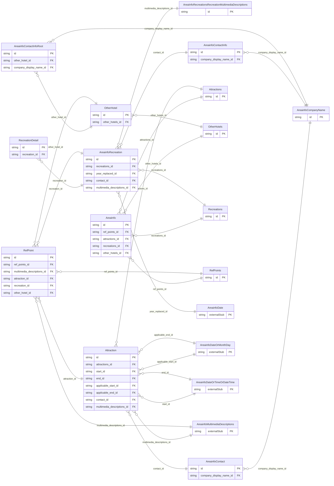

<!-- Code generated by protoc-gen-store. DO NOT EDIT. -->

# `ota/opentravel/hotel/property/area_info/area_info/` — Prisma schema

Generated from Protobuf by protoc-gen-store. Source of truth is the `.proto` files — regenerate rather than editing.

| Models | Enums |
| ---: | ---: |
| 15 | 1 |

## Entity relationships

Schema file: [`area_info.postgres.prisma`](./area_info.postgres.prisma)

### `AreaInfo` → `resource`

Provides information on area attractions, recreations and reference points. A singleton (AIP-156 <https://aip.dev/156>) resource, named "hotels/{hotel}/areaInfo". OTA: OTA_HotelDescriptiveContentNotifRQ/HotelDescriptiveContents/HotelDescriptiveContent/AreaInfo.

| Column | Type | Null |
| --- | --- | --- |
| `id` | `CHAR(26)` | not null |
| `name` | `VARCHAR(255)` | not null |
| `uid` | `VARCHAR(255)` | nullable |
| `etag` | `VARCHAR(255)` | nullable |
| `create_time` | `TIMESTAMPTZ` | not null |
| `update_time` | `TIMESTAMPTZ` | not null |
| `ref_points_id` | `CHAR(26)` | nullable |
| `attractions_id` | `CHAR(26)` | nullable |
| `recreations_id` | `CHAR(26)` | nullable |
| `other_hotels_id` | `CHAR(26)` | nullable |

### `RefPoints` → `ref_points`

A collection of reference points.

| Column | Type | Null |
| --- | --- | --- |
| `id` | `CHAR(26)` | not null |
| `last_update_time` | `TIMESTAMPTZ` | nullable |

### `Attractions` → `attractions`

A collection of Attraction objects identifying the local interest attractions in the vicinity of this hotel facility.

| Column | Type | Null |
| --- | --- | --- |
| `id` | `CHAR(26)` | not null |
| `last_update_time` | `TIMESTAMPTZ` | nullable |

### `Recreations` → `recreations`

A collection of Recreation objects identifying the different types of recreation facilities available to the guest.

| Column | Type | Null |
| --- | --- | --- |
| `id` | `CHAR(26)` | not null |
| `last_update_time` | `TIMESTAMPTZ` | nullable |

### `OtherHotels` → `other_hotels`

Collection of other area hotels.

| Column | Type | Null |
| --- | --- | --- |
| `id` | `CHAR(26)` | not null |
| `last_update_time` | `TIMESTAMPTZ` | nullable |

### `RefPoint` → `ref_point`

Provides information on the location of an area attraction.

| Column | Type | Null |
| --- | --- | --- |
| `direction` | `VARCHAR(255)` | nullable |
| `distance` | `VARCHAR(255)` | nullable |
| `unit_code` | `AreainfoUnitOfMeasureCode` | nullable |
| `nearest` | `BOOLEAN` | nullable |
| `index_point_code` | `AreainfoIndexPointCode` | nullable |
| `name` | `VARCHAR(255)` | nullable |
| `primary_indicator` | `BOOLEAN` | nullable |
| `facility_direction` | `AreainfoToFrom` | nullable |
| `approximate_distance` | `BOOLEAN` | nullable |
| `position_accuracy` | `AreainfoPositionAccuracy` | nullable |
| `ref_point_category_code` | `ReferencePointCategoryCode` | nullable |
| `proximity` | `VARCHAR(255)` | nullable |
| `city_code` | `VARCHAR(255)` | nullable |
| `code_detail` | `VARCHAR(255)` | nullable |
| `ref_point_display_name` | `VARCHAR(255)` | nullable |
| `latitude` | `VARCHAR(255)` | nullable |
| `longitude` | `VARCHAR(255)` | nullable |
| `altitude` | `VARCHAR(255)` | nullable |
| `altitude_unit_code` | `AreainfoUnitOfMeasureCode` | nullable |
| `position_accuracy_code` | `AreainfoPositionAccuracy` | nullable |
| `code` | `VARCHAR(255)` | nullable |
| `code_context` | `VARCHAR(255)` | nullable |
| `quantity` | `INTEGER` | nullable |
| `uri` | `VARCHAR(255)` | nullable |
| `exists_code` | `AreainfoOptionTypeCode` | nullable |
| `state_prov` | `VARCHAR(255)` | nullable |
| `region_code` | `VARCHAR(255)` | nullable |
| `id` | `VARCHAR(255)` | not null |
| `sort` | `INTEGER` | nullable |
| `descriptive_text` | `VARCHAR(255)` | nullable |
| `ref_points_id` | `CHAR(26)` | not null |
| `multimedia_descriptions_id` | `CHAR(26)` | nullable |
| `attraction_id` | `VARCHAR(255)` | not null |
| `recreation_id` | `VARCHAR(255)` | not null |
| `other_hotel_id` | `VARCHAR(255)` | not null |

### `Attraction` → `attraction`

This identifies an item of local interest (e.g. theme park, airport, museum, rail station, university).

| Column | Type | Null |
| --- | --- | --- |
| `attraction_category_code` | `AttractionCategoryCode` | nullable |
| `code_detail` | `VARCHAR(255)` | nullable |
| `attraction_display_name` | `VARCHAR(255)` | nullable |
| `attraction_fee` | `REAL` | nullable |
| `courtesy_phone` | `BOOLEAN` | nullable |
| `duration` | `VARCHAR(255)` | nullable |
| `code` | `VARCHAR(255)` | nullable |
| `code_context` | `VARCHAR(255)` | nullable |
| `quantity` | `INTEGER` | nullable |
| `uri` | `VARCHAR(255)` | nullable |
| `proximity_code` | `VARCHAR(255)` | nullable |
| `id` | `VARCHAR(255)` | not null |
| `sort` | `INTEGER` | nullable |
| `min_age_appropriate_code` | `AreainfoAgeQualifyingCode` | nullable |
| `language_code` | `VARCHAR(255)` | nullable |
| `descriptive_text` | `VARCHAR(255)` | nullable |
| `attractions_id` | `CHAR(26)` | not null |
| `start_id` | `CHAR(26)` | nullable |
| `end_id` | `CHAR(26)` | nullable |
| `applicable_start_id` | `CHAR(26)` | nullable |
| `applicable_end_id` | `CHAR(26)` | nullable |
| `contact_id` | `CHAR(26)` | nullable |
| `multimedia_descriptions_id` | `CHAR(26)` | nullable |

### `AreainfoRecreation` → `recreation`

A recreation facility available to the guest. These may or may not be operated by the hotel or located at the hotel.

| Column | Type | Null |
| --- | --- | --- |
| `code_detail` | `VARCHAR(255)` | nullable |
| `code` | `AreainfoRecreationSrvcType` | nullable |
| `name` | `VARCHAR(255)` | nullable |
| `proximity_code` | `VARCHAR(255)` | nullable |
| `included` | `BOOLEAN` | nullable |
| `exists_code` | `AreainfoOptionTypeCode` | nullable |
| `id` | `VARCHAR(255)` | not null |
| `sort` | `INTEGER` | nullable |
| `language_code` | `VARCHAR(255)` | nullable |
| `featured` | `BOOLEAN` | nullable |
| `descriptive_text` | `VARCHAR(255)` | nullable |
| `recreations_id` | `CHAR(26)` | not null |
| `year_replaced_id` | `CHAR(26)` | nullable |
| `contact_id` | `CHAR(26)` | nullable |
| `multimedia_descriptions_id` | `CHAR(26)` | nullable |

### `OtherHotel` → `other_hotel`

Provides information on other area hotels.

| Column | Type | Null |
| --- | --- | --- |
| `competitor_indicator` | `BOOLEAN` | nullable |
| `segment_category_code` | `VARCHAR(255)` | nullable |
| `chain_code` | `VARCHAR(255)` | nullable |
| `brand_code` | `VARCHAR(255)` | nullable |
| `hotel_code` | `VARCHAR(255)` | nullable |
| `hotel_city_code` | `VARCHAR(255)` | nullable |
| `hotel_display_name` | `VARCHAR(255)` | nullable |
| `hotel_code_context` | `VARCHAR(255)` | nullable |
| `chain_display_name` | `VARCHAR(255)` | nullable |
| `brand_display_name` | `VARCHAR(255)` | nullable |
| `area_id` | `VARCHAR(255)` | nullable |
| `tt_icode` | `INTEGER` | nullable |
| `id` | `VARCHAR(255)` | not null |
| `alternate_id` | `VARCHAR(255)` | nullable |
| `hotel_reference_rph` | `VARCHAR(255)` | nullable |
| `other_hotels_id` | `CHAR(26)` | not null |

### `AreainfoContact` → `contacts`

Used to pass contact information of a specific attraction.

| Column | Type | Null |
| --- | --- | --- |
| `id` | `CHAR(26)` | not null |
| `location` | `AreainfoContactLocation` | nullable |
| `company_display_name_id` | `VARCHAR(255)` | nullable |

### `AreainfoContactInfo` → `contact_infos`

Allows multiple pieces of information to be repeated for a single contact (e.g. one employee has mutliple e-mail addresses) and also allows multiple contacts to be associated to a single or multiple piece of information (e.g. all employees working in a restaurant can be reached at the same phone number).

| Column | Type | Null |
| --- | --- | --- |
| `id` | `CHAR(26)` | not null |
| `location` | `AreainfoContactLocation` | nullable |
| `company_display_name_id` | `VARCHAR(255)` | nullable |

### `AreaInfoRecreationsRecreationMultimediaDescriptions` → `recreations_recreation_multimedia_descriptions`

Multimedia information about the recreation facility.

| Column | Type | Null |
| --- | --- | --- |
| `id` | `CHAR(26)` | not null |
| `last_update_time` | `TIMESTAMPTZ` | nullable |
| `location` | `BOOLEAN` | nullable |
| `reference_direction` | `BOOLEAN` | nullable |

### `RecreationDetail` → `recreation_details`

RecreationDetail is used to give furher desciption regarding the recreation. These codes are passed in the code attribute and include details such as if a golf course has a driving range and what the total yardage for the course is.

| Column | Type | Null |
| --- | --- | --- |
| `id` | `CHAR(26)` | not null |
| `code` | `RecreationSrvcDetailCode` | nullable |
| `exists_code` | `AreainfoOptionTypeCode` | nullable |
| `code_detail` | `VARCHAR(255)` | nullable |
| `recreation_id` | `VARCHAR(255)` | not null |

### `AreainfoContactInfoRoot` → `contact_info_roots`

The ContactInfo class is used to define the contacts for consumers and technical people at the hotel facility, including various telephone numbers and e-mail addresses, or any respective attribute or affiliation for the hotel.

| Column | Type | Null |
| --- | --- | --- |
| `id` | `CHAR(26)` | not null |
| `location` | `AreainfoContactLocation` | nullable |
| `contact_profile_id` | `VARCHAR(255)` | nullable |
| `contact_profile_type` | `VARCHAR(255)` | nullable |
| `last_update_time` | `TIMESTAMPTZ` | nullable |
| `other_hotel_id` | `VARCHAR(255)` | not null |
| `company_display_name_id` | `VARCHAR(255)` | nullable |

### `AreainfoCompanyName` → `company_names`

The name of the company with which this contact is associated.

| Column | Type | Null |
| --- | --- | --- |
| `company_short_display_name` | `VARCHAR(255)` | nullable |
| `travel_sector` | `AreainfoTravelSector` | nullable |
| `code` | `VARCHAR(255)` | nullable |
| `code_context` | `VARCHAR(255)` | nullable |
| `region_code` | `VARCHAR(255)` | nullable |
| `division` | `VARCHAR(255)` | nullable |
| `department` | `VARCHAR(255)` | nullable |
| `id` | `VARCHAR(255)` | not null |
| `value` | `VARCHAR(255)` | nullable |

### Enums

- `AreainfoToFrom`: TO_FACILITY, FROM_FACILITY
