<!-- Code generated by protoc-gen-store. DO NOT EDIT. -->

# `ota/opentravel/hotel/property/area_info/v1/types/` — Prisma schema

Generated from Protobuf by protoc-gen-store. Source of truth is the `.proto` files — regenerate rather than editing.

| Models | Enums |
| ---: | ---: |
| 42 | 11 |

## Entity relationships

```mermaid
erDiagram
    direction LR
    AreainfoAddress {
        string id PK
        string contact_id FK
        string contact_info_id FK
        string contact_info_root_id FK
        string street_nmbr_id FK
        string state_prov_id FK
        string country_display_name_id FK
    }
    AreainfoBldgRoom {
        string id PK
        string address_id FK
    }
    AreainfoCountryName {
        string id PK
    }
    AreainfoDate {
        string id PK
    }
    AreainfoDateOrDateTime {
        string id PK
        string day_id FK
    }
    AreainfoDateOrMonthDay {
        string id PK
        string day_id FK
    }
    AreainfoDateOrTimeOrDateTime {
        string id PK
        string day_id FK
        string clock_id FK
    }
    AreainfoDecimal {
        string id PK
    }
    AreainfoDocument {
        string id PK
    }
    AreainfoEmail {
        string id PK
        string contact_id FK
        string contact_info_id FK
        string contact_info_root_id FK
    }
    AreainfoFee {
        string id PK
        string operation_schedules_plus_charge_item_id FK
        string amount_id FK
        string percent_id FK
        string effective_day_id FK
        string expire_day_id FK
        string taxes_id FK
    }
    AreainfoFormattedTextText {
        string id PK
        string paragraph_id FK
    }
    AreainfoImageFormat {
        string id PK
        string image_item_id FK
        string copyright_start_id FK
        string copyright_end_id FK
        string effective_start_id FK
        string effective_end_id FK
        string applicable_start_id FK
        string applicable_end_id FK
    }
    AreainfoImageItem {
        string id PK
        string image_items_id FK
        string purge_day_id FK
    }
    AreainfoImageItems {
        string id PK
    }
    AreainfoImageItemsImageItemDescription {
        string id PK
        string image_item_id FK
    }
    AreainfoJobTitle {
        string id PK
        string name_id FK
    }
    AreainfoListItem {
        string id PK
        string paragraph_id FK
    }
    AreainfoMoney {
        string id PK
    }
    AreainfoMultimediaDescription {
        string id PK
        string multimedia_descriptions_id FK
        string video_items_id FK
        string image_items_id FK
        string text_items_id FK
    }
    AreainfoMultimediaDescriptions {
        string id PK
    }
    AreainfoName {
        string id PK
        string contact_id FK
        string contact_info_id FK
        string contact_info_root_id FK
        string document_id FK
    }
    AreainfoOperationSchedule {
        string id PK
        string operation_schedules_id FK
        string start_id FK
        string end_id FK
    }
    AreainfoOperationSchedules {
        string id PK
        string start_id FK
        string end_id FK
    }
    AreainfoOperationSchedulesPlusChargeItem {
        string id PK
        string attraction_id FK
        string recreation_id FK
        string start_id FK
        string end_id FK
    }
    AreainfoOperationTime {
        string id PK
        string operation_schedules_plus_charge_item_id FK
        string start_id FK
        string end_id FK
        string operation_schedule_id FK
    }
    AreainfoParagraph {
        string id PK
        string recreation_detail_id FK
        string fee_id FK
        string purge_day_id FK
        string tax_id FK
    }
    AreainfoPhone {
        string id PK
        string contact_id FK
        string contact_info_id FK
        string contact_info_root_id FK
    }
    AreainfoStateProv {
        string id PK
    }
    AreainfoStreetNmbr {
        string id PK
    }
    AreainfoTax {
        string id PK
        string taxes_id FK
        string amount_id FK
        string percent_id FK
        string effective_day_id FK
        string expire_day_id FK
    }
    AreainfoTaxes {
        string id PK
        string amount_id FK
    }
    AreainfoTextItem {
        string id PK
        string text_items_id FK
        string copyright_start_id FK
        string copyright_end_id FK
        string effective_start_id FK
        string effective_end_id FK
        string applicable_start_id FK
        string applicable_end_id FK
        string purge_day_id FK
    }
    AreainfoTextItems {
        string id PK
    }
    AreainfoTextItemsTextItemDescription {
        string id PK
        string text_item_id FK
    }
    AreainfoTimeOfDay {
        string id PK
    }
    AreainfoTransportation {
        string id PK
        string ref_point_id FK
        string amount_id FK
        string multimedia_descriptions_id FK
        string operation_schedules_id FK
    }
    AreainfoUrl {
        string id PK
        string contact_id FK
        string contact_info_id FK
        string contact_info_root_id FK
    }
    AreainfoVideoFormat {
        string id PK
        string video_item_id FK
        string copyright_start_id FK
        string copyright_end_id FK
        string effective_start_id FK
        string effective_end_id FK
        string applicable_start_id FK
        string applicable_end_id FK
    }
    AreainfoVideoItem {
        string id PK
        string video_items_id FK
        string purge_day_id FK
    }
    AreainfoVideoItems {
        string id PK
    }
    AreainfoVideoItemsVideoItemDescription {
        string id PK
        string video_item_id FK
    }
    AreainfoContact {
        string externalStub PK
    }
    AreainfoContactInfo {
        string externalStub PK
    }
    AreainfoContactInfoRoot {
        string externalStub PK
    }
    AreainfoRecreation {
        string externalStub PK
    }
    Attraction {
        string externalStub PK
    }
    RecreationDetail {
        string externalStub PK
    }
    RefPoint {
        string externalStub PK
    }
    AreainfoAddress }o--|| AreainfoContact : "contact_id"
    AreainfoAddress }o--|| AreainfoContactInfo : "contact_info_id"
    AreainfoAddress }o--|| AreainfoContactInfoRoot : "contact_info_root_id"
    AreainfoAddress }o--|| AreainfoStreetNmbr : "street_nmbr_id"
    AreainfoAddress }o--|| AreainfoStateProv : "state_prov_id"
    AreainfoAddress }o--|| AreainfoCountryName : "country_display_name_id"
    AreainfoBldgRoom }o--|| AreainfoAddress : "address_id"
    AreainfoDateOrDateTime }o--|| AreainfoDate : "day_id"
    AreainfoDateOrMonthDay }o--|| AreainfoDate : "day_id"
    AreainfoDateOrTimeOrDateTime }o--|| AreainfoDate : "day_id"
    AreainfoDateOrTimeOrDateTime }o--|| AreainfoTimeOfDay : "clock_id"
    AreainfoEmail }o--|| AreainfoContact : "contact_id"
    AreainfoEmail }o--|| AreainfoContactInfo : "contact_info_id"
    AreainfoEmail }o--|| AreainfoContactInfoRoot : "contact_info_root_id"
    AreainfoFee }o--|| AreainfoOperationSchedulesPlusChargeItem : "operation_schedules_plus_charge_item_id"
    AreainfoFee }o--|| AreainfoMoney : "amount_id"
    AreainfoFee }o--|| AreainfoDecimal : "percent_id"
    AreainfoFee }o--|| AreainfoDate : "effective_day_id"
    AreainfoFee }o--|| AreainfoDate : "expire_day_id"
    AreainfoFee }o--|| AreainfoTaxes : "taxes_id"
    AreainfoFormattedTextText }o--|| AreainfoParagraph : "paragraph_id"
    AreainfoImageFormat }o--|| AreainfoImageItem : "image_item_id"
    AreainfoImageFormat }o--|| AreainfoDateOrDateTime : "copyright_start_id"
    AreainfoImageFormat }o--|| AreainfoDateOrDateTime : "copyright_end_id"
    AreainfoImageFormat }o--|| AreainfoDateOrDateTime : "effective_start_id"
    AreainfoImageFormat }o--|| AreainfoDateOrDateTime : "effective_end_id"
    AreainfoImageFormat }o--|| AreainfoDateOrMonthDay : "applicable_start_id"
    AreainfoImageFormat }o--|| AreainfoDateOrMonthDay : "applicable_end_id"
    AreainfoImageItem }o--|| AreainfoImageItems : "image_items_id"
    AreainfoImageItem }o--|| AreainfoDate : "purge_day_id"
    AreainfoImageItemsImageItemDescription }o--|| AreainfoImageItem : "image_item_id"
    AreainfoJobTitle }o--|| AreainfoName : "name_id"
    AreainfoListItem }o--|| AreainfoParagraph : "paragraph_id"
    AreainfoMultimediaDescription }o--|| AreainfoMultimediaDescriptions : "multimedia_descriptions_id"
    AreainfoMultimediaDescription }o--|| AreainfoVideoItems : "video_items_id"
    AreainfoMultimediaDescription }o--|| AreainfoImageItems : "image_items_id"
    AreainfoMultimediaDescription }o--|| AreainfoTextItems : "text_items_id"
    AreainfoName }o--|| AreainfoContact : "contact_id"
    AreainfoName }o--|| AreainfoContactInfo : "contact_info_id"
    AreainfoName }o--|| AreainfoContactInfoRoot : "contact_info_root_id"
    AreainfoName }o--|| AreainfoDocument : "document_id"
    AreainfoOperationSchedule }o--|| AreainfoOperationSchedules : "operation_schedules_id"
    AreainfoOperationSchedule }o--|| AreainfoDateOrTimeOrDateTime : "start_id"
    AreainfoOperationSchedule }o--|| AreainfoDateOrTimeOrDateTime : "end_id"
    AreainfoOperationSchedules }o--|| AreainfoDateOrTimeOrDateTime : "start_id"
    AreainfoOperationSchedules }o--|| AreainfoDateOrTimeOrDateTime : "end_id"
    AreainfoOperationSchedulesPlusChargeItem }o--|| Attraction : "attraction_id"
    AreainfoOperationSchedulesPlusChargeItem }o--|| AreainfoRecreation : "recreation_id"
    AreainfoOperationSchedulesPlusChargeItem }o--|| AreainfoDateOrTimeOrDateTime : "start_id"
    AreainfoOperationSchedulesPlusChargeItem }o--|| AreainfoDateOrTimeOrDateTime : "end_id"
    AreainfoOperationTime }o--|| AreainfoOperationSchedulesPlusChargeItem : "operation_schedules_plus_charge_item_id"
    AreainfoOperationTime }o--|| AreainfoDateOrTimeOrDateTime : "start_id"
    AreainfoOperationTime }o--|| AreainfoDateOrTimeOrDateTime : "end_id"
    AreainfoOperationTime }o--|| AreainfoOperationSchedule : "operation_schedule_id"
    AreainfoParagraph }o--|| RecreationDetail : "recreation_detail_id"
    AreainfoParagraph }o--|| AreainfoFee : "fee_id"
    AreainfoParagraph }o--|| AreainfoDate : "purge_day_id"
    AreainfoParagraph }o--|| AreainfoTax : "tax_id"
    AreainfoPhone }o--|| AreainfoContact : "contact_id"
    AreainfoPhone }o--|| AreainfoContactInfo : "contact_info_id"
    AreainfoPhone }o--|| AreainfoContactInfoRoot : "contact_info_root_id"
    AreainfoTax }o--|| AreainfoTaxes : "taxes_id"
    AreainfoTax }o--|| AreainfoMoney : "amount_id"
    AreainfoTax }o--|| AreainfoDecimal : "percent_id"
    AreainfoTax }o--|| AreainfoDate : "effective_day_id"
    AreainfoTax }o--|| AreainfoDate : "expire_day_id"
    AreainfoTaxes }o--|| AreainfoMoney : "amount_id"
    AreainfoTextItem }o--|| AreainfoTextItems : "text_items_id"
    AreainfoTextItem }o--|| AreainfoDateOrDateTime : "copyright_start_id"
    AreainfoTextItem }o--|| AreainfoDateOrDateTime : "copyright_end_id"
    AreainfoTextItem }o--|| AreainfoDateOrDateTime : "effective_start_id"
    AreainfoTextItem }o--|| AreainfoDateOrDateTime : "effective_end_id"
    AreainfoTextItem }o--|| AreainfoDateOrMonthDay : "applicable_start_id"
    AreainfoTextItem }o--|| AreainfoDateOrMonthDay : "applicable_end_id"
    AreainfoTextItem }o--|| AreainfoDate : "purge_day_id"
    AreainfoTextItemsTextItemDescription }o--|| AreainfoTextItem : "text_item_id"
    AreainfoTransportation }o--|| RefPoint : "ref_point_id"
    AreainfoTransportation }o--|| AreainfoMoney : "amount_id"
    AreainfoTransportation }o--|| AreainfoMultimediaDescriptions : "multimedia_descriptions_id"
    AreainfoTransportation }o--|| AreainfoOperationSchedules : "operation_schedules_id"
    AreainfoUrl }o--|| AreainfoContact : "contact_id"
    AreainfoUrl }o--|| AreainfoContactInfo : "contact_info_id"
    AreainfoUrl }o--|| AreainfoContactInfoRoot : "contact_info_root_id"
    AreainfoVideoFormat }o--|| AreainfoVideoItem : "video_item_id"
    AreainfoVideoFormat }o--|| AreainfoDateOrDateTime : "copyright_start_id"
    AreainfoVideoFormat }o--|| AreainfoDateOrDateTime : "copyright_end_id"
    AreainfoVideoFormat }o--|| AreainfoDateOrDateTime : "effective_start_id"
    AreainfoVideoFormat }o--|| AreainfoDateOrDateTime : "effective_end_id"
    AreainfoVideoFormat }o--|| AreainfoDateOrMonthDay : "applicable_start_id"
    AreainfoVideoFormat }o--|| AreainfoDateOrMonthDay : "applicable_end_id"
    AreainfoVideoItem }o--|| AreainfoVideoItems : "video_items_id"
    AreainfoVideoItem }o--|| AreainfoDate : "purge_day_id"
    AreainfoVideoItemsVideoItemDescription }o--|| AreainfoVideoItem : "video_item_id"
```

## Subfolders

- [`address/`](./address/README.md)
- [`country_name/`](./country_name/README.md)
- [`date/`](./date/README.md)
- [`date_or_date_time/`](./date_or_date_time/README.md)
- [`date_or_month_day/`](./date_or_month_day/README.md)
- [`date_or_time_or_date_time/`](./date_or_time_or_date_time/README.md)
- [`decimal/`](./decimal/README.md)
- [`email/`](./email/README.md)
- [`fee/`](./fee/README.md)
- [`formatted_text_text/`](./formatted_text_text/README.md)
- [`image_items/`](./image_items/README.md)
- [`money/`](./money/README.md)
- [`multimedia_description/`](./multimedia_description/README.md)
- [`multimedia_descriptions/`](./multimedia_descriptions/README.md)
- [`name/`](./name/README.md)
- [`operation_schedule/`](./operation_schedule/README.md)
- [`operation_schedules/`](./operation_schedules/README.md)
- [`operation_schedules_plus_charge_item/`](./operation_schedules_plus_charge_item/README.md)
- [`paragraph/`](./paragraph/README.md)
- [`phone/`](./phone/README.md)
- [`state_prov/`](./state_prov/README.md)
- [`tax/`](./tax/README.md)
- [`taxes/`](./taxes/README.md)
- [`text_items/`](./text_items/README.md)
- [`time_of_day/`](./time_of_day/README.md)
- [`transportation/`](./transportation/README.md)
- [`url/`](./url/README.md)
- [`video_items/`](./video_items/README.md)
