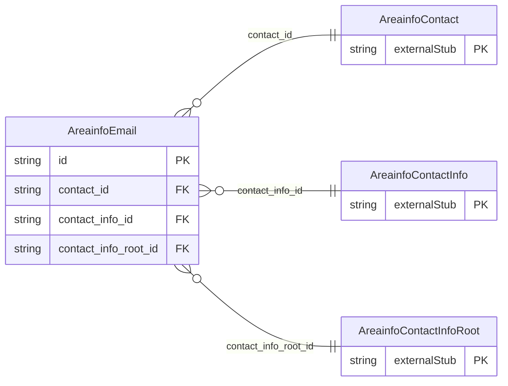

<!-- Code generated by protoc-gen-store. DO NOT EDIT. -->

# `ota/opentravel/hotel/property/area_info/v1/types/email/` — Prisma schema

Generated from Protobuf by protoc-gen-store. Source of truth is the `.proto` files — regenerate rather than editing.

| Models | Enums |
| ---: | ---: |
| 1 | 1 |

## Entity relationships

Schema file: [`email.postgres.prisma`](./email.postgres.prisma)

### `AreainfoEmail` → `emails`

Used to pass detailed email information.

| Column | Type | Null |
| --- | --- | --- |
| `share_synch_ind` | `AreainfoNameShareSynchInd` | nullable |
| `share_market_ind` | `AreainfoNameShareMarketInd` | nullable |
| `default_value` | `BOOLEAN` | nullable |
| `email_type` | `AreainfoEmailAddressType` | nullable |
| `rph` | `VARCHAR(255)` | nullable |
| `remark` | `VARCHAR(255)` | nullable |
| `valid` | `BOOLEAN` | nullable |
| `text_format` | `AreainfoEmailTextFormat` | nullable |
| `id` | `VARCHAR(255)` | not null |
| `value` | `VARCHAR(255)` | nullable |
| `contact_id` | `CHAR(26)` | not null |
| `contact_info_id` | `CHAR(26)` | not null |
| `contact_info_root_id` | `CHAR(26)` | not null |

### Enums

- `AreainfoEmailTextFormat`: TEXT_HTML, TEXT_PLAIN
