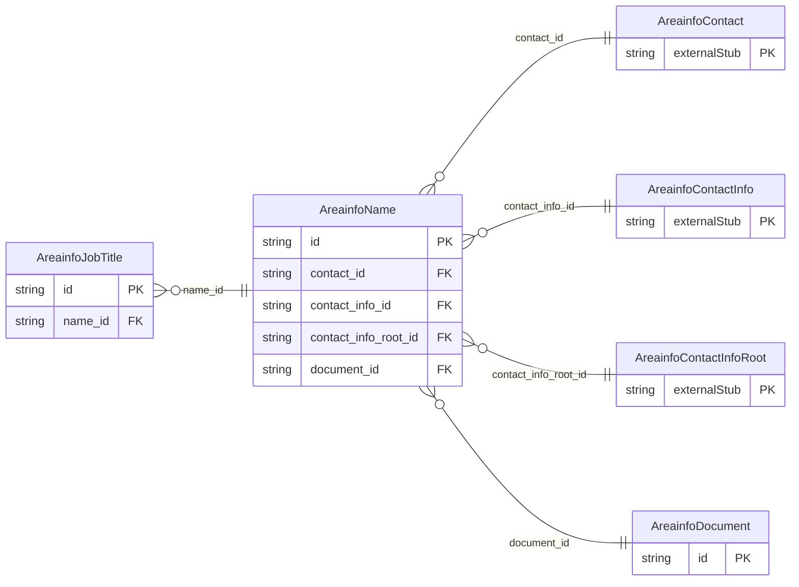

<!-- Code generated by protoc-gen-store. DO NOT EDIT. -->

# `ota/opentravel/hotel/property/area_info/v1/types/name/` — Prisma schema

Generated from Protobuf by protoc-gen-store. Source of truth is the `.proto` files — regenerate rather than editing.

| Models | Enums |
| ---: | ---: |
| 3 | 3 |

## Entity relationships

Schema file: [`name.postgres.prisma`](./name.postgres.prisma)

### `AreainfoName` → `names`

Used to pass detailed name information regarding a contact.

| Column | Type | Null |
| --- | --- | --- |
| `share_synch_ind` | `AreainfoNameShareSynchInd` | nullable |
| `share_market_ind` | `AreainfoNameShareMarketInd` | nullable |
| `name_type` | `AreainfoNameType` | nullable |
| `language_code` | `VARCHAR(255)` | nullable |
| `default_value` | `BOOLEAN` | nullable |
| `code_detail` | `VARCHAR(255)` | nullable |
| `gender` | `AreainfoGender` | nullable |
| `srvc_code` | `AreainfoContactSrvcCode` | nullable |
| `location` | `AreainfoContactLocation` | nullable |
| `corporate_position` | `VARCHAR(255)` | nullable |
| `publishable` | `BOOLEAN` | nullable |
| `name_ordered` | `VARCHAR(255)` | nullable |
| `id` | `VARCHAR(255)` | not null |
| `name_prefixes` | `VARCHAR(255)[]` | nullable |
| `given_names` | `VARCHAR(255)[]` | nullable |
| `middle_names` | `VARCHAR(255)[]` | nullable |
| `surname_prefix` | `VARCHAR(255)` | nullable |
| `surname` | `VARCHAR(255)` | not null |
| `name_suffixes` | `VARCHAR(255)[]` | nullable |
| `name_titles` | `VARCHAR(255)[]` | nullable |
| `contact_id` | `CHAR(26)` | not null |
| `contact_info_id` | `CHAR(26)` | not null |
| `contact_info_root_id` | `CHAR(26)` | not null |
| `document_id` | `CHAR(26)` | nullable |

### `AreainfoDocument` → `documents`

Document information for verification purposes and also used for additional filtering for common names.

| Column | Type | Null |
| --- | --- | --- |
| `id` | `CHAR(26)` | not null |
| `doc_id` | `VARCHAR(255)` | nullable |
| `doc_type` | `AreainfoDocumentType` | nullable |

### `AreainfoJobTitle` → `job_titles`

Job title.

| Column | Type | Null |
| --- | --- | --- |
| `id` | `CHAR(26)` | not null |
| `type` | `VARCHAR(255)` | nullable |
| `value` | `VARCHAR(255)` | nullable |
| `name_id` | `VARCHAR(255)` | not null |

### Enums

- `AreainfoNameShareSynchInd`: YES, NO, INHERIT
- `AreainfoNameShareMarketInd`: YES, NO, INHERIT
- `AreainfoGender`: MALE, FEMALE, UNKNOWN, MALE_NO_SHARE, FEMALE_NO_SHARE
