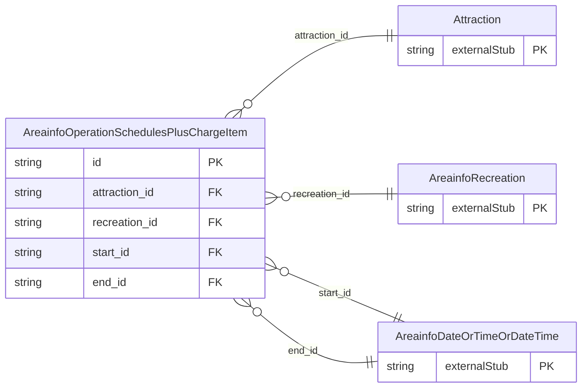

<!-- Code generated by protoc-gen-store. DO NOT EDIT. -->

# `ota/opentravel/hotel/property/area_info/v1/types/operation_schedules_plus_charge_item/` — Prisma schema

Generated from Protobuf by protoc-gen-store. Source of truth is the `.proto` files — regenerate rather than editing.

| Models | Enums |
| ---: | ---: |
| 1 | 0 |

## Entity relationships

Schema file: [`operation_schedules_plus_charge_item.postgres.prisma`](./operation_schedules_plus_charge_item.postgres.prisma)

### `AreainfoOperationSchedulesPlusChargeItem` → `operation_schedules_plus_charge_items`

The OperationSchedule class defines details the dates and hours of operation.

| Column | Type | Null |
| --- | --- | --- |
| `id` | `CHAR(26)` | not null |
| `duration` | `VARCHAR(255)` | nullable |
| `display_name` | `VARCHAR(255)` | nullable |
| `attraction_id` | `VARCHAR(255)` | not null |
| `recreation_id` | `VARCHAR(255)` | not null |
| `start_id` | `CHAR(26)` | nullable |
| `end_id` | `CHAR(26)` | nullable |
