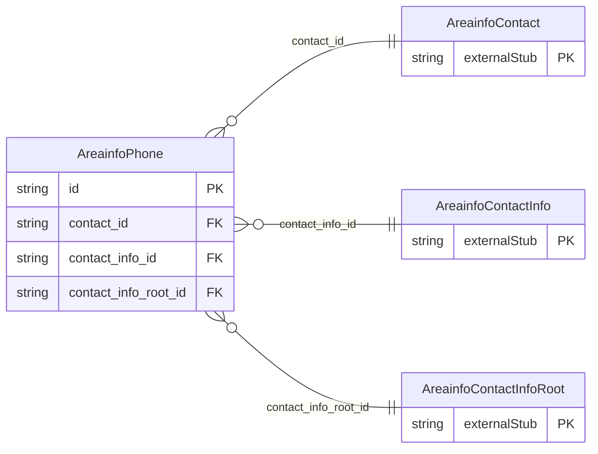

<!-- Code generated by protoc-gen-store. DO NOT EDIT. -->

# `ota/opentravel/hotel/property/area_info/v1/types/phone/` — Prisma schema

Generated from Protobuf by protoc-gen-store. Source of truth is the `.proto` files — regenerate rather than editing.

| Models | Enums |
| ---: | ---: |
| 1 | 2 |

## Entity relationships

Schema file: [`phone.postgres.prisma`](./phone.postgres.prisma)

### `AreainfoPhone` → `phones`

Used to pass detailed phone information.

| Column | Type | Null |
| --- | --- | --- |
| `rph` | `VARCHAR(255)` | nullable |
| `share_synch_ind` | `AreainfoPhoneShareSynchInd` | nullable |
| `share_market_ind` | `AreainfoPhoneShareMarketInd` | nullable |
| `phone_location_type` | `AreainfoPhoneLocationType` | nullable |
| `phone_tech_type` | `AreainfoPhoneTechnologyType` | nullable |
| `phone_use_type` | `AreainfoPhoneUseType` | nullable |
| `country_access_code` | `VARCHAR(255)` | nullable |
| `area_city_code` | `VARCHAR(255)` | nullable |
| `phone_number` | `VARCHAR(255)` | not null |
| `extension` | `VARCHAR(255)` | nullable |
| `pin` | `VARCHAR(255)` | nullable |
| `remark` | `VARCHAR(255)` | nullable |
| `formatted` | `BOOLEAN` | nullable |
| `default_value` | `BOOLEAN` | nullable |
| `id` | `VARCHAR(255)` | not null |
| `contact_id` | `CHAR(26)` | not null |
| `contact_info_id` | `CHAR(26)` | not null |
| `contact_info_root_id` | `CHAR(26)` | not null |

### Enums

- `AreainfoPhoneShareSynchInd`: YES, NO, INHERIT
- `AreainfoPhoneShareMarketInd`: YES, NO, INHERIT
