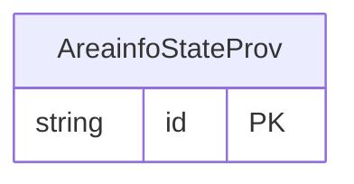

<!-- Code generated by protoc-gen-store. DO NOT EDIT. -->

# `ota/opentravel/hotel/property/area_info/v1/types/state_prov/` — Prisma schema

Generated from Protobuf by protoc-gen-store. Source of truth is the `.proto` files — regenerate rather than editing.

| Models | Enums |
| ---: | ---: |
| 1 | 0 |

## Entity relationships

Schema file: [`state_prov.postgres.prisma`](./state_prov.postgres.prisma)

### `AreainfoStateProv` → `state_provs`

State, province, or region name or code needed to identify location.

| Column | Type | Null |
| --- | --- | --- |
| `id` | `CHAR(26)` | not null |
| `state_code` | `VARCHAR(255)` | nullable |
| `value` | `VARCHAR(255)` | nullable |
