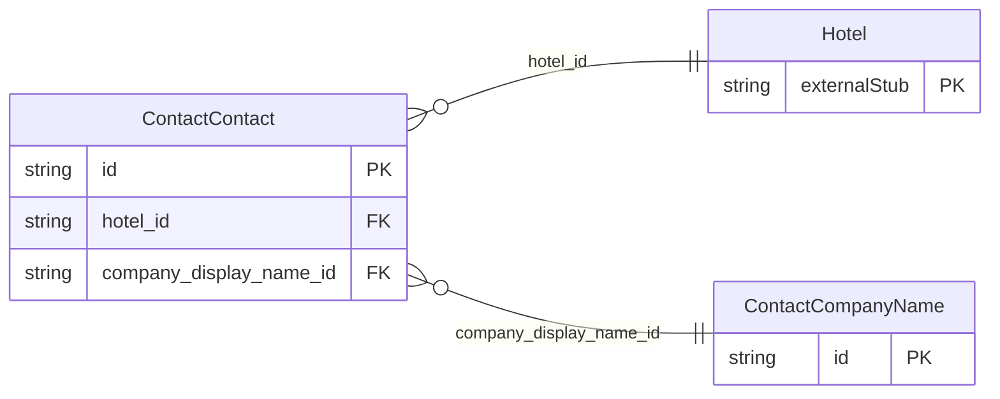

<!-- Code generated by protoc-gen-store. DO NOT EDIT. -->

# `ota/opentravel/hotel/property/contact/contact/` — Prisma schema

Generated from Protobuf by protoc-gen-store. Source of truth is the `.proto` files — regenerate rather than editing.

| Models | Enums |
| ---: | ---: |
| 2 | 0 |

## Entity relationships

Schema file: [`contact.postgres.prisma`](./contact.postgres.prisma)

### `ContactContact` → `resource`

Used to define specific contact information such as phone and address. A collection resource, named "hotels/{hotel}/contacts/{contact}". OTA: OTA_HotelDescriptiveContentNotifRQ/HotelDescriptiveContents/HotelDescriptiveContent/ContactInfos/ContactInfo.

| Column | Type | Null |
| --- | --- | --- |
| `id` | `CHAR(26)` | not null |
| `name` | `VARCHAR(255)` | not null |
| `uid` | `VARCHAR(255)` | nullable |
| `etag` | `VARCHAR(255)` | nullable |
| `delete_time` | `TIMESTAMPTZ` | nullable |
| `expire_time` | `TIMESTAMPTZ` | nullable |
| `create_time` | `TIMESTAMPTZ` | not null |
| `update_time` | `TIMESTAMPTZ` | not null |
| `location` | `ContactContactLocation` | nullable |
| `contact_profile_type` | `VARCHAR(255)` | nullable |
| `hotel_id` | `CHAR(26)` | not null |
| `company_display_name_id` | `VARCHAR(255)` | nullable |

### `ContactCompanyName` → `company_names`

The name of the company with which this contact is associated.

| Column | Type | Null |
| --- | --- | --- |
| `company_short_display_name` | `VARCHAR(255)` | nullable |
| `travel_sector` | `ContactTravelSector` | nullable |
| `code` | `VARCHAR(255)` | nullable |
| `code_context` | `VARCHAR(255)` | nullable |
| `region_code` | `VARCHAR(255)` | nullable |
| `division` | `VARCHAR(255)` | nullable |
| `department` | `VARCHAR(255)` | nullable |
| `id` | `VARCHAR(255)` | not null |
| `value` | `VARCHAR(255)` | nullable |
