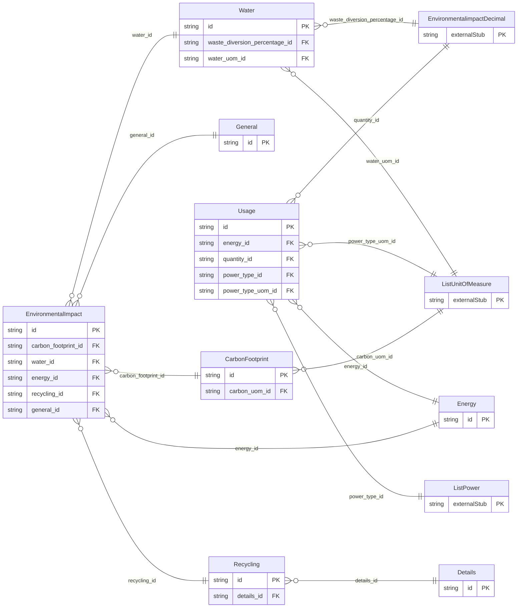

<!-- Code generated by protoc-gen-store. DO NOT EDIT. -->

# `ota/opentravel/hotel/property/environmental_impact/environmental_impact/` — Prisma schema

Generated from Protobuf by protoc-gen-store. Source of truth is the `.proto` files — regenerate rather than editing.

| Models | Enums |
| ---: | ---: |
| 8 | 0 |

## Entity relationships

Schema file: [`environmental_impact.postgres.prisma`](./environmental_impact.postgres.prisma)

### `EnvironmentalImpact` → `resource`

Property environmental impact and green program/ initiative information. A singleton (AIP-156 <https://aip.dev/156>) resource, named "hotels/{hotel}/environmentalImpact". OTA: OTA_HotelDescriptiveContentNotifRQ/HotelDescriptiveContents/HotelDescriptiveContent/EnvironmentalImpact.

| Column | Type | Null |
| --- | --- | --- |
| `id` | `CHAR(26)` | not null |
| `name` | `VARCHAR(255)` | not null |
| `uid` | `VARCHAR(255)` | nullable |
| `etag` | `VARCHAR(255)` | nullable |
| `create_time` | `TIMESTAMPTZ` | not null |
| `update_time` | `TIMESTAMPTZ` | not null |
| `carbon_footprint_id` | `CHAR(26)` | nullable |
| `water_id` | `CHAR(26)` | nullable |
| `energy_id` | `CHAR(26)` | nullable |
| `recycling_id` | `CHAR(26)` | nullable |
| `general_id` | `CHAR(26)` | nullable |

### `CarbonFootprint` → `carbon_footprints`

Carbon foot print information.

| Column | Type | Null |
| --- | --- | --- |
| `id` | `CHAR(26)` | not null |
| `non_carbon_measure` | `BOOLEAN` | nullable |
| `non_carbon_measure_desc` | `VARCHAR(255)` | nullable |
| `meeting_event` | `INTEGER` | nullable |
| `room_night` | `INTEGER` | nullable |
| `weather_normalized` | `INTEGER` | nullable |
| `carbon_uom_id` | `CHAR(26)` | nullable |

### `Water` → `waters`

Water usage information.

| Column | Type | Null |
| --- | --- | --- |
| `id` | `CHAR(26)` | not null |
| `gray_water` | `BOOLEAN` | nullable |
| `water_program` | `BOOLEAN` | nullable |
| `per_room_night_usage` | `INTEGER` | nullable |
| `per_room_day_usage` | `INTEGER` | nullable |
| `waste_diversion_percentage_id` | `CHAR(26)` | nullable |
| `water_uom_id` | `CHAR(26)` | nullable |

### `Energy` → `energies`

Property energy and power usage information.

| Column | Type | Null |
| --- | --- | --- |
| `id` | `CHAR(26)` | not null |
| `efficient_appliances` | `BOOLEAN` | nullable |
| `efficient_lighting` | `BOOLEAN` | nullable |
| `heat_power_comb` | `BOOLEAN` | nullable |
| `heat_pump` | `BOOLEAN` | nullable |
| `power_saving_policy` | `BOOLEAN` | nullable |
| `solar` | `BOOLEAN` | nullable |
| `temp_control_ind` | `VARCHAR(255)` | nullable |
| `wind_turbine` | `BOOLEAN` | nullable |
| `energy_generated` | `INTEGER` | nullable |
| `energy_star_rating` | `VARCHAR(255)` | nullable |

### `Recycling` → `recyclings`

Recycling information.

| Column | Type | Null |
| --- | --- | --- |
| `id` | `CHAR(26)` | not null |
| `active_program` | `BOOLEAN` | nullable |
| `ecological_dishware` | `BOOLEAN` | nullable |
| `details_id` | `CHAR(26)` | nullable |

### `General` → `generals`

Other environmental program information.

| Column | Type | Null |
| --- | --- | --- |
| `id` | `CHAR(26)` | not null |
| `certification_avail` | `BOOLEAN` | nullable |
| `chemical_allergies` | `BOOLEAN` | nullable |
| `environmental_cleaners` | `BOOLEAN` | nullable |
| `linen_reuse_ind` | `VARCHAR(255)` | nullable |
| `procurement_policy` | `BOOLEAN` | nullable |

### `Usage` → `usages`

Power usage detail.

| Column | Type | Null |
| --- | --- | --- |
| `id` | `CHAR(26)` | not null |
| `energy_id` | `CHAR(26)` | not null |
| `quantity_id` | `CHAR(26)` | nullable |
| `power_type_id` | `CHAR(26)` | nullable |
| `power_type_uom_id` | `CHAR(26)` | nullable |

### `Details` → `details`

Recycling details.

| Column | Type | Null |
| --- | --- | --- |
| `id` | `CHAR(26)` | not null |
