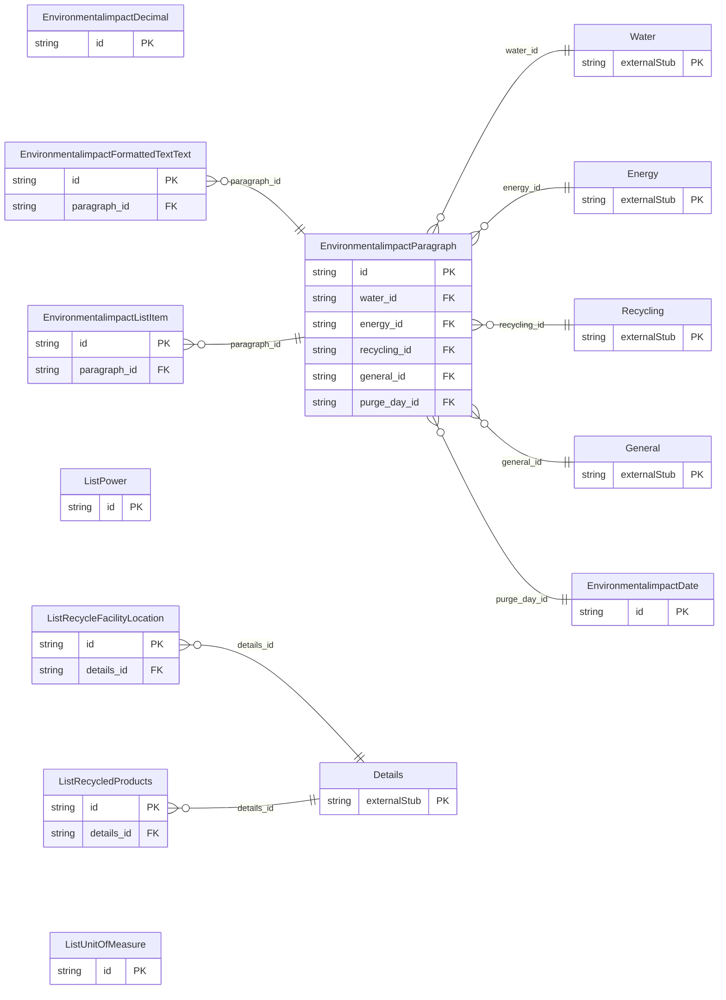

<!-- Code generated by protoc-gen-store. DO NOT EDIT. -->

# `ota/opentravel/hotel/property/environmental_impact/v1/types/` — Prisma schema

Generated from Protobuf by protoc-gen-store. Source of truth is the `.proto` files — regenerate rather than editing.

| Models | Enums |
| ---: | ---: |
| 9 | 1 |

## Entity relationships

## Subfolders

- [`date/`](./date/README.md)
- [`decimal/`](./decimal/README.md)
- [`formatted_text_text/`](./formatted_text_text/README.md)
- [`list_power/`](./list_power/README.md)
- [`list_recycle_facility_location/`](./list_recycle_facility_location/README.md)
- [`list_recycled_products/`](./list_recycled_products/README.md)
- [`list_unit_of_measure/`](./list_unit_of_measure/README.md)
- [`paragraph/`](./paragraph/README.md)
