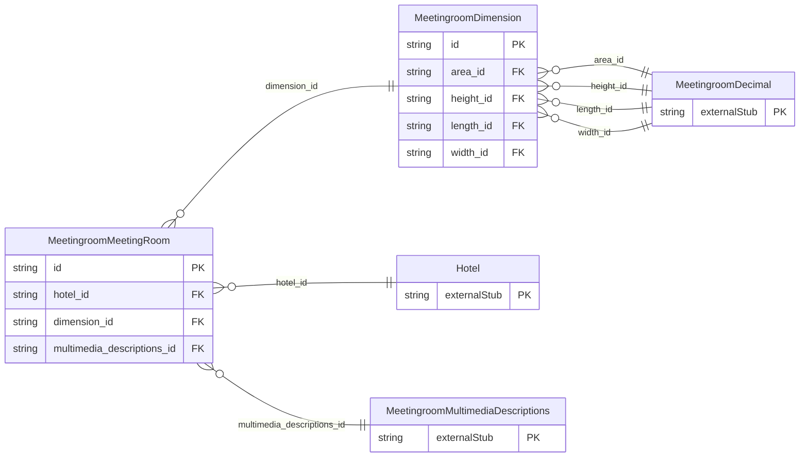

<!-- Code generated by protoc-gen-store. DO NOT EDIT. -->

# `ota/opentravel/hotel/property/meeting_room/meeting_room/` — Prisma schema

Generated from Protobuf by protoc-gen-store. Source of truth is the `.proto` files — regenerate rather than editing.

| Models | Enums |
| ---: | ---: |
| 2 | 0 |

## Entity relationships

Schema file: [`meeting_room.postgres.prisma`](./meeting_room.postgres.prisma)

### `MeetingroomMeetingRoom` → `resource`

Dedicated or non-dedicated space or area in which to hold a meeting. A collection resource, named "hotels/{hotel}/meetingRooms/{meeting_room}". OTA: OTA_HotelDescriptiveContentNotifRQ/HotelDescriptiveContents/HotelDescriptiveContent/FacilityInfo/MeetingRooms/MeetingRoom.

| Column | Type | Null |
| --- | --- | --- |
| `id` | `CHAR(26)` | not null |
| `name` | `VARCHAR(255)` | not null |
| `uid` | `VARCHAR(255)` | nullable |
| `etag` | `VARCHAR(255)` | nullable |
| `delete_time` | `TIMESTAMPTZ` | nullable |
| `expire_time` | `TIMESTAMPTZ` | nullable |
| `create_time` | `TIMESTAMPTZ` | not null |
| `update_time` | `TIMESTAMPTZ` | not null |
| `irregular` | `BOOLEAN` | nullable |
| `property_system_display_name` | `VARCHAR(255)` | nullable |
| `room_display_name` | `VARCHAR(255)` | nullable |
| `sort` | `INTEGER` | nullable |
| `meeting_room_capacity` | `INTEGER` | nullable |
| `access` | `VARCHAR(255)` | nullable |
| `meeting_room_type_code` | `MeetingroomMeetingRoomFormatCode` | nullable |
| `meeting_room_level` | `VARCHAR(255)` | nullable |
| `dedicated_indicator` | `BOOLEAN` | nullable |
| `featured` | `BOOLEAN` | nullable |
| `hotel_id` | `CHAR(26)` | not null |
| `dimension_id` | `CHAR(26)` | nullable |
| `multimedia_descriptions_id` | `CHAR(26)` | nullable |

### `MeetingroomDimension` → `dimensions`

Dimensions of the meeting room.

| Column | Type | Null |
| --- | --- | --- |
| `id` | `CHAR(26)` | not null |
| `units` | `VARCHAR(255)` | nullable |
| `unit_code` | `MeetingroomUnitOfMeasureCode` | nullable |
| `area_id` | `CHAR(26)` | nullable |
| `height_id` | `CHAR(26)` | nullable |
| `length_id` | `CHAR(26)` | nullable |
| `width_id` | `CHAR(26)` | nullable |
