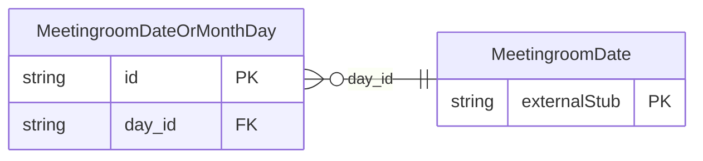

<!-- Code generated by protoc-gen-store. DO NOT EDIT. -->

# `ota/opentravel/hotel/property/meeting_room/v1/types/date_or_month_day/` — Prisma schema

Generated from Protobuf by protoc-gen-store. Source of truth is the `.proto` files — regenerate rather than editing.

| Models | Enums |
| ---: | ---: |
| 1 | 1 |

## Entity relationships

Schema file: [`date_or_month_day.postgres.prisma`](./date_or_month_day.postgres.prisma)

### `MeetingroomDateOrMonthDay` → `date_or_month_days`

A construct to validate either a date or a month and day value.

| Column | Type | Null |
| --- | --- | --- |
| `id` | `CHAR(26)` | not null |
| `month_day` | `VARCHAR(255)` | nullable |
| `value_case` | `MeetingroomDateOrMonthDayValueCase` | nullable |
| `day_id` | `CHAR(26)` | nullable |

### Enums

- `MeetingroomDateOrMonthDayValueCase`: DAY, MONTH_DAY
