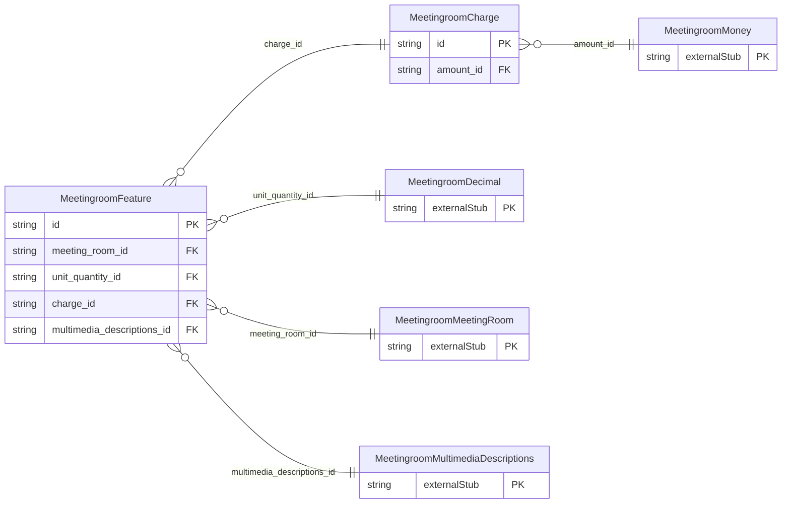

<!-- Code generated by protoc-gen-store. DO NOT EDIT. -->

# `ota/opentravel/hotel/property/meeting_room/v1/types/feature/` — Prisma schema

Generated from Protobuf by protoc-gen-store. Source of truth is the `.proto` files — regenerate rather than editing.

| Models | Enums |
| ---: | ---: |
| 2 | 0 |

## Entity relationships

Schema file: [`feature.postgres.prisma`](./feature.postgres.prisma)

### `MeetingroomFeature` → `features`

Describes individual security and physically challenged features that a hotel offers.

| Column | Type | Null |
| --- | --- | --- |
| `code_detail` | `VARCHAR(255)` | nullable |
| `accessible_code` | `MeetingroomDisabilityFeatureCode` | nullable |
| `security_code` | `MeetingroomSecurityFeatureCode` | nullable |
| `exists_code` | `MeetingroomOptionTypeCode` | nullable |
| `proximity_code` | `MeetingroomProximity` | nullable |
| `id` | `VARCHAR(255)` | not null |
| `unit` | `VARCHAR(255)` | nullable |
| `unit_code` | `MeetingroomUnitOfMeasureCode` | nullable |
| `descriptive_text` | `VARCHAR(255)` | nullable |
| `meeting_room_id` | `CHAR(26)` | not null |
| `unit_quantity_id` | `CHAR(26)` | nullable |
| `charge_id` | `CHAR(26)` | nullable |
| `multimedia_descriptions_id` | `CHAR(26)` | nullable |

### `MeetingroomCharge` → `charges`

Indicates whether this feature is chargeable.

| Column | Type | Null |
| --- | --- | --- |
| `id` | `CHAR(26)` | not null |
| `amount_id` | `CHAR(26)` | nullable |
