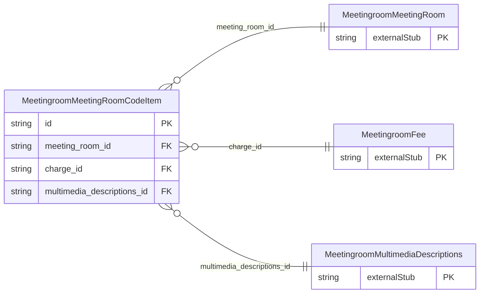

<!-- Code generated by protoc-gen-store. DO NOT EDIT. -->

# `ota/opentravel/hotel/property/meeting_room/v1/types/meeting_room_code_item/` — Prisma schema

Generated from Protobuf by protoc-gen-store. Source of truth is the `.proto` files — regenerate rather than editing.

| Models | Enums |
| ---: | ---: |
| 1 | 0 |

## Entity relationships

Schema file: [`meeting_room_code_item.postgres.prisma`](./meeting_room_code_item.postgres.prisma)

### `MeetingroomMeetingRoomCodeItem` → `code_items`

Meeting room code item.

| Column | Type | Null |
| --- | --- | --- |
| `code` | `MeetingroomMeetingRoomCode` | nullable |
| `exists_code` | `MeetingroomOptionTypeCode` | nullable |
| `code_detail` | `VARCHAR(255)` | nullable |
| `quantity` | `INTEGER` | nullable |
| `discounts_available_code` | `MeetingroomDiscountsAvailable` | nullable |
| `id` | `VARCHAR(255)` | not null |
| `meeting_room_id` | `CHAR(26)` | not null |
| `charge_id` | `CHAR(26)` | nullable |
| `multimedia_descriptions_id` | `CHAR(26)` | nullable |
