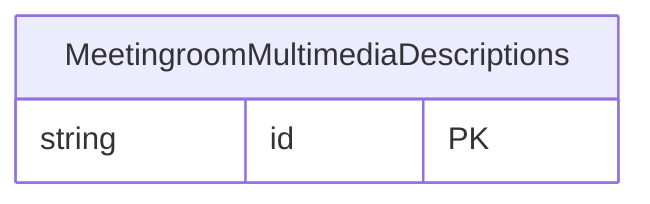

<!-- Code generated by protoc-gen-store. DO NOT EDIT. -->

# `ota/opentravel/hotel/property/meeting_room/v1/types/multimedia_descriptions/` — Prisma schema

Generated from Protobuf by protoc-gen-store. Source of truth is the `.proto` files — regenerate rather than editing.

| Models | Enums |
| ---: | ---: |
| 1 | 0 |

## Entity relationships

Schema file: [`multimedia_descriptions.postgres.prisma`](./multimedia_descriptions.postgres.prisma)

### `MeetingroomMultimediaDescriptions` → `multimedia_descriptions`

Contains multimedia item(s).

| Column | Type | Null |
| --- | --- | --- |
| `id` | `CHAR(26)` | not null |
| `last_update_time` | `TIMESTAMPTZ` | nullable |
