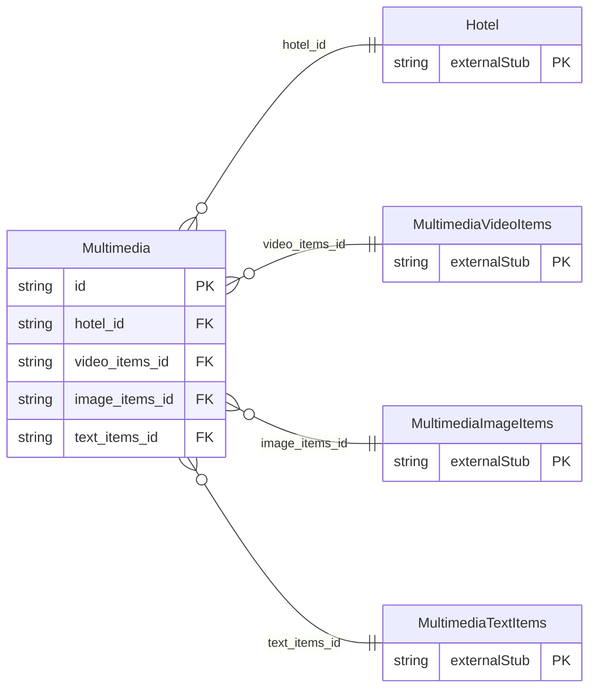

<!-- Code generated by protoc-gen-store. DO NOT EDIT. -->

# `ota/opentravel/hotel/property/multimedia/multimedia/` — Prisma schema

Generated from Protobuf by protoc-gen-store. Source of truth is the `.proto` files — regenerate rather than editing.

| Models | Enums |
| ---: | ---: |
| 1 | 1 |

## Entity relationships

Schema file: [`multimedia.postgres.prisma`](./multimedia.postgres.prisma)

### `Multimedia` → `resource`

A multimedia item. A collection resource, named "hotels/{hotel}/multimedia/{multimedia}". OTA: OTA_HotelDescriptiveContentNotifRQ/HotelDescriptiveContents/HotelDescriptiveContent/MultimediaDescriptions/MultimediaDescription.

| Column | Type | Null |
| --- | --- | --- |
| `id` | `CHAR(26)` | not null |
| `name` | `VARCHAR(255)` | not null |
| `uid` | `VARCHAR(255)` | nullable |
| `etag` | `VARCHAR(255)` | nullable |
| `delete_time` | `TIMESTAMPTZ` | nullable |
| `expire_time` | `TIMESTAMPTZ` | nullable |
| `create_time` | `TIMESTAMPTZ` | not null |
| `update_time` | `TIMESTAMPTZ` | not null |
| `info_code` | `MultimediaInfoType` | nullable |
| `additional_detail_code` | `MultimediaAdditionalDetailType` | nullable |
| `ota_uid` | `VARCHAR(255)` | nullable |
| `version` | `VARCHAR(255)` | nullable |
| `video_items_or_image_items_or_text_items_case` | `MultimediaVideoItemsOrImageItemsOrTextItemsCase` | nullable |
| `hotel_id` | `CHAR(26)` | not null |
| `video_items_id` | `CHAR(26)` | nullable |
| `image_items_id` | `CHAR(26)` | nullable |
| `text_items_id` | `CHAR(26)` | nullable |

### Enums

- `MultimediaVideoItemsOrImageItemsOrTextItemsCase`: VIDEO_ITEMS, IMAGE_ITEMS, TEXT_ITEMS
