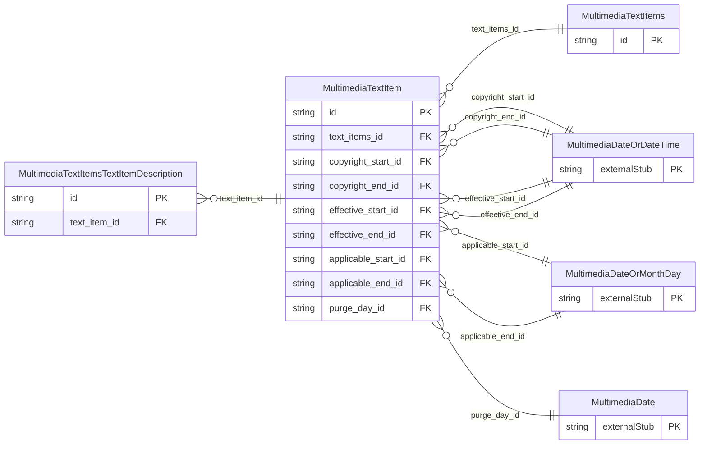

<!-- Code generated by protoc-gen-store. DO NOT EDIT. -->

# `ota/opentravel/hotel/property/multimedia/v1/types/text_items/` — Prisma schema

Generated from Protobuf by protoc-gen-store. Source of truth is the `.proto` files — regenerate rather than editing.

| Models | Enums |
| ---: | ---: |
| 3 | 0 |

## Entity relationships

Schema file: [`text_items.postgres.prisma`](./text_items.postgres.prisma)

### `MultimediaTextItems` → `text_items`

Collection of text items.

| Column | Type | Null |
| --- | --- | --- |
| `id` | `CHAR(26)` | not null |

### `MultimediaTextItem` → `text_item`

Text description of a given category.

| Column | Type | Null |
| --- | --- | --- |
| `id` | `CHAR(26)` | not null |
| `category` | `MultimediaPictureCategoryCode` | nullable |
| `content_id` | `VARCHAR(255)` | nullable |
| `title` | `VARCHAR(255)` | nullable |
| `author` | `VARCHAR(255)` | nullable |
| `copyright_notice` | `VARCHAR(255)` | nullable |
| `copyright_owner` | `VARCHAR(255)` | nullable |
| `record_id` | `VARCHAR(255)` | nullable |
| `source_id` | `VARCHAR(255)` | nullable |
| `language_code` | `VARCHAR(255)` | nullable |
| `create_date_time` | `TIMESTAMPTZ` | nullable |
| `creator_id` | `VARCHAR(255)` | nullable |
| `last_modify_date_time` | `TIMESTAMPTZ` | nullable |
| `last_modifier_id` | `VARCHAR(255)` | nullable |
| `version` | `VARCHAR(255)` | nullable |
| `uri` | `VARCHAR(255)` | nullable |
| `text_items_id` | `CHAR(26)` | not null |
| `copyright_start_id` | `CHAR(26)` | nullable |
| `copyright_end_id` | `CHAR(26)` | nullable |
| `effective_start_id` | `CHAR(26)` | nullable |
| `effective_end_id` | `CHAR(26)` | nullable |
| `applicable_start_id` | `CHAR(26)` | nullable |
| `applicable_end_id` | `CHAR(26)` | nullable |
| `purge_day_id` | `CHAR(26)` | nullable |

### `MultimediaTextItemsTextItemDescription` → `text_items_text_item_descriptions`

The text in a specific language.

| Column | Type | Null |
| --- | --- | --- |
| `id` | `CHAR(26)` | not null |
| `formatted` | `BOOLEAN` | nullable |
| `language_code` | `VARCHAR(255)` | nullable |
| `text_format` | `MultimediaTextFormat` | nullable |
| `list_item` | `INTEGER` | nullable |
| `value` | `VARCHAR(255)` | nullable |
| `text_item_id` | `CHAR(26)` | not null |
