<!-- Code generated by protoc-gen-store. DO NOT EDIT. -->

# `ota/opentravel/hotel/property/policy/policy/` — Prisma schema

Generated from Protobuf by protoc-gen-store. Source of truth is the `.proto` files — regenerate rather than editing.

| Models | Enums |
| ---: | ---: |
| 18 | 10 |

## Entity relationships

```mermaid
erDiagram
    direction LR
    CommissionPolicy {
        string id PK
        string amount_id FK
        string percent_id FK
        string effective_day_id FK
        string expire_day_id FK
        string taxes_id FK
    }
    GroupPolicy {
        string id PK
        string policy_id FK
    }
    GuaranteePaymentPolicy {
        string id PK
    }
    PaymentCompany {
        string id PK
        string commission_policy_id FK
    }
    PetsPolicies {
        string id PK
    }
    PetsPolicy {
        string id PK
        string pets_policies_id FK
        string unit_quantity_id FK
        string refundable_deposit_id FK
        string non_refundable_fee_id FK
        string min_unit_quantity_id FK
    }
    PolicyCheckoutCharge {
        string id PK
        string policy_id FK
        string amount_id FK
        string percent_id FK
    }
    PolicyGuaranteePayment {
        string id PK
        string guarantee_payment_policy_id FK
        string hold_clock_id FK
        string start_id FK
        string end_id FK
        string amount_percent_id FK
    }
    PolicyGuaranteePaymentPolicyGuaranteePaymentAddress {
        string id PK
        string guarantee_payment_id FK
        string street_nmbr_id FK
        string state_prov_id FK
        string country_display_name_id FK
    }
    PolicyGuaranteePaymentPolicyGuaranteePaymentAmountPercent {
        string id PK
        string percent_id FK
        string amount_id FK
        string taxes_id FK
    }
    PolicyGuaranteePaymentPolicyGuaranteePaymentDeadline {
        string id PK
        string guarantee_payment_id FK
        string absolute_deadline_id FK
    }
    PolicyInfoCode {
        string id PK
        string policy_id FK
    }
    PolicyPolicy {
        string id PK
        string hotel_id FK
        string start_id FK
        string end_id FK
        string cancel_policy_id FK
        string guarantee_payment_policy_id FK
        string policy_info_id FK
        string pets_policies_id FK
        string commission_policy_id FK
    }
    PolicyPolicyInfo {
        string id PK
        string checkin_id FK
        string check_out_id FK
        string description_id FK
    }
    RatePolicy {
        string id PK
        string policy_id FK
        string type_id FK
    }
    StayRequirement {
        string id PK
        string policy_id FK
        string start_id FK
        string end_id FK
        string description_id FK
    }
    TaxPolicy {
        string id PK
        string policy_id FK
        string amount_id FK
        string percent_id FK
        string effective_day_id FK
        string expire_day_id FK
    }
    Type {
        string id PK
    }
    Hotel {
        string externalStub PK
    }
    PolicyCancelPenalties {
        string externalStub PK
    }
    PolicyCountryName {
        string externalStub PK
    }
    PolicyDate {
        string externalStub PK
    }
    PolicyDateOrTimeOrDateTime {
        string externalStub PK
    }
    PolicyDecimal {
        string externalStub PK
    }
    PolicyMoney {
        string externalStub PK
    }
    PolicyParagraph {
        string externalStub PK
    }
    PolicyStateProv {
        string externalStub PK
    }
    PolicyStreetNmbr {
        string externalStub PK
    }
    PolicyTaxes {
        string externalStub PK
    }
    PolicyTimeOfDay {
        string externalStub PK
    }
    PolicyTimeOrDateTime {
        string externalStub PK
    }
    CommissionPolicy }o--|| PolicyMoney : "amount_id"
    CommissionPolicy }o--|| PolicyDecimal : "percent_id"
    CommissionPolicy }o--|| PolicyDate : "effective_day_id"
    CommissionPolicy }o--|| PolicyDate : "expire_day_id"
    CommissionPolicy }o--|| PolicyTaxes : "taxes_id"
    GroupPolicy }o--|| PolicyPolicy : "policy_id"
    PaymentCompany }o--|| CommissionPolicy : "commission_policy_id"
    PetsPolicy }o--|| PetsPolicies : "pets_policies_id"
    PetsPolicy }o--|| PolicyDecimal : "unit_quantity_id"
    PetsPolicy }o--|| PolicyMoney : "refundable_deposit_id"
    PetsPolicy }o--|| PolicyMoney : "non_refundable_fee_id"
    PetsPolicy }o--|| PolicyDecimal : "min_unit_quantity_id"
    PolicyCheckoutCharge }o--|| PolicyPolicy : "policy_id"
    PolicyCheckoutCharge }o--|| PolicyMoney : "amount_id"
    PolicyCheckoutCharge }o--|| PolicyDecimal : "percent_id"
    PolicyGuaranteePayment }o--|| GuaranteePaymentPolicy : "guarantee_payment_policy_id"
    PolicyGuaranteePayment }o--|| PolicyTimeOfDay : "hold_clock_id"
    PolicyGuaranteePayment }o--|| PolicyDateOrTimeOrDateTime : "start_id"
    PolicyGuaranteePayment }o--|| PolicyDateOrTimeOrDateTime : "end_id"
    PolicyGuaranteePayment }o--|| PolicyGuaranteePaymentPolicyGuaranteePaymentAmountPercent : "amount_percent_id"
    PolicyGuaranteePaymentPolicyGuaranteePaymentAddress }o--|| PolicyGuaranteePayment : "guarantee_payment_id"
    PolicyGuaranteePaymentPolicyGuaranteePaymentAddress }o--|| PolicyStreetNmbr : "street_nmbr_id"
    PolicyGuaranteePaymentPolicyGuaranteePaymentAddress }o--|| PolicyStateProv : "state_prov_id"
    PolicyGuaranteePaymentPolicyGuaranteePaymentAddress }o--|| PolicyCountryName : "country_display_name_id"
    PolicyGuaranteePaymentPolicyGuaranteePaymentAmountPercent }o--|| PolicyDecimal : "percent_id"
    PolicyGuaranteePaymentPolicyGuaranteePaymentAmountPercent }o--|| PolicyMoney : "amount_id"
    PolicyGuaranteePaymentPolicyGuaranteePaymentAmountPercent }o--|| PolicyTaxes : "taxes_id"
    PolicyGuaranteePaymentPolicyGuaranteePaymentDeadline }o--|| PolicyGuaranteePayment : "guarantee_payment_id"
    PolicyGuaranteePaymentPolicyGuaranteePaymentDeadline }o--|| PolicyTimeOrDateTime : "absolute_deadline_id"
    PolicyInfoCode }o--|| PolicyPolicy : "policy_id"
    PolicyPolicy }o--|| Hotel : "hotel_id"
    PolicyPolicy }o--|| PolicyDateOrTimeOrDateTime : "start_id"
    PolicyPolicy }o--|| PolicyDateOrTimeOrDateTime : "end_id"
    PolicyPolicy }o--|| PolicyCancelPenalties : "cancel_policy_id"
    PolicyPolicy }o--|| GuaranteePaymentPolicy : "guarantee_payment_policy_id"
    PolicyPolicy }o--|| PolicyPolicyInfo : "policy_info_id"
    PolicyPolicy }o--|| PetsPolicies : "pets_policies_id"
    PolicyPolicy }o--|| CommissionPolicy : "commission_policy_id"
    PolicyPolicyInfo }o--|| PolicyTimeOrDateTime : "checkin_id"
    PolicyPolicyInfo }o--|| PolicyTimeOrDateTime : "check_out_id"
    PolicyPolicyInfo }o--|| PolicyParagraph : "description_id"
    RatePolicy }o--|| PolicyPolicy : "policy_id"
    RatePolicy }o--|| Type : "type_id"
    StayRequirement }o--|| PolicyPolicy : "policy_id"
    StayRequirement }o--|| PolicyDateOrTimeOrDateTime : "start_id"
    StayRequirement }o--|| PolicyDateOrTimeOrDateTime : "end_id"
    StayRequirement }o--|| PolicyParagraph : "description_id"
    TaxPolicy }o--|| PolicyPolicy : "policy_id"
    TaxPolicy }o--|| PolicyMoney : "amount_id"
    TaxPolicy }o--|| PolicyDecimal : "percent_id"
    TaxPolicy }o--|| PolicyDate : "effective_day_id"
    TaxPolicy }o--|| PolicyDate : "expire_day_id"
```

Schema file: [`policy.postgres.prisma`](./policy.postgres.prisma)

### `PolicyPolicy` → `policies`

Describes the policies of the hotel, such as the type of payments, or whether children or pets are accepted. A collection resource, named "hotels/{hotel}/policies/{policy}". OTA: OTA_HotelDescriptiveContentNotifRQ/HotelDescriptiveContents/HotelDescriptiveContent/Policies/Policy.

| Column | Type | Null |
| --- | --- | --- |
| `id` | `CHAR(26)` | not null |
| `name` | `VARCHAR(255)` | not null |
| `uid` | `VARCHAR(255)` | nullable |
| `etag` | `VARCHAR(255)` | nullable |
| `delete_time` | `TIMESTAMPTZ` | nullable |
| `expire_time` | `TIMESTAMPTZ` | nullable |
| `create_time` | `TIMESTAMPTZ` | not null |
| `update_time` | `TIMESTAMPTZ` | not null |
| `default_valid_booking_min_offset` | `INTEGER` | nullable |
| `duration` | `VARCHAR(255)` | nullable |
| `code` | `VARCHAR(255)` | nullable |
| `code_detail` | `VARCHAR(255)` | nullable |
| `weekdays` | `` | nullable |
| `hotel_id` | `CHAR(26)` | not null |
| `start_id` | `CHAR(26)` | nullable |
| `end_id` | `CHAR(26)` | nullable |
| `cancel_policy_id` | `CHAR(26)` | nullable |
| `guarantee_payment_policy_id` | `CHAR(26)` | nullable |
| `policy_info_id` | `CHAR(26)` | nullable |
| `pets_policies_id` | `CHAR(26)` | nullable |
| `commission_policy_id` | `CHAR(26)` | nullable |

### `GuaranteePaymentPolicy` → `guarantee_payment_policies`

A collection of deposit policies, guarantees policy, and/or accepted forms of payment.

| Column | Type | Null |
| --- | --- | --- |
| `id` | `CHAR(26)` | not null |

### `PolicyInfoCode` → `info_codes`

Policy info code.

| Column | Type | Null |
| --- | --- | --- |
| `id` | `CHAR(26)` | not null |
| `code_detail` | `VARCHAR(255)` | nullable |
| `code` | `VARCHAR(255)` | nullable |
| `code_context` | `VARCHAR(255)` | nullable |
| `quantity` | `INTEGER` | nullable |
| `uri` | `VARCHAR(255)` | nullable |
| `name` | `Name` | nullable |
| `exists_code` | `PolicyOptionTypeCode` | nullable |
| `policy_id` | `CHAR(26)` | not null |

### `PolicyCheckoutCharge` → `checkout_charges`

Checkout charge.

| Column | Type | Null |
| --- | --- | --- |
| `id` | `CHAR(26)` | not null |
| `type` | `PolicyCheckoutChargeType` | nullable |
| `code_detail` | `VARCHAR(255)` | nullable |
| `night_count` | `INTEGER` | nullable |
| `exists_code` | `PolicyOptionTypeCode` | nullable |
| `stay_balance` | `BOOLEAN` | nullable |
| `policy_id` | `CHAR(26)` | not null |
| `amount_id` | `CHAR(26)` | nullable |
| `percent_id` | `CHAR(26)` | nullable |

### `PolicyPolicyInfo` → `infos`

Basic property policy information.

| Column | Type | Null |
| --- | --- | --- |
| `id` | `CHAR(26)` | not null |
| `min_guest_age` | `INTEGER` | nullable |
| `min_recommended_guest_age` | `INTEGER` | nullable |
| `usual_stay_free_cutoff_age` | `INTEGER` | nullable |
| `usual_stay_free_child_per_adult` | `INTEGER` | nullable |
| `total_guest_count` | `INTEGER` | nullable |
| `default_tax_service_inclusive` | `BOOLEAN` | nullable |
| `kids_stay_free` | `BOOLEAN` | nullable |
| `max_child_age` | `INTEGER` | nullable |
| `internet_guarantee_required` | `BOOLEAN` | nullable |
| `accepted_guest_type` | `AcceptedGuestType` | nullable |
| `room_guarantee_late_arrv` | `BOOLEAN` | nullable |
| `checkin_id` | `CHAR(26)` | nullable |
| `check_out_id` | `CHAR(26)` | nullable |
| `description_id` | `CHAR(26)` | nullable |

### `TaxPolicy` → `tax_policies`

Tax policy.

| Column | Type | Null |
| --- | --- | --- |
| `id` | `CHAR(26)` | not null |
| `type` | `PolicyAmountDetermination` | nullable |
| `code` | `PolicyFeeTaxType` | nullable |
| `expire_date_exclusive` | `BOOLEAN` | nullable |
| `charge_unit` | `PolicyChargeType` | nullable |
| `charge_frequency` | `PolicyChargeType` | nullable |
| `charge_unit_exempt` | `INTEGER` | nullable |
| `charge_frequency_exempt` | `INTEGER` | nullable |
| `max_charge_unit_applies` | `INTEGER` | nullable |
| `max_charge_frequency_applies` | `INTEGER` | nullable |
| `sequence_nbr` | `INTEGER` | nullable |
| `duration` | `VARCHAR(255)` | nullable |
| `tax_exempt_nights` | `INTEGER` | nullable |
| `taxable_nights_quantity` | `INTEGER` | nullable |
| `policy_id` | `CHAR(26)` | not null |
| `amount_id` | `CHAR(26)` | nullable |
| `percent_id` | `CHAR(26)` | nullable |
| `effective_day_id` | `CHAR(26)` | nullable |
| `expire_day_id` | `CHAR(26)` | nullable |

### `PetsPolicies` → `pets_policies`

Property pet policies.

| Column | Type | Null |
| --- | --- | --- |
| `id` | `CHAR(26)` | not null |
| `pets_allowed_code` | `PetsAllowedCode` | nullable |

### `StayRequirement` → `stay_requirements`

Defines the requirements for a minimimum or maximum length of stay for a property. Day of week may or may not have an impact on this requirement. Day of week is a stayover day unless StayContext is used.

| Column | Type | Null |
| --- | --- | --- |
| `id` | `CHAR(26)` | not null |
| `weekdays` | `` | nullable |
| `min_los` | `INTEGER` | nullable |
| `max_los` | `INTEGER` | nullable |
| `stay_context` | `StayContext` | nullable |
| `duration` | `VARCHAR(255)` | nullable |
| `policy_id` | `CHAR(26)` | not null |
| `start_id` | `CHAR(26)` | nullable |
| `end_id` | `CHAR(26)` | nullable |
| `description_id` | `CHAR(26)` | nullable |

### `CommissionPolicy` → `commission_policies`

Used to define the property's high-level commission policy.

| Column | Type | Null |
| --- | --- | --- |
| `id` | `CHAR(26)` | not null |
| `tax_inclusive` | `BOOLEAN` | nullable |
| `type` | `PolicyAmountDetermination` | nullable |
| `code` | `PolicyFeeTaxType` | nullable |
| `expire_date_exclusive` | `BOOLEAN` | nullable |
| `mandatory` | `BOOLEAN` | nullable |
| `rph` | `VARCHAR(255)` | nullable |
| `charge_unit` | `PolicyChargeType` | nullable |
| `charge_frequency` | `PolicyChargeType` | nullable |
| `charge_unit_exempt` | `INTEGER` | nullable |
| `charge_frequency_exempt` | `INTEGER` | nullable |
| `max_charge_unit_applies` | `INTEGER` | nullable |
| `max_charge_frequency_applies` | `INTEGER` | nullable |
| `taxable_indicator` | `BOOLEAN` | nullable |
| `min_age` | `INTEGER` | nullable |
| `max_age` | `INTEGER` | nullable |
| `commission_applicability` | `CommissionApplicability` | nullable |
| `amount_id` | `CHAR(26)` | nullable |
| `percent_id` | `CHAR(26)` | nullable |
| `effective_day_id` | `CHAR(26)` | nullable |
| `expire_day_id` | `CHAR(26)` | nullable |
| `taxes_id` | `CHAR(26)` | nullable |

### `RatePolicy` → `rate_policies`

A rate policy description.

| Column | Type | Null |
| --- | --- | --- |
| `id` | `CHAR(26)` | not null |
| `changeable` | `BOOLEAN` | nullable |
| `id_required` | `BOOLEAN` | nullable |
| `guest_types` | `VARCHAR(255)[]` | nullable |
| `min_room_night_commitment` | `INTEGER` | nullable |
| `rate_offer_type` | `PolicyRatePlanType` | nullable |
| `corporate_id` | `BOOLEAN` | nullable |
| `policy_id` | `CHAR(26)` | not null |
| `type_id` | `CHAR(26)` | nullable |

### `GroupPolicy` → `group_policies`

Group policy information.

| Column | Type | Null |
| --- | --- | --- |
| `id` | `CHAR(26)` | not null |
| `contract_currency` | `VARCHAR(255)` | nullable |
| `contract_language` | `VARCHAR(255)` | nullable |
| `local_dmc_role` | `LocalDmcRole` | nullable |
| `max_group_size` | `INTEGER` | nullable |
| `policy_id` | `CHAR(26)` | not null |

### `PolicyGuaranteePayment` → `guarantee_payments`

Used to define the deposit policy, guarantees policy, and/or accepted forms of payment.

| Column | Type | Null |
| --- | --- | --- |
| `id` | `CHAR(26)` | not null |
| `retribution_type` | `PolicyRetributionType` | nullable |
| `payment_code` | `VARCHAR(255)` | nullable |
| `type` | `PolicyGuaranteePaymentPolicyGuaranteePaymentType` | nullable |
| `guarantee_code` | `VARCHAR(255)` | nullable |
| `guarantee_type` | `PolicyGuaranteeType` | nullable |
| `weekdays` | `` | nullable |
| `duration` | `VARCHAR(255)` | nullable |
| `no_card_holder_info_req` | `BOOLEAN` | nullable |
| `name` | `BOOLEAN` | nullable |
| `address` | `BOOLEAN` | nullable |
| `phone` | `BOOLEAN` | nullable |
| `interbank_nbr` | `BOOLEAN` | nullable |
| `room_type_code` | `VARCHAR(255)` | nullable |
| `info_source` | `VARCHAR(255)` | nullable |
| `non_refundable_indicator` | `BOOLEAN` | nullable |
| `policy_code` | `VARCHAR(255)` | nullable |
| `agency_name_addr_req` | `BOOLEAN` | nullable |
| `company_name_addr_req` | `BOOLEAN` | nullable |
| `no_card_holder_info_retain` | `BOOLEAN` | nullable |
| `name_retain` | `BOOLEAN` | nullable |
| `address_retain` | `BOOLEAN` | nullable |
| `phone_retain` | `BOOLEAN` | nullable |
| `guarantee_payment_policy_id` | `CHAR(26)` | not null |
| `hold_clock_id` | `CHAR(26)` | nullable |
| `start_id` | `CHAR(26)` | nullable |
| `end_id` | `CHAR(26)` | nullable |
| `amount_percent_id` | `CHAR(26)` | nullable |

### `PetsPolicy` → `pets_policy`

Detailed policy information when Pets are Allowed.

| Column | Type | Null |
| --- | --- | --- |
| `id` | `CHAR(26)` | not null |
| `pets_policy_code` | `VARCHAR(255)` | nullable |
| `unit` | `VARCHAR(255)` | nullable |
| `unit_code` | `PolicyUnitOfMeasureCode` | nullable |
| `max_pet_quantity` | `INTEGER` | nullable |
| `charge_code` | `PolicyChargeType` | nullable |
| `restriction` | `BOOLEAN` | nullable |
| `pets_policies_id` | `CHAR(26)` | not null |
| `unit_quantity_id` | `CHAR(26)` | nullable |
| `refundable_deposit_id` | `CHAR(26)` | nullable |
| `non_refundable_fee_id` | `CHAR(26)` | nullable |
| `min_unit_quantity_id` | `CHAR(26)` | nullable |

### `PaymentCompany` → `payment_companies`

Company processing the commission payment for the property.

| Column | Type | Null |
| --- | --- | --- |
| `id` | `CHAR(26)` | not null |
| `name` | `VARCHAR(255)` | nullable |
| `commission_policy_id` | `CHAR(26)` | not null |

### `Type` → `types`

The type of the rate policy e.g. government and preferred. Select a predefined value from the list or use the "Other_" value to create an enumerated value agreed upon between trading partners.

| Column | Type | Null |
| --- | --- | --- |
| `id` | `CHAR(26)` | not null |
| `extension` | `VARCHAR(255)` | nullable |
| `value` | `RatePlanEnum` | nullable |

### `PolicyGuaranteePaymentPolicyGuaranteePaymentAmountPercent` → `guarantee_payment_policy_guarantee_payment_amount_percents`

Payment expressed as a fixed amount, or a percentage of/or room nights.

| Column | Type | Null |
| --- | --- | --- |
| `id` | `CHAR(26)` | not null |
| `tax_inclusive` | `BOOLEAN` | nullable |
| `fees_inclusive` | `BOOLEAN` | nullable |
| `night_count` | `INTEGER` | nullable |
| `basis_type` | `PolicyBasisType` | nullable |
| `apply_as` | `PolicyApplyAs` | nullable |
| `overridden_amount_indicator` | `BOOLEAN` | nullable |
| `percent_id` | `CHAR(26)` | nullable |
| `amount_id` | `CHAR(26)` | nullable |
| `taxes_id` | `CHAR(26)` | nullable |

### `PolicyGuaranteePaymentPolicyGuaranteePaymentDeadline` → `guarantee_payment_policy_guarantee_payment_deadlines`

Payment deadline, absolute or relative.

| Column | Type | Null |
| --- | --- | --- |
| `id` | `CHAR(26)` | not null |
| `offset_time_unit` | `PolicyTimeUnit` | nullable |
| `offset_unit_multiplier` | `INTEGER` | nullable |
| `offset_drop_point` | `PolicyOffsetDropTime` | nullable |
| `override_indicator` | `BOOLEAN` | nullable |
| `guarantee_payment_id` | `CHAR(26)` | not null |
| `absolute_deadline_id` | `CHAR(26)` | nullable |

### `PolicyGuaranteePaymentPolicyGuaranteePaymentAddress` → `guarantee_payment_policy_guarantee_payment_address`

The address to which a deposit may be sent.

| Column | Type | Null |
| --- | --- | --- |
| `id` | `CHAR(26)` | not null |
| `formatted` | `BOOLEAN` | nullable |
| `share_synch_ind` | `PolicyAcceptedPaymentShareSynchInd` | nullable |
| `share_market_ind` | `PolicyAcceptedPaymentShareMarketInd` | nullable |
| `type` | `PolicyCommunicationLocationType` | nullable |
| `remark` | `VARCHAR(255)` | nullable |
| `language_code` | `VARCHAR(255)` | nullable |
| `valid` | `BOOLEAN` | nullable |
| `default_value` | `BOOLEAN` | nullable |
| `use_type` | `PolicyAddressUseType` | nullable |
| `rph` | `VARCHAR(255)` | nullable |
| `addressee_display_name` | `VARCHAR(255)` | nullable |
| `address_lines` | `VARCHAR(255)[]` | nullable |
| `city_display_name` | `VARCHAR(255)` | nullable |
| `postal_code` | `VARCHAR(255)` | nullable |
| `county` | `VARCHAR(255)` | nullable |
| `guarantee_payment_id` | `CHAR(26)` | not null |
| `street_nmbr_id` | `CHAR(26)` | nullable |
| `state_prov_id` | `CHAR(26)` | nullable |
| `country_display_name_id` | `CHAR(26)` | nullable |

### Enums

- `Name`: ADDITIONAL_OVERSOLD_POLICY, EARLY_CHECKIN_AVAILABLE, LATE_CHECKOUT_AVAILABLE, OVERSOLD_ARRANGE_ACCOMMODATIONS, OVERSOLD_ARRANGE_TRANSPORTATION, OVERSOLD_NOTIFY_CONTACTS, OVERSOLD_PAY_ONE_NIGHT_ROOM, OVERSOLD_PROVIDE_PHONECALL
- `PolicyCheckoutChargeType`: EARLY, LATE
- `AcceptedGuestType`: ADULT_ONLY, COUPLES_ONLY
- `PetsAllowedCode`: PETS_ALLOWED, PETS_NOT_ALLOWED, ASSISTIVE_ANIMALS_ONLY, PETS_BY_ARRANGEMENTS
- `StayContext`: CHECKIN, CHECKOUT
- `CommissionApplicability`: ALL_RATES, NO_RATES, SOME_RATES
- `LocalDmcRole`: SUGGESTED, REQUIRED, EMPTY
- `PolicyRetributionType`: RES_AUTO_CANCELLED, RES_NOT_GUARANTEED
- `PolicyGuaranteePaymentPolicyGuaranteePaymentType`: REQUIRED_PAYMENT, GUARANTEE_POLICY, ACCEPTED_PAYMENT_FORMS
- `PolicyGuaranteeType`: GUARANTEE_REQUIRED, NONE, CC_DC_VOUCHER, PROFILE, DEPOSIT, PRE_PAY
