<!-- Code generated by protoc-gen-store. DO NOT EDIT. -->

# `ota/opentravel/hotel/property/policy/v1/types/` — Prisma schema

Generated from Protobuf by protoc-gen-store. Source of truth is the `.proto` files — regenerate rather than editing.

| Models | Enums |
| ---: | ---: |
| 53 | 24 |

## Entity relationships

```mermaid
erDiagram
    direction LR
    PolicyAcceptedPayment {
        string id PK
        string guarantee_payment_id FK
        string payment_card_id FK
        string bank_acct_id FK
        string direct_bill_id FK
        string voucher_id FK
        string loyalty_redemption_id FK
        string misc_charge_order_id FK
        string ticket_id FK
        string cash_id FK
    }
    PolicyAddress {
        string id PK
        string street_nmbr_id FK
        string state_prov_id FK
        string country_display_name_id FK
    }
    PolicyAddressInfo {
        string id PK
        string street_nmbr_id FK
        string state_prov_id FK
        string country_display_name_id FK
    }
    PolicyAmountPercent {
        string id PK
        string percent_id FK
        string amount_id FK
        string taxes_id FK
    }
    PolicyAuthenticationVerificationValue {
        string id PK
        string secure_id FK
    }
    PolicyBankAcct {
        string id PK
        string bank_acct_number_id FK
        string bank_id_id FK
        string type_id FK
    }
    PolicyBillingAccountName {
        string id PK
    }
    PolicyBldgRoom {
        string id PK
        string address_id FK
        string address_info_id FK
    }
    PolicyCancelPenalties {
        string id PK
    }
    PolicyCancelPenalty {
        string id PK
        string cancel_penalties_id FK
        string start_id FK
        string end_id FK
        string deadline_id FK
        string amount_percent_id FK
    }
    PolicyCancelPenaltyDeadline {
        string id PK
        string absolute_deadline_id FK
    }
    PolicyCash {
        string id PK
    }
    PolicyCompanyName {
        string id PK
    }
    PolicyConjunctionTicketNbr {
        string id PK
        string ticket_id FK
    }
    PolicyCountryName {
        string id PK
    }
    PolicyCustLoyalty {
        string id PK
        string payment_card_id FK
        string signup_day_id FK
        string effective_day_id FK
        string expire_day_id FK
    }
    PolicyDate {
        string id PK
    }
    PolicyDateOrTimeOrDateTime {
        string id PK
        string day_id FK
        string clock_id FK
    }
    PolicyDecimal {
        string id PK
    }
    PolicyDirectBill {
        string id PK
        string company_display_name_id FK
        string address_id FK
        string email_id FK
        string telephone_id FK
    }
    PolicyDirectBillTelephone {
        string id PK
    }
    PolicyDocument {
        string id PK
    }
    PolicyEmail {
        string id PK
        string payment_card_id FK
    }
    PolicyEncryptionToken {
        string id PK
        string payment_card_id FK
        string warning_id FK
    }
    PolicyFee {
        string id PK
        string policy_id FK
        string amount_id FK
        string percent_id FK
        string effective_day_id FK
        string expire_day_id FK
        string taxes_id FK
    }
    PolicyFormattedTextText {
        string id PK
        string paragraph_id FK
    }
    PolicyGateway {
        string id PK
        string authentication_verification_value_id FK
        string transaction_password_id FK
    }
    PolicyIssuer {
        string id PK
    }
    PolicyListBankAccount {
        string id PK
    }
    PolicyListItem {
        string id PK
        string paragraph_id FK
    }
    PolicyListPaymentCardIssuer {
        string id PK
    }
    PolicyLoyaltyCertificate {
        string id PK
        string loyalty_redemption_id FK
        string effective_day_id FK
        string expire_day_id FK
    }
    PolicyLoyaltyRedemption {
        string id PK
    }
    PolicyMiscChargeOrder {
        string id PK
        string original_issue_day_id FK
    }
    PolicyMoney {
        string id PK
    }
    PolicyParagraph {
        string id PK
        string policy_info_code_id FK
        string checkout_charge_id FK
        string tax_policy_id FK
        string commission_policy_id FK
        string fee_id FK
        string rate_policy_id FK
        string cancel_penalty_id FK
        string guarantee_payment_id FK
        string purge_day_id FK
        string pets_policy_id FK
        string tax_id FK
    }
    PolicyPaymentCard {
        string id PK
        string card_code_id FK
        string card_type_id FK
        string issuer_id FK
        string card_holder_name_details_id FK
        string address_id FK
        string card_number_id FK
        string series_code_id FK
        string three_domain_security_id FK
        string signature_on_file_id FK
    }
    PolicyPaymentCardCode {
        string id PK
    }
    PolicyPaymentCardTelephone {
        string id PK
        string payment_card_id FK
    }
    PolicyPersonName {
        string id PK
        string document_id FK
    }
    PolicyResults {
        string id PK
    }
    PolicySignatureOnFile {
        string id PK
        string effective_day_id FK
        string expire_day_id FK
    }
    PolicyStateProv {
        string id PK
    }
    PolicyStreetNmbr {
        string id PK
    }
    PolicyTax {
        string id PK
        string taxes_id FK
        string amount_id FK
        string percent_id FK
        string effective_day_id FK
        string expire_day_id FK
    }
    PolicyTaxes {
        string id PK
        string amount_id FK
    }
    PolicyThreeDomainSecurity {
        string id PK
        string gateway_id FK
        string results_id FK
    }
    PolicyTicket {
        string id PK
        string original_issue_day_id FK
    }
    PolicyTimeOfDay {
        string id PK
    }
    PolicyTimeOrDateTime {
        string id PK
        string clock_id FK
    }
    PolicyTransactionPassword {
        string id PK
        string secure_id FK
    }
    PolicyVoucher {
        string id PK
        string effective_day_id FK
        string expire_day_id FK
        string billing_account_display_name_id FK
        string billing_account_address_id FK
    }
    PolicyWarning {
        string id PK
    }
    CommissionPolicy {
        string externalStub PK
    }
    PetsPolicy {
        string externalStub PK
    }
    PolicyCheckoutCharge {
        string externalStub PK
    }
    PolicyGuaranteePayment {
        string externalStub PK
    }
    PolicyGuaranteePaymentPolicyGuaranteePaymentAddress {
        string externalStub PK
    }
    PolicyInfoCode {
        string externalStub PK
    }
    PolicyPolicy {
        string externalStub PK
    }
    RatePolicy {
        string externalStub PK
    }
    TaxPolicy {
        string externalStub PK
    }
    PolicyAcceptedPayment }o--|| PolicyGuaranteePayment : "guarantee_payment_id"
    PolicyAcceptedPayment }o--|| PolicyPaymentCard : "payment_card_id"
    PolicyAcceptedPayment }o--|| PolicyBankAcct : "bank_acct_id"
    PolicyAcceptedPayment }o--|| PolicyDirectBill : "direct_bill_id"
    PolicyAcceptedPayment }o--|| PolicyVoucher : "voucher_id"
    PolicyAcceptedPayment }o--|| PolicyLoyaltyRedemption : "loyalty_redemption_id"
    PolicyAcceptedPayment }o--|| PolicyMiscChargeOrder : "misc_charge_order_id"
    PolicyAcceptedPayment }o--|| PolicyTicket : "ticket_id"
    PolicyAcceptedPayment }o--|| PolicyCash : "cash_id"
    PolicyAddress }o--|| PolicyStreetNmbr : "street_nmbr_id"
    PolicyAddress }o--|| PolicyStateProv : "state_prov_id"
    PolicyAddress }o--|| PolicyCountryName : "country_display_name_id"
    PolicyAddressInfo }o--|| PolicyStreetNmbr : "street_nmbr_id"
    PolicyAddressInfo }o--|| PolicyStateProv : "state_prov_id"
    PolicyAddressInfo }o--|| PolicyCountryName : "country_display_name_id"
    PolicyAmountPercent }o--|| PolicyDecimal : "percent_id"
    PolicyAmountPercent }o--|| PolicyMoney : "amount_id"
    PolicyAmountPercent }o--|| PolicyTaxes : "taxes_id"
    PolicyAuthenticationVerificationValue }o--|| PolicyEncryptionToken : "secure_id"
    PolicyBankAcct }o--|| PolicyEncryptionToken : "bank_acct_number_id"
    PolicyBankAcct }o--|| PolicyEncryptionToken : "bank_id_id"
    PolicyBankAcct }o--|| PolicyListBankAccount : "type_id"
    PolicyBldgRoom }o--|| PolicyGuaranteePaymentPolicyGuaranteePaymentAddress : "address_id"
    PolicyBldgRoom }o--|| PolicyAddressInfo : "address_info_id"
    PolicyCancelPenalty }o--|| PolicyCancelPenalties : "cancel_penalties_id"
    PolicyCancelPenalty }o--|| PolicyDateOrTimeOrDateTime : "start_id"
    PolicyCancelPenalty }o--|| PolicyDateOrTimeOrDateTime : "end_id"
    PolicyCancelPenalty }o--|| PolicyCancelPenaltyDeadline : "deadline_id"
    PolicyCancelPenalty }o--|| PolicyAmountPercent : "amount_percent_id"
    PolicyCancelPenaltyDeadline }o--|| PolicyTimeOrDateTime : "absolute_deadline_id"
    PolicyConjunctionTicketNbr }o--|| PolicyTicket : "ticket_id"
    PolicyCustLoyalty }o--|| PolicyPaymentCard : "payment_card_id"
    PolicyCustLoyalty }o--|| PolicyDate : "signup_day_id"
    PolicyCustLoyalty }o--|| PolicyDate : "effective_day_id"
    PolicyCustLoyalty }o--|| PolicyDate : "expire_day_id"
    PolicyDateOrTimeOrDateTime }o--|| PolicyDate : "day_id"
    PolicyDateOrTimeOrDateTime }o--|| PolicyTimeOfDay : "clock_id"
    PolicyDirectBill }o--|| PolicyCompanyName : "company_display_name_id"
    PolicyDirectBill }o--|| PolicyAddressInfo : "address_id"
    PolicyDirectBill }o--|| PolicyEmail : "email_id"
    PolicyDirectBill }o--|| PolicyDirectBillTelephone : "telephone_id"
    PolicyEmail }o--|| PolicyPaymentCard : "payment_card_id"
    PolicyEncryptionToken }o--|| PolicyPaymentCard : "payment_card_id"
    PolicyEncryptionToken }o--|| PolicyWarning : "warning_id"
    PolicyFee }o--|| PolicyPolicy : "policy_id"
    PolicyFee }o--|| PolicyMoney : "amount_id"
    PolicyFee }o--|| PolicyDecimal : "percent_id"
    PolicyFee }o--|| PolicyDate : "effective_day_id"
    PolicyFee }o--|| PolicyDate : "expire_day_id"
    PolicyFee }o--|| PolicyTaxes : "taxes_id"
    PolicyFormattedTextText }o--|| PolicyParagraph : "paragraph_id"
    PolicyGateway }o--|| PolicyAuthenticationVerificationValue : "authentication_verification_value_id"
    PolicyGateway }o--|| PolicyTransactionPassword : "transaction_password_id"
    PolicyListItem }o--|| PolicyParagraph : "paragraph_id"
    PolicyLoyaltyCertificate }o--|| PolicyLoyaltyRedemption : "loyalty_redemption_id"
    PolicyLoyaltyCertificate }o--|| PolicyDate : "effective_day_id"
    PolicyLoyaltyCertificate }o--|| PolicyDate : "expire_day_id"
    PolicyMiscChargeOrder }o--|| PolicyDate : "original_issue_day_id"
    PolicyParagraph }o--|| PolicyInfoCode : "policy_info_code_id"
    PolicyParagraph }o--|| PolicyCheckoutCharge : "checkout_charge_id"
    PolicyParagraph }o--|| TaxPolicy : "tax_policy_id"
    PolicyParagraph }o--|| CommissionPolicy : "commission_policy_id"
    PolicyParagraph }o--|| PolicyFee : "fee_id"
    PolicyParagraph }o--|| RatePolicy : "rate_policy_id"
    PolicyParagraph }o--|| PolicyCancelPenalty : "cancel_penalty_id"
    PolicyParagraph }o--|| PolicyGuaranteePayment : "guarantee_payment_id"
    PolicyParagraph }o--|| PolicyDate : "purge_day_id"
    PolicyParagraph }o--|| PetsPolicy : "pets_policy_id"
    PolicyParagraph }o--|| PolicyTax : "tax_id"
    PolicyPaymentCard }o--|| PolicyPaymentCardCode : "card_code_id"
    PolicyPaymentCard }o--|| PolicyListPaymentCardIssuer : "card_type_id"
    PolicyPaymentCard }o--|| PolicyIssuer : "issuer_id"
    PolicyPaymentCard }o--|| PolicyPersonName : "card_holder_name_details_id"
    PolicyPaymentCard }o--|| PolicyAddress : "address_id"
    PolicyPaymentCard }o--|| PolicyEncryptionToken : "card_number_id"
    PolicyPaymentCard }o--|| PolicyEncryptionToken : "series_code_id"
    PolicyPaymentCard }o--|| PolicyThreeDomainSecurity : "three_domain_security_id"
    PolicyPaymentCard }o--|| PolicySignatureOnFile : "signature_on_file_id"
    PolicyPaymentCardTelephone }o--|| PolicyPaymentCard : "payment_card_id"
    PolicyPersonName }o--|| PolicyDocument : "document_id"
    PolicySignatureOnFile }o--|| PolicyDate : "effective_day_id"
    PolicySignatureOnFile }o--|| PolicyDate : "expire_day_id"
    PolicyTax }o--|| PolicyTaxes : "taxes_id"
    PolicyTax }o--|| PolicyMoney : "amount_id"
    PolicyTax }o--|| PolicyDecimal : "percent_id"
    PolicyTax }o--|| PolicyDate : "effective_day_id"
    PolicyTax }o--|| PolicyDate : "expire_day_id"
    PolicyTaxes }o--|| PolicyMoney : "amount_id"
    PolicyThreeDomainSecurity }o--|| PolicyGateway : "gateway_id"
    PolicyThreeDomainSecurity }o--|| PolicyResults : "results_id"
    PolicyTicket }o--|| PolicyDate : "original_issue_day_id"
    PolicyTimeOrDateTime }o--|| PolicyTimeOfDay : "clock_id"
    PolicyTransactionPassword }o--|| PolicyEncryptionToken : "secure_id"
    PolicyVoucher }o--|| PolicyDate : "effective_day_id"
    PolicyVoucher }o--|| PolicyDate : "expire_day_id"
    PolicyVoucher }o--|| PolicyBillingAccountName : "billing_account_display_name_id"
    PolicyVoucher }o--|| PolicyAddress : "billing_account_address_id"
```

## Subfolders

- [`accepted_payment/`](./accepted_payment/README.md)
- [`amount_percent/`](./amount_percent/README.md)
- [`cancel_penalties/`](./cancel_penalties/README.md)
- [`cancel_penalty/`](./cancel_penalty/README.md)
- [`country_name/`](./country_name/README.md)
- [`date/`](./date/README.md)
- [`date_or_time_or_date_time/`](./date_or_time_or_date_time/README.md)
- [`decimal/`](./decimal/README.md)
- [`encryption_token/`](./encryption_token/README.md)
- [`fee/`](./fee/README.md)
- [`formatted_text_text/`](./formatted_text_text/README.md)
- [`list_bank_account/`](./list_bank_account/README.md)
- [`list_payment_card_issuer/`](./list_payment_card_issuer/README.md)
- [`money/`](./money/README.md)
- [`paragraph/`](./paragraph/README.md)
- [`payment_card_code/`](./payment_card_code/README.md)
- [`state_prov/`](./state_prov/README.md)
- [`tax/`](./tax/README.md)
- [`taxes/`](./taxes/README.md)
- [`time_of_day/`](./time_of_day/README.md)
- [`time_or_date_time/`](./time_or_date_time/README.md)
- [`warning/`](./warning/README.md)
