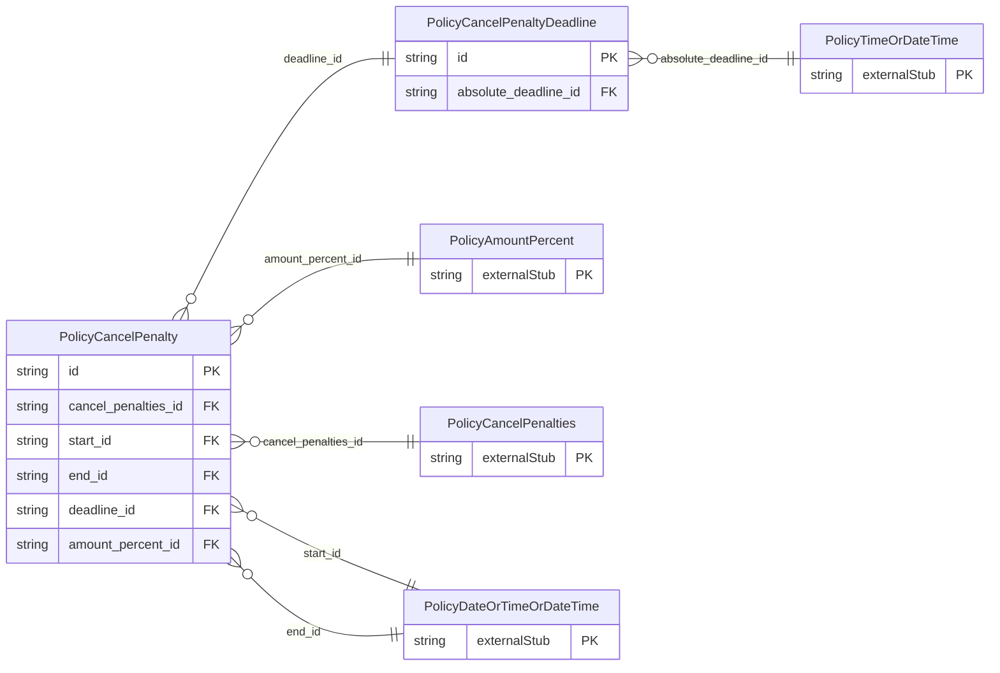

<!-- Code generated by protoc-gen-store. DO NOT EDIT. -->

# `ota/opentravel/hotel/property/policy/v1/types/cancel_penalty/` — Prisma schema

Generated from Protobuf by protoc-gen-store. Source of truth is the `.proto` files — regenerate rather than editing.

| Models | Enums |
| ---: | ---: |
| 2 | 1 |

## Entity relationships

Schema file: [`cancel_penalty.postgres.prisma`](./cancel_penalty.postgres.prisma)

### `PolicyCancelPenalty` → `cancel_penalty`

The CancelPenalty class defines the cancellation policy of the hotel facility.

| Column | Type | Null |
| --- | --- | --- |
| `id` | `CHAR(26)` | not null |
| `confirm_class_code` | `VARCHAR(255)` | nullable |
| `policy_code` | `VARCHAR(255)` | nullable |
| `non_refundable` | `BOOLEAN` | nullable |
| `weekdays` | `` | nullable |
| `duration` | `VARCHAR(255)` | nullable |
| `room_type_code` | `VARCHAR(255)` | nullable |
| `no_cancel` | `BOOLEAN` | nullable |
| `cancel_penalties_id` | `CHAR(26)` | not null |
| `start_id` | `CHAR(26)` | nullable |
| `end_id` | `CHAR(26)` | nullable |
| `deadline_id` | `CHAR(26)` | nullable |
| `amount_percent_id` | `CHAR(26)` | nullable |

### `PolicyCancelPenaltyDeadline` → `cancel_penalty_deadlines`

Cancellation deadline, absolute or relative.

| Column | Type | Null |
| --- | --- | --- |
| `id` | `CHAR(26)` | not null |
| `offset_time_unit` | `PolicyTimeUnit` | nullable |
| `offset_unit_multiplier` | `INTEGER` | nullable |
| `offset_drop_point` | `PolicyOffsetDropTime` | nullable |
| `absolute_deadline_id` | `CHAR(26)` | nullable |

### Enums

- `PolicyOffsetDropTime`: BEFORE_ARRIVAL, AFTER_BOOKING, AFTER_CONFIRMATION, AFTER_ARRIVAL, AFTER_DEPARTURE
