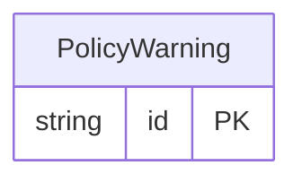

<!-- Code generated by protoc-gen-store. DO NOT EDIT. -->

# `ota/opentravel/hotel/property/policy/v1/types/warning/` — Prisma schema

Generated from Protobuf by protoc-gen-store. Source of truth is the `.proto` files — regenerate rather than editing.

| Models | Enums |
| ---: | ---: |
| 1 | 0 |

## Entity relationships

Schema file: [`warning.postgres.prisma`](./warning.postgres.prisma)

### `PolicyWarning` → `warnings`

Used when a message has been successfully processed to report any warnings or business errors that occurred.

| Column | Type | Null |
| --- | --- | --- |
| `id` | `CHAR(26)` | not null |
| `language_code` | `VARCHAR(255)` | nullable |
| `type` | `PolicyErrorWarningType` | not null |
| `short_text` | `VARCHAR(255)` | nullable |
| `code` | `VARCHAR(255)` | nullable |
| `doc_uri` | `VARCHAR(255)` | nullable |
| `status` | `VARCHAR(255)` | nullable |
| `tag` | `VARCHAR(255)` | nullable |
| `record_id` | `VARCHAR(255)` | nullable |
| `rph` | `VARCHAR(255)` | nullable |
| `value` | `VARCHAR(255)` | nullable |
