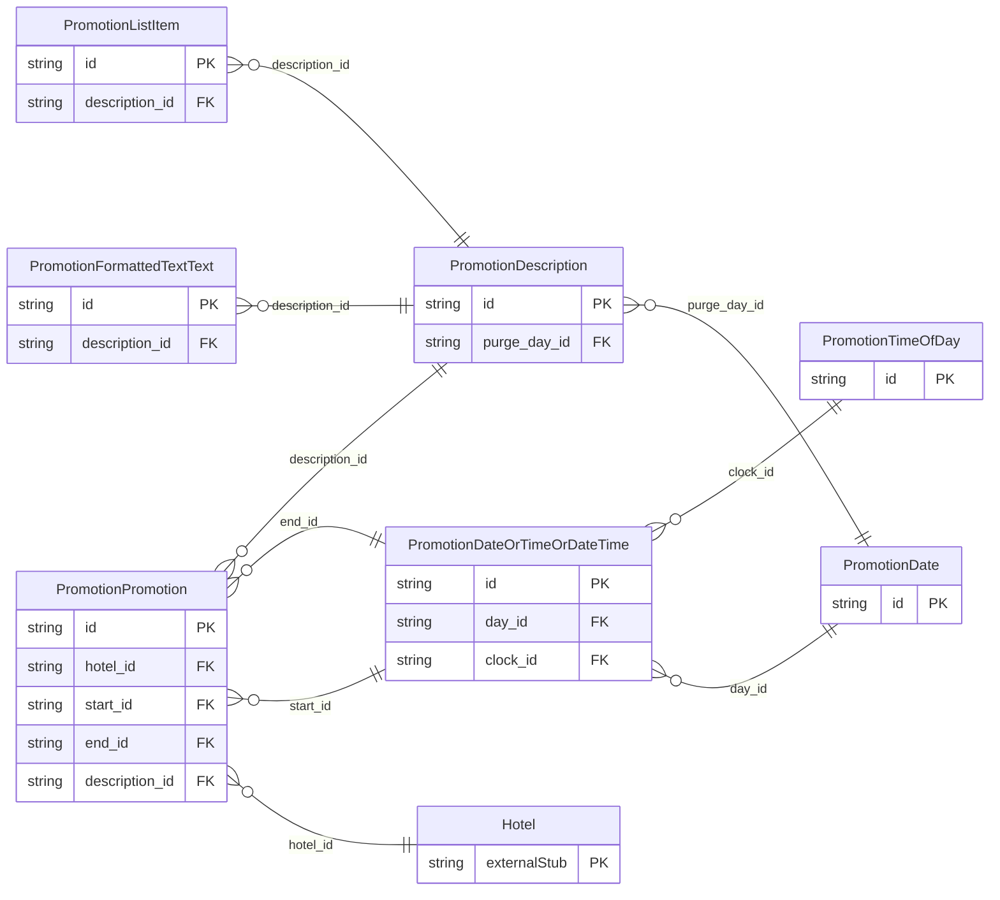

<!-- Code generated by protoc-gen-store. DO NOT EDIT. -->

# `ota/opentravel/hotel/property/promotion/` — Prisma schema

Generated from Protobuf by protoc-gen-store. Source of truth is the `.proto` files — regenerate rather than editing.

| Models | Enums |
| ---: | ---: |
| 7 | 4 |

## Entity relationships

## Subfolders

- [`promotion/`](./promotion/README.md)
- [`v1/`](./v1/README.md)
