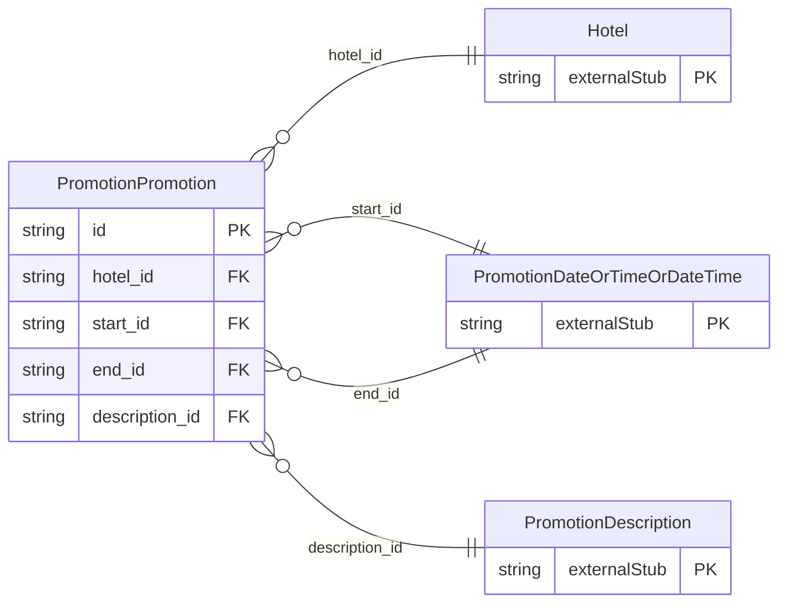

<!-- Code generated by protoc-gen-store. DO NOT EDIT. -->

# `ota/opentravel/hotel/property/promotion/promotion/` — Prisma schema

Generated from Protobuf by protoc-gen-store. Source of truth is the `.proto` files — regenerate rather than editing.

| Models | Enums |
| ---: | ---: |
| 1 | 1 |

## Entity relationships

Schema file: [`promotion.postgres.prisma`](./promotion.postgres.prisma)

### `PromotionPromotion` → `resource`

A hotel package or promotion. A collection resource, named "hotels/{hotel}/promotions/{promotion}". OTA: OTA_HotelDescriptiveContentNotifRQ/HotelDescriptiveContents/HotelDescriptiveContent/Promotions/Promotion.

| Column | Type | Null |
| --- | --- | --- |
| `id` | `CHAR(26)` | not null |
| `name` | `VARCHAR(255)` | not null |
| `uid` | `VARCHAR(255)` | nullable |
| `etag` | `VARCHAR(255)` | nullable |
| `delete_time` | `TIMESTAMPTZ` | nullable |
| `expire_time` | `TIMESTAMPTZ` | nullable |
| `create_time` | `TIMESTAMPTZ` | not null |
| `update_time` | `TIMESTAMPTZ` | not null |
| `pkg_or_promotion` | `PkgOrPromotion` | nullable |
| `type` | `PackageType` | nullable |
| `title` | `VARCHAR(255)` | nullable |
| `min_los` | `INTEGER` | nullable |
| `weekdays` | `` | nullable |
| `duration` | `VARCHAR(255)` | nullable |
| `remarks` | `VARCHAR(255)` | nullable |
| `sort_order` | `INTEGER` | nullable |
| `hotel_id` | `CHAR(26)` | not null |
| `start_id` | `CHAR(26)` | nullable |
| `end_id` | `CHAR(26)` | nullable |
| `description_id` | `CHAR(26)` | nullable |

### Enums

- `PkgOrPromotion`: PACKAGE, PROMOTION
