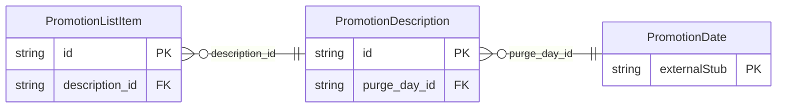

<!-- Code generated by protoc-gen-store. DO NOT EDIT. -->

# `ota/opentravel/hotel/property/promotion/v1/types/description/` — Prisma schema

Generated from Protobuf by protoc-gen-store. Source of truth is the `.proto` files — regenerate rather than editing.

| Models | Enums |
| ---: | ---: |
| 2 | 0 |

## Entity relationships

Schema file: [`description.postgres.prisma`](./description.postgres.prisma)

### `PromotionDescription` → `descriptions`

An extension of ParagraphType. It is used to pass description information when reference to or from a location may be needed.

| Column | Type | Null |
| --- | --- | --- |
| `id` | `CHAR(26)` | not null |
| `display_name` | `VARCHAR(255)` | nullable |
| `paragraph_number` | `INTEGER` | nullable |
| `create_date_time` | `TIMESTAMPTZ` | nullable |
| `creator_id` | `VARCHAR(255)` | nullable |
| `last_modify_date_time` | `TIMESTAMPTZ` | nullable |
| `last_modifier_id` | `VARCHAR(255)` | nullable |
| `language_code` | `VARCHAR(255)` | nullable |
| `location` | `BOOLEAN` | nullable |
| `reference_direction` | `BOOLEAN` | nullable |
| `images` | `VARCHAR(255)[]` | nullable |
| `uris` | `VARCHAR(255)[]` | nullable |
| `purge_day_id` | `CHAR(26)` | nullable |

### `PromotionListItem` → `list_items`

Formatted text content and an associated item or sequence number.

| Column | Type | Null |
| --- | --- | --- |
| `id` | `CHAR(26)` | not null |
| `formatted` | `BOOLEAN` | nullable |
| `language_code` | `VARCHAR(255)` | nullable |
| `text_format` | `PromotionTextFormat` | nullable |
| `list_item` | `INTEGER` | nullable |
| `value` | `VARCHAR(255)` | nullable |
| `description_id` | `CHAR(26)` | not null |
