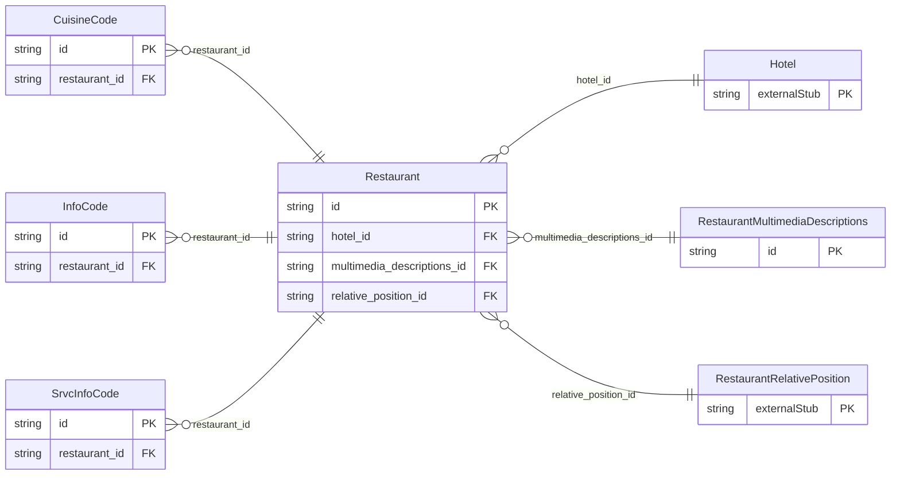

<!-- Code generated by protoc-gen-store. DO NOT EDIT. -->

# `ota/opentravel/hotel/property/restaurant/restaurant/` — Prisma schema

Generated from Protobuf by protoc-gen-store. Source of truth is the `.proto` files — regenerate rather than editing.

| Models | Enums |
| ---: | ---: |
| 5 | 1 |

## Entity relationships

Schema file: [`restaurant.postgres.prisma`](./restaurant.postgres.prisma)

### `Restaurant` → `resource`

Details of a specific restaurant such as type of restaurant, directions, schedules, etc. A collection resource, named "hotels/{hotel}/restaurants/{restaurant}". OTA: OTA_HotelDescriptiveContentNotifRQ/HotelDescriptiveContents/HotelDescriptiveContent/FacilityInfo/Restaurants/Restaurant.

| Column | Type | Null |
| --- | --- | --- |
| `id` | `CHAR(26)` | not null |
| `name` | `VARCHAR(255)` | not null |
| `uid` | `VARCHAR(255)` | nullable |
| `etag` | `VARCHAR(255)` | nullable |
| `delete_time` | `TIMESTAMPTZ` | nullable |
| `expire_time` | `TIMESTAMPTZ` | nullable |
| `create_time` | `TIMESTAMPTZ` | not null |
| `update_time` | `TIMESTAMPTZ` | not null |
| `display_name` | `VARCHAR(255)` | nullable |
| `max_seating_capacity` | `INTEGER` | nullable |
| `max_single_party` | `INTEGER` | nullable |
| `inv_code` | `VARCHAR(255)` | nullable |
| `offer_breakfast` | `BOOLEAN` | nullable |
| `offer_lunch` | `BOOLEAN` | nullable |
| `offer_dinner` | `BOOLEAN` | nullable |
| `offer_brunch` | `BOOLEAN` | nullable |
| `proximity_code` | `VARCHAR(255)` | nullable |
| `sort` | `INTEGER` | nullable |
| `reservation_req` | `BOOLEAN` | nullable |
| `featured` | `BOOLEAN` | nullable |
| `awards_rph` | `VARCHAR(255)` | nullable |
| `descriptive_text` | `VARCHAR(255)` | nullable |
| `hotel_id` | `CHAR(26)` | not null |
| `multimedia_descriptions_id` | `CHAR(26)` | nullable |
| `relative_position_id` | `CHAR(26)` | nullable |

### `RestaurantMultimediaDescriptions` → `multimedia_descriptions_link`

Multimedia information about the restaurant.

| Column | Type | Null |
| --- | --- | --- |
| `id` | `CHAR(26)` | not null |
| `last_update_time` | `TIMESTAMPTZ` | nullable |
| `attire` | `VARCHAR(255)` | nullable |

### `InfoCode` → `info_codes`

Indicates the generic type of restaurant such as fast food, cafe, fine dining, etc.

| Column | Type | Null |
| --- | --- | --- |
| `id` | `CHAR(26)` | not null |
| `name` | `RestaurantInfoCodeName` | nullable |
| `code` | `RestaurantCategoryCode` | nullable |
| `code_detail` | `VARCHAR(255)` | nullable |
| `restaurant_id` | `CHAR(26)` | not null |

### `CuisineCode` → `cuisine_codes`

The code for the type of cuisine served at the restaurant.

| Column | Type | Null |
| --- | --- | --- |
| `id` | `CHAR(26)` | not null |
| `code` | `RestaurantMainCuisineCode` | nullable |
| `code_detail` | `VARCHAR(255)` | nullable |
| `main` | `BOOLEAN` | nullable |
| `exists_code` | `RestaurantOptionTypeCode` | nullable |
| `restaurant_id` | `CHAR(26)` | not null |

### `SrvcInfoCode` → `srvc_info_codes`

This identifies the type of service.

| Column | Type | Null |
| --- | --- | --- |
| `id` | `CHAR(26)` | not null |
| `quantity` | `INTEGER` | nullable |
| `code` | `RestaurantSrvcInfo` | nullable |
| `code_detail` | `VARCHAR(255)` | nullable |
| `restaurant_id` | `CHAR(26)` | not null |

### Enums

- `RestaurantInfoCodeName`: SRVC_INFO, BEVERAGE, AVAILABLE_MEAL_CATEGORY, RESTAURANT_CATEGORY, RESTAURANT_POLICY
