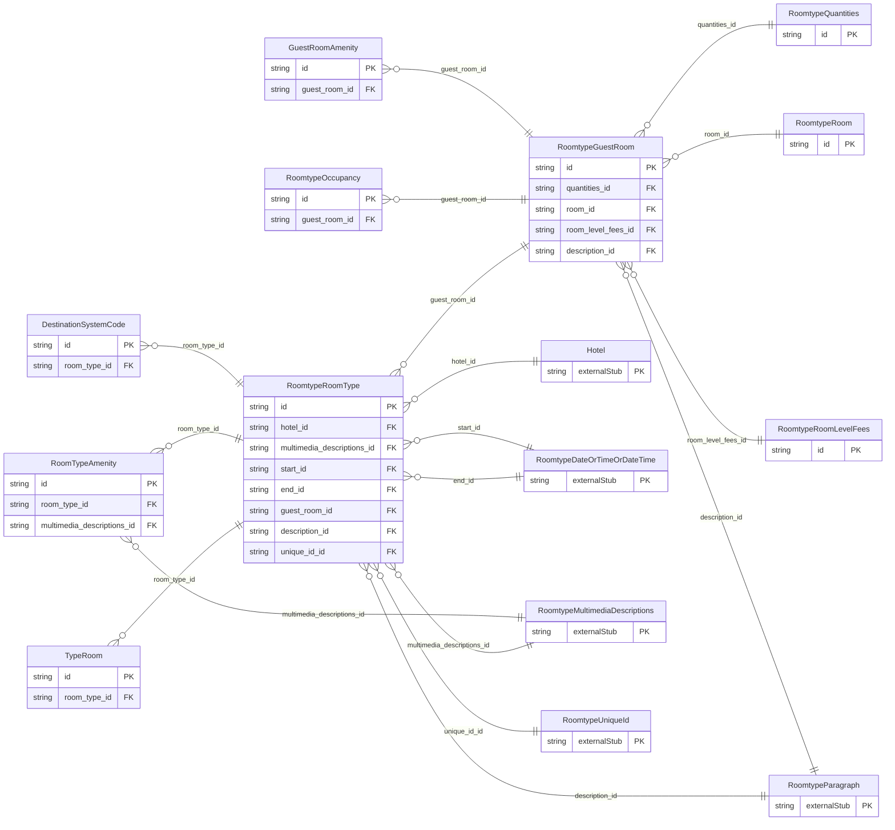

<!-- Code generated by protoc-gen-store. DO NOT EDIT. -->

# `ota/opentravel/hotel/property/room_type/room_type/` — Prisma schema

Generated from Protobuf by protoc-gen-store. Source of truth is the `.proto` files — regenerate rather than editing.

| Models | Enums |
| ---: | ---: |
| 10 | 3 |

## Entity relationships

Schema file: [`room_type.postgres.prisma`](./room_type.postgres.prisma)

### `RoomtypeRoomType` → `resource`

The accommodation occupied by a guest. A collection resource, named "hotels/{hotel}/roomTypes/{room_type}". OTA: OTA_HotelDescriptiveContentNotifRQ/HotelDescriptiveContents/HotelDescriptiveContent/FacilityInfo/GuestRooms/GuestRoom.

| Column | Type | Null |
| --- | --- | --- |
| `id` | `CHAR(26)` | not null |
| `name` | `VARCHAR(255)` | not null |
| `uid` | `VARCHAR(255)` | nullable |
| `etag` | `VARCHAR(255)` | nullable |
| `delete_time` | `TIMESTAMPTZ` | nullable |
| `expire_time` | `TIMESTAMPTZ` | nullable |
| `create_time` | `TIMESTAMPTZ` | not null |
| `update_time` | `TIMESTAMPTZ` | not null |
| `code_context` | `VARCHAR(255)` | nullable |
| `quantity` | `INTEGER` | nullable |
| `uri` | `VARCHAR(255)` | nullable |
| `display_name` | `VARCHAR(255)` | nullable |
| `composite` | `BOOLEAN` | nullable |
| `quality` | `VARCHAR(255)` | nullable |
| `max_occupancy` | `INTEGER` | nullable |
| `min_occupancy` | `INTEGER` | nullable |
| `max_adult_occupancy` | `INTEGER` | nullable |
| `nonsmoking_quantity` | `INTEGER` | nullable |
| `ota_uid` | `VARCHAR(255)` | nullable |
| `max_child_occupancy` | `INTEGER` | nullable |
| `sort` | `INTEGER` | nullable |
| `language_code` | `VARCHAR(255)` | nullable |
| `descriptive_text` | `VARCHAR(255)` | nullable |
| `rph` | `VARCHAR(255)` | nullable |
| `inv_code_application` | `RoomtypeInvCodeApplication` | nullable |
| `inv_code` | `VARCHAR(255)` | nullable |
| `inv_type` | `VARCHAR(255)` | nullable |
| `inv_status_type` | `RoomtypeInvStatusType` | nullable |
| `inv_grouping_code` | `VARCHAR(255)` | nullable |
| `order_sequence` | `INTEGER` | nullable |
| `duration` | `VARCHAR(255)` | nullable |
| `hotel_id` | `CHAR(26)` | not null |
| `multimedia_descriptions_id` | `CHAR(26)` | nullable |
| `start_id` | `CHAR(26)` | nullable |
| `end_id` | `CHAR(26)` | nullable |
| `guest_room_id` | `CHAR(26)` | nullable |
| `description_id` | `CHAR(26)` | nullable |
| `unique_id_id` | `VARCHAR(255)` | nullable |

### `TypeRoom` → `type_rooms`

Describes the guest room type; in composite types there can be multiple occurrences.

| Column | Type | Null |
| --- | --- | --- |
| `id` | `CHAR(26)` | not null |
| `standard_num_beds` | `INTEGER` | nullable |
| `standard_occupancy` | `INTEGER` | nullable |
| `max_rollaways` | `INTEGER` | nullable |
| `size` | `INTEGER` | nullable |
| `type_implied` | `VARCHAR(255)` | nullable |
| `count` | `INTEGER` | nullable |
| `name` | `VARCHAR(255)` | nullable |
| `room_type` | `VARCHAR(255)` | nullable |
| `room_type_code` | `VARCHAR(255)` | nullable |
| `room_category` | `RoomtypeSegmentCategoryCode` | nullable |
| `room_id` | `VARCHAR(255)` | nullable |
| `floor` | `INTEGER` | nullable |
| `inv_block_code` | `VARCHAR(255)` | nullable |
| `promotion_code` | `VARCHAR(255)` | nullable |
| `promotion_vendor_codes` | `VARCHAR(255)[]` | nullable |
| `room_location_code` | `RoomtypeRoomLocationType` | nullable |
| `room_view_code` | `RoomtypeRoomViewType` | nullable |
| `bed_type_codes` | `` | nullable |
| `non_smoking` | `BOOLEAN` | nullable |
| `config` | `VARCHAR(255)` | nullable |
| `size_measurement` | `VARCHAR(255)` | nullable |
| `quantity` | `INTEGER` | nullable |
| `composite` | `BOOLEAN` | nullable |
| `room_classification_code` | `RoomtypeGuestRoomInfo` | nullable |
| `room_architecture_code` | `RoomtypeArchitecturalStyleCode` | nullable |
| `room_gender` | `RoomtypeRoomGender` | nullable |
| `shared_room` | `BOOLEAN` | nullable |
| `max_cribs` | `INTEGER` | nullable |
| `room_type_id` | `CHAR(26)` | not null |

### `RoomTypeAmenity` → `amenities`

Tangible room item(s) (e.g., newspaper) available to the guest.

| Column | Type | Null |
| --- | --- | --- |
| `room_amenity_code` | `RoomtypeRoomAmenityType` | nullable |
| `rate_included_indicator` | `BOOLEAN` | nullable |
| `exists_code` | `VARCHAR(255)` | nullable |
| `code_detail` | `VARCHAR(255)` | nullable |
| `quantity` | `INTEGER` | nullable |
| `id` | `VARCHAR(255)` | not null |
| `descriptive_text` | `VARCHAR(255)` | nullable |
| `room_type_id` | `CHAR(26)` | not null |
| `multimedia_descriptions_id` | `CHAR(26)` | nullable |

### `DestinationSystemCode` → `destination_system_codes`

The destination system code defines a system to which information is to be provided.

| Column | Type | Null |
| --- | --- | --- |
| `id` | `CHAR(26)` | not null |
| `chain_rate_level_cross_ref` | `VARCHAR(255)` | nullable |
| `chain_rate_code_cross_ref` | `VARCHAR(255)` | nullable |
| `value` | `VARCHAR(255)` | nullable |
| `room_type_id` | `CHAR(26)` | not null |

### `RoomtypeGuestRoom` → `guest_rooms`

GuestRoomType is used to contain all the information on a guest room.

| Column | Type | Null |
| --- | --- | --- |
| `id` | `CHAR(26)` | not null |
| `quantities_id` | `CHAR(26)` | nullable |
| `room_id` | `CHAR(26)` | nullable |
| `room_level_fees_id` | `CHAR(26)` | nullable |
| `description_id` | `CHAR(26)` | nullable |

### `RoomtypeQuantities` → `quantities`

Max rollaways, number of beds.

| Column | Type | Null |
| --- | --- | --- |
| `id` | `CHAR(26)` | not null |
| `max_rollaways` | `INTEGER` | nullable |
| `standard_num_beds` | `INTEGER` | nullable |
| `maximum_additional_guests` | `INTEGER` | nullable |
| `min_billable_guests` | `INTEGER` | nullable |
| `max_cribs` | `INTEGER` | nullable |

### `RoomtypeOccupancy` → `occupancies`

Provides parameters of occupancy limits.

| Column | Type | Null |
| --- | --- | --- |
| `id` | `CHAR(26)` | not null |
| `min_occupancy` | `INTEGER` | nullable |
| `max_occupancy` | `INTEGER` | nullable |
| `age_qualifying_code` | `RoomtypeAgeQualifyingCode` | nullable |
| `min_age` | `INTEGER` | nullable |
| `max_age` | `INTEGER` | nullable |
| `age_time_unit` | `RoomtypeTimeUnit` | nullable |
| `age_bucket` | `VARCHAR(255)` | nullable |
| `guest_room_id` | `CHAR(26)` | not null |

### `RoomtypeRoom` → `rooms`

Attributes to describe the room from room category to location to view to bed type.

| Column | Type | Null |
| --- | --- | --- |
| `id` | `CHAR(26)` | not null |
| `room_type` | `VARCHAR(255)` | nullable |
| `room_type_code` | `VARCHAR(255)` | nullable |
| `room_category` | `RoomtypeSegmentCategoryCode` | nullable |
| `room_id` | `VARCHAR(255)` | nullable |
| `floor` | `INTEGER` | nullable |
| `inv_block_code` | `VARCHAR(255)` | nullable |
| `promotion_code` | `VARCHAR(255)` | nullable |
| `promotion_vendor_codes` | `VARCHAR(255)[]` | nullable |
| `room_location_code` | `RoomtypeRoomLocationType` | nullable |
| `room_view_code` | `RoomtypeRoomViewType` | nullable |
| `bed_type_codes` | `` | nullable |
| `non_smoking` | `BOOLEAN` | nullable |
| `config` | `VARCHAR(255)` | nullable |
| `size_measurement` | `VARCHAR(255)` | nullable |
| `quantity` | `INTEGER` | nullable |
| `composite` | `BOOLEAN` | nullable |
| `room_classification_code` | `RoomtypeGuestRoomInfo` | nullable |
| `room_architecture_code` | `RoomtypeArchitecturalStyleCode` | nullable |
| `room_gender` | `RoomtypeRoomGender` | nullable |
| `shared_room` | `BOOLEAN` | nullable |

### `GuestRoomAmenity` → `guest_room_amenities`

Amenity Code Attribute is used to hold actual amenity code.

| Column | Type | Null |
| --- | --- | --- |
| `id` | `CHAR(26)` | not null |
| `amenity_code` | `RoomtypeRoomAmenityType` | nullable |
| `guest_room_id` | `CHAR(26)` | not null |

### `RoomtypeRoomLevelFees` → `room_level_fees`

Collection of fees charged at the room level.

| Column | Type | Null |
| --- | --- | --- |
| `id` | `CHAR(26)` | not null |
| `code` | `VARCHAR(255)` | nullable |
| `code_context` | `VARCHAR(255)` | nullable |
| `quantity` | `INTEGER` | nullable |
| `uri` | `VARCHAR(255)` | nullable |

### Enums

- `RoomtypeInvCodeApplication`: DOES_NOT_APPLY, INV_CODE, INV_GROUPING_CODE
- `RoomtypeInvStatusType`: INITIAL, ACTIVE, DEACTIVATED
- `RoomtypeRoomGender`: MALE, FEMALE, MALE_AND_FEMALE, UNKNOWN
