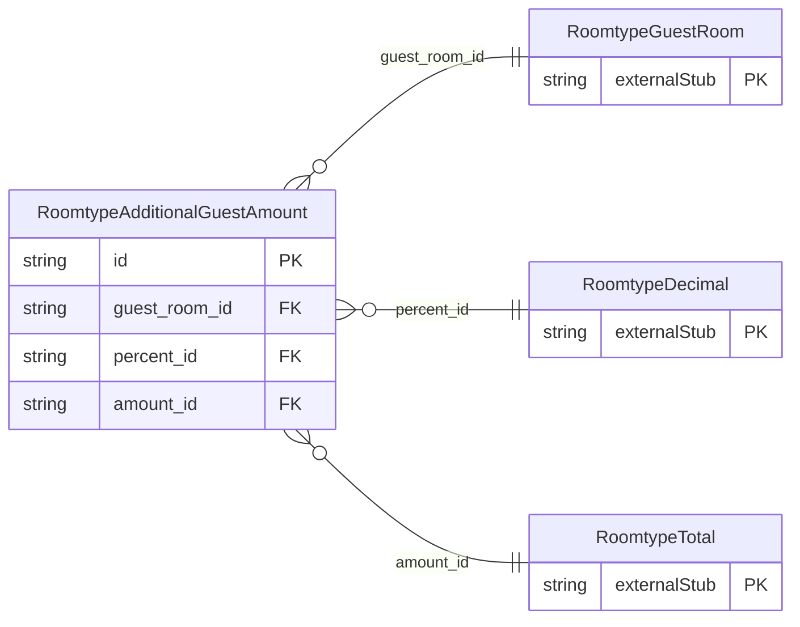

<!-- Code generated by protoc-gen-store. DO NOT EDIT. -->

# `ota/opentravel/hotel/property/room_type/v1/types/additional_guest_amount/` — Prisma schema

Generated from Protobuf by protoc-gen-store. Source of truth is the `.proto` files — regenerate rather than editing.

| Models | Enums |
| ---: | ---: |
| 1 | 0 |

## Entity relationships

Schema file: [`additional_guest_amount.postgres.prisma`](./additional_guest_amount.postgres.prisma)

### `RoomtypeAdditionalGuestAmount` → `additional_guest_amounts`

Charges related to additional guests.

| Column | Type | Null |
| --- | --- | --- |
| `id` | `CHAR(26)` | not null |
| `max_additional_guests` | `INTEGER` | nullable |
| `age_qualifying_code` | `RoomtypeAgeQualifyingCode` | nullable |
| `min_age` | `INTEGER` | nullable |
| `max_age` | `INTEGER` | nullable |
| `age_time_unit` | `RoomtypeTimeUnit` | nullable |
| `age_bucket` | `VARCHAR(255)` | nullable |
| `type` | `RoomtypeAdditionalDetailType` | nullable |
| `rph` | `VARCHAR(255)` | nullable |
| `guest_room_id` | `CHAR(26)` | not null |
| `percent_id` | `CHAR(26)` | nullable |
| `amount_id` | `CHAR(26)` | not null |
