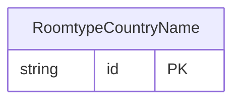

<!-- Code generated by protoc-gen-store. DO NOT EDIT. -->

# `ota/opentravel/hotel/property/room_type/v1/types/country_name/` — Prisma schema

Generated from Protobuf by protoc-gen-store. Source of truth is the `.proto` files — regenerate rather than editing.

| Models | Enums |
| ---: | ---: |
| 1 | 0 |

## Entity relationships

Schema file: [`country_name.postgres.prisma`](./country_name.postgres.prisma)

### `RoomtypeCountryName` → `country_names`

The name or code of a country (e.g. as used in an address or to specify citizenship of a traveller).

| Column | Type | Null |
| --- | --- | --- |
| `id` | `CHAR(26)` | not null |
| `region_code` | `VARCHAR(255)` | nullable |
| `value` | `VARCHAR(255)` | nullable |
