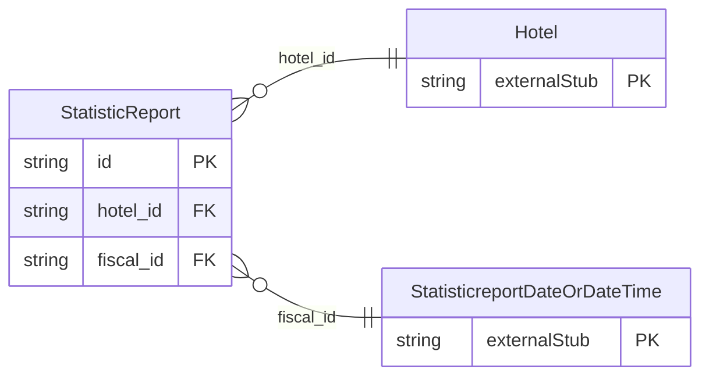

<!-- Code generated by protoc-gen-store. DO NOT EDIT. -->

# `ota/opentravel/hotel/reporting/statistic_report/statistic_report/` — Prisma schema

Generated from Protobuf by protoc-gen-store. Source of truth is the `.proto` files — regenerate rather than editing.

| Models | Enums |
| ---: | ---: |
| 1 | 0 |

## Entity relationships

Schema file: [`statistic_report.postgres.prisma`](./statistic_report.postgres.prisma)

### `StatisticReport` → `resource`

Used to define the report fiscal date, report code, and the hotel(s) for which data is being reported. A collection resource, named "hotels/{hotel}/statisticReports/{statistic_report}". OTA: OTA_HotelStatsNotifRQ/Statistics/Statistic.

| Column | Type | Null |
| --- | --- | --- |
| `id` | `CHAR(26)` | not null |
| `name` | `VARCHAR(255)` | not null |
| `uid` | `VARCHAR(255)` | nullable |
| `etag` | `VARCHAR(255)` | nullable |
| `delete_time` | `TIMESTAMPTZ` | nullable |
| `expire_time` | `TIMESTAMPTZ` | nullable |
| `create_time` | `TIMESTAMPTZ` | not null |
| `update_time` | `TIMESTAMPTZ` | not null |
| `report_code` | `VARCHAR(255)` | nullable |
| `hotel_id` | `CHAR(26)` | not null |
| `fiscal_id` | `CHAR(26)` | nullable |
