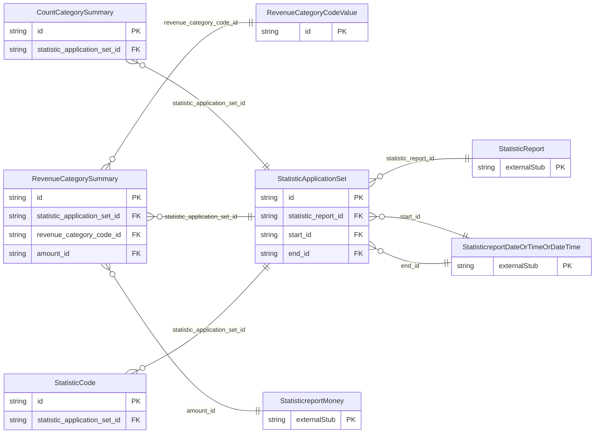

<!-- Code generated by protoc-gen-store. DO NOT EDIT. -->

# `ota/opentravel/hotel/reporting/statistic_report/v1/types/statistic_application_set/` — Prisma schema

Generated from Protobuf by protoc-gen-store. Source of truth is the `.proto` files — regenerate rather than editing.

| Models | Enums |
| ---: | ---: |
| 5 | 1 |

## Entity relationships

Schema file: [`statistic_application_set.postgres.prisma`](./statistic_application_set.postgres.prisma)

### `StatisticApplicationSet` → `statistic_application_sets`

Includes the statistic data reported and the codes for which it has been aggregated, if applicable. The applicable date range for the data is defined in its attributes.

| Column | Type | Null |
| --- | --- | --- |
| `id` | `CHAR(26)` | not null |
| `duration` | `VARCHAR(255)` | nullable |
| `statistic_report_id` | `CHAR(26)` | not null |
| `start_id` | `CHAR(26)` | nullable |
| `end_id` | `CHAR(26)` | nullable |

### `StatisticCode` → `statistic_codes`

Defines the codes and corresponding categories for which the data in the other elements has been gathered.

| Column | Type | Null |
| --- | --- | --- |
| `id` | `CHAR(26)` | not null |
| `stat_code` | `VARCHAR(255)` | nullable |
| `stat_category_code` | `VARCHAR(255)` | nullable |
| `statistic_application_set_id` | `CHAR(26)` | not null |

### `RevenueCategorySummary` → `revenue_category_summaries`

This element has revenue amount data for its revenue category, identified using OpenTravel Code List RCC, such as Room Revenue, Food and Beverage Revenue.

| Column | Type | Null |
| --- | --- | --- |
| `id` | `CHAR(26)` | not null |
| `statistic_application_set_id` | `CHAR(26)` | not null |
| `revenue_category_code_id` | `CHAR(26)` | nullable |
| `amount_id` | `CHAR(26)` | nullable |

### `CountCategorySummary` → `count_category_summaries`

This element has count data for each count category, identified using OpenTravel Code List CNT, such as number of guests, rooms occupied, etc.

| Column | Type | Null |
| --- | --- | --- |
| `id` | `CHAR(26)` | not null |
| `summary_count` | `INTEGER` | nullable |
| `count_category_code` | `CountCategory` | nullable |
| `statistic_application_set_id` | `CHAR(26)` | not null |

### `RevenueCategoryCodeValue` → `revenue_category_code_values`

Revenue category code value.

| Column | Type | Null |
| --- | --- | --- |
| `id` | `CHAR(26)` | not null |
| `revenue_category_code` | `StatisticreportRevenueCategoryCode` | nullable |
| `text` | `VARCHAR(255)` | nullable |
| `value_case` | `RevenueCategoryCodeValueValueCase` | nullable |

### Enums

- `RevenueCategoryCodeValueValueCase`: REVENUE_CATEGORY_CODE, TEXT
