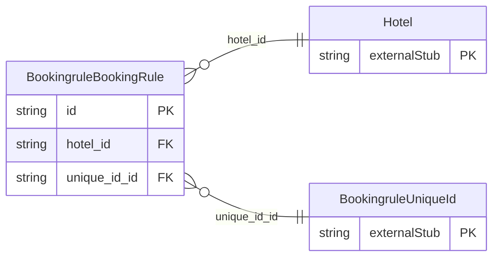

<!-- Code generated by protoc-gen-store. DO NOT EDIT. -->

# `ota/opentravel/hotel/revenue/booking_rule/booking_rule/` — Prisma schema

Generated from Protobuf by protoc-gen-store. Source of truth is the `.proto` files — regenerate rather than editing.

| Models | Enums |
| ---: | ---: |
| 1 | 0 |

## Entity relationships

Schema file: [`booking_rule.postgres.prisma`](./booking_rule.postgres.prisma)

### `BookingruleBookingRule` → `resource`

Container for the collection of Booking Rules for a given hotel or chain. A collection resource, named "hotels/{hotel}/ratePlans/{rate_plan}/bookingRules/{booking_rule}". OTA: OTA_HotelBookingRuleNotifRQ/RuleMessages/RuleMessage.

| Column | Type | Null |
| --- | --- | --- |
| `id` | `CHAR(26)` | not null |
| `name` | `VARCHAR(255)` | not null |
| `uid` | `VARCHAR(255)` | nullable |
| `etag` | `VARCHAR(255)` | nullable |
| `delete_time` | `TIMESTAMPTZ` | nullable |
| `expire_time` | `TIMESTAMPTZ` | nullable |
| `create_time` | `TIMESTAMPTZ` | not null |
| `update_time` | `TIMESTAMPTZ` | not null |
| `hotel_id` | `CHAR(26)` | not null |
| `rate_plan_id` | `CHAR(26)` | not null |
| `unique_id_id` | `VARCHAR(255)` | nullable |
