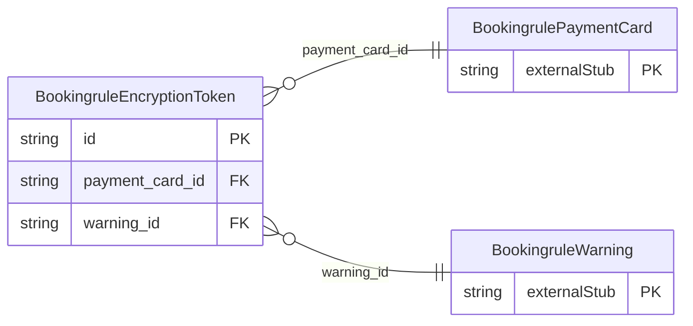

<!-- Code generated by protoc-gen-store. DO NOT EDIT. -->

# `ota/opentravel/hotel/revenue/booking_rule/v1/types/encryption_token/` — Prisma schema

Generated from Protobuf by protoc-gen-store. Source of truth is the `.proto` files — regenerate rather than editing.

| Models | Enums |
| ---: | ---: |
| 1 | 1 |

## Entity relationships

Schema file: [`encryption_token.postgres.prisma`](./encryption_token.postgres.prisma)

### `BookingruleEncryptionToken` → `encryption_tokens`

Secure information that supports PCI tokens, data masking and other encryption methods. OpenTravel Best Practice: Use of Encrypted, Masked or Tokenized Information: Certain OpenTravel schema may have combinations payment and/or account information with other personally identifying information, such as customer name and date of birth. For enhanced customer privacy and security, it is RECOMMENDED that the payment and account information be protected, using tokenization or some other encryption method and displayed in a masked format.

| Column | Type | Null |
| --- | --- | --- |
| `id` | `CHAR(26)` | not null |
| `encryption_key` | `VARCHAR(255)` | nullable |
| `encryption_key_method` | `VARCHAR(255)` | nullable |
| `encryption_method` | `VARCHAR(255)` | nullable |
| `encrypted_value` | `VARCHAR(255)` | nullable |
| `mask` | `VARCHAR(255)` | nullable |
| `token` | `VARCHAR(255)` | nullable |
| `token_provider_id` | `VARCHAR(255)` | nullable |
| `authentication_method` | `BookingruleAuthenticationMethod` | nullable |
| `plain_text` | `VARCHAR(255)` | nullable |
| `payment_card_id` | `CHAR(26)` | not null |
| `warning_id` | `CHAR(26)` | nullable |

### Enums

- `BookingruleAuthenticationMethod`: SECURITY_CODE, MAGNETIC_STRIPE
