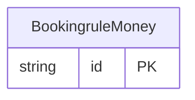

<!-- Code generated by protoc-gen-store. DO NOT EDIT. -->

# `ota/opentravel/hotel/revenue/booking_rule/v1/types/money/` — Prisma schema

Generated from Protobuf by protoc-gen-store. Source of truth is the `.proto` files — regenerate rather than editing.

| Models | Enums |
| ---: | ---: |
| 1 | 0 |

## Entity relationships

Schema file: [`money.postgres.prisma`](./money.postgres.prisma)

### `BookingruleMoney` → `moneys`

An amount of money in a currency, after google.type.Money. OTA's Amount, CurrencyCode and DecimalPlaces become this: DecimalPlaces scales an integral Amount (8500 with DecimalPlaces 2 is 85.00), so it is applied on the way in and not kept. See docs/conventions.md rule 13.

| Column | Type | Null |
| --- | --- | --- |
| `id` | `CHAR(26)` | not null |
| `currency_code` | `VARCHAR(255)` | nullable |
| `units` | `BIGINT` | nullable |
| `nano_units` | `INTEGER` | nullable |
