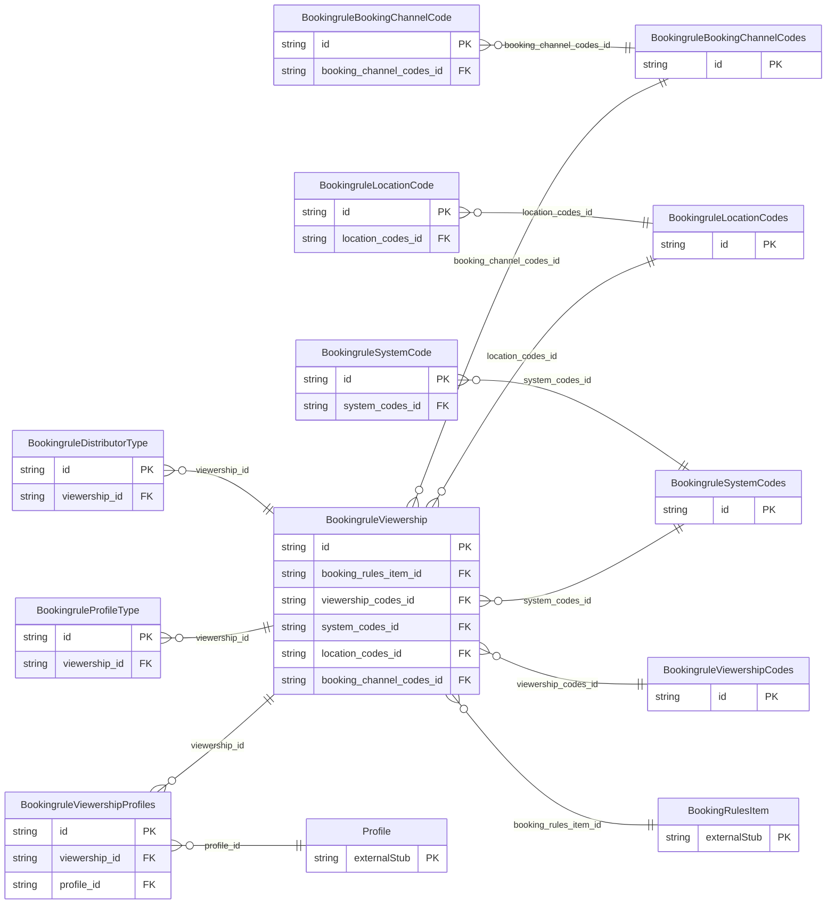

<!-- Code generated by protoc-gen-store. DO NOT EDIT. -->

# `ota/opentravel/hotel/revenue/booking_rule/v1/types/viewership/` — Prisma schema

Generated from Protobuf by protoc-gen-store. Source of truth is the `.proto` files — regenerate rather than editing.

| Models | Enums |
| ---: | ---: |
| 11 | 0 |

## Entity relationships

Schema file: [`viewership.postgres.prisma`](./viewership.postgres.prisma)

### `BookingruleViewership` → `viewerships`

Viewership defines a system that is allowed to view the rateplan identified in a Hotel Rate Plan Notification message. This may also be used to define a system that is able to view the hotel content.

| Column | Type | Null |
| --- | --- | --- |
| `id` | `CHAR(26)` | not null |
| `viewership_rph` | `VARCHAR(255)` | nullable |
| `view_only` | `BOOLEAN` | nullable |
| `booking_rules_item_id` | `CHAR(26)` | not null |
| `viewership_codes_id` | `CHAR(26)` | nullable |
| `system_codes_id` | `CHAR(26)` | nullable |
| `location_codes_id` | `CHAR(26)` | nullable |
| `booking_channel_codes_id` | `CHAR(26)` | nullable |

### `BookingruleViewershipCodes` → `viewership_codes`

A collection of Viewship codes

| Column | Type | Null |
| --- | --- | --- |
| `id` | `CHAR(26)` | not null |
| `viewership_code` | `VARCHAR(255)` | not null |

### `BookingruleSystemCodes` → `system_codes`

A collection of system codes.

| Column | Type | Null |
| --- | --- | --- |
| `id` | `CHAR(26)` | not null |
| `system_codes_inclusive` | `BOOLEAN` | nullable |

### `BookingruleProfileType` → `profile_types`

Profile types associated with the viewership, i.e, the types of profiles allowed to view this information. Please refer the OpenTravel Code List PRT.

| Column | Type | Null |
| --- | --- | --- |
| `id` | `CHAR(26)` | not null |
| `profile_type` | `BookingruleCodesProfileType` | nullable |
| `viewership_id` | `CHAR(26)` | not null |

### `BookingruleLocationCodes` → `location_codes`

A collections of strings that identify the locations, such as regions or countries, etc., associated with this viewership record.

| Column | Type | Null |
| --- | --- | --- |
| `id` | `CHAR(26)` | not null |
| `location_codes_inclusive` | `BOOLEAN` | nullable |

### `BookingruleBookingChannelCodes` → `booking_channel_codes`

A collections of strings that identify booking channels, such as GDSs or Internet sites, etc., associated with this viewership record.

| Column | Type | Null |
| --- | --- | --- |
| `id` | `CHAR(26)` | not null |
| `channel_codes_inclusive` | `BOOLEAN` | nullable |

### `BookingruleDistributorType` → `distributor_types`

Distributor type.

| Column | Type | Null |
| --- | --- | --- |
| `id` | `CHAR(26)` | not null |
| `distributor_code` | `VARCHAR(255)` | nullable |
| `distributor_type_code` | `VARCHAR(255)` | nullable |
| `value` | `VARCHAR(255)` | nullable |
| `viewership_id` | `CHAR(26)` | not null |

### `BookingruleSystemCode` → `system_code`

The system code (e.g., AA, 1P, 1G, 1A) associated with this viewership record.

| Column | Type | Null |
| --- | --- | --- |
| `id` | `CHAR(26)` | not null |
| `restricted_display_indicator` | `BOOLEAN` | nullable |
| `sort` | `INTEGER` | nullable |
| `value` | `VARCHAR(255)` | nullable |
| `system_codes_id` | `CHAR(26)` | not null |

### `BookingruleLocationCode` → `location_code`

Location code.

| Column | Type | Null |
| --- | --- | --- |
| `id` | `CHAR(26)` | not null |
| `city_code` | `VARCHAR(255)` | nullable |
| `state_province_code` | `VARCHAR(255)` | nullable |
| `region_code` | `VARCHAR(255)` | nullable |
| `location_codes_id` | `CHAR(26)` | not null |

### `BookingruleBookingChannelCode` → `booking_channel_code`

Specific code in relation to POS booking source (e.g. Expedia, hotels.com, etc.).

| Column | Type | Null |
| --- | --- | --- |
| `id` | `CHAR(26)` | not null |
| `restricted_display_indicator` | `BOOLEAN` | nullable |
| `sort` | `INTEGER` | nullable |
| `value` | `VARCHAR(255)` | nullable |
| `booking_channel_codes_id` | `CHAR(26)` | not null |

### `BookingruleViewershipProfiles` → `viewership_profiles`

Join table for the many-to-many relation Viewership.profiles ↔ Profile.

| Column | Type | Null |
| --- | --- | --- |
| `id` | `CHAR(26)` | not null |
| `viewership_id` | `CHAR(26)` | not null |
| `profile_id` | `CHAR(26)` | not null |
