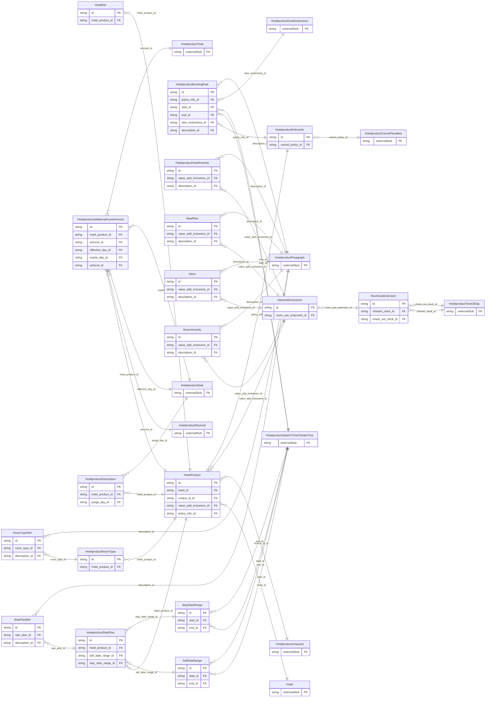

<!-- Code generated by protoc-gen-store. DO NOT EDIT. -->

# `ota/opentravel/hotel/revenue/hotel_product/hotel_product/` — Prisma schema

Generated from Protobuf by protoc-gen-store. Source of truth is the `.proto` files — regenerate rather than editing.

| Models | Enums |
| ---: | ---: |
| 18 | 3 |

## Entity relationships

Schema file: [`hotel_product.postgres.prisma`](./hotel_product.postgres.prisma)

### `HotelProduct` → `resource`

Specifies product information for a hotel. A product may be a room type, a rate plan, a room type rate plan combination or hotel policy information. This may be used for sending products at multiple hotels or multiple products at a single hotel. A collection resource, named "hotels/{hotel}/hotelProducts/{hotel_product}". OTA: OTA_HotelProductNotifRQ/HotelProducts/HotelProduct.

| Column | Type | Null |
| --- | --- | --- |
| `id` | `CHAR(26)` | not null |
| `name` | `VARCHAR(255)` | not null |
| `uid` | `VARCHAR(255)` | nullable |
| `etag` | `VARCHAR(255)` | nullable |
| `delete_time` | `TIMESTAMPTZ` | nullable |
| `expire_time` | `TIMESTAMPTZ` | nullable |
| `create_time` | `TIMESTAMPTZ` | not null |
| `update_time` | `TIMESTAMPTZ` | not null |
| `product_status_type` | `ProductStatusType` | nullable |
| `hotel_id` | `CHAR(26)` | not null |
| `unique_id_id` | `VARCHAR(255)` | nullable |
| `value_add_inclusions_id` | `CHAR(26)` | nullable |
| `policy_info_id` | `CHAR(26)` | nullable |

### `HotelRef` → `hotel_refs`

Identifies hotel information for an alternate system.

| Column | Type | Null |
| --- | --- | --- |
| `id` | `CHAR(26)` | not null |
| `chain_code` | `VARCHAR(255)` | nullable |
| `brand_code` | `VARCHAR(255)` | nullable |
| `hotel_code` | `VARCHAR(255)` | nullable |
| `hotel_city_code` | `VARCHAR(255)` | nullable |
| `hotel_display_name` | `VARCHAR(255)` | nullable |
| `hotel_code_context` | `VARCHAR(255)` | nullable |
| `chain_display_name` | `VARCHAR(255)` | nullable |
| `brand_display_name` | `VARCHAR(255)` | nullable |
| `area_id` | `VARCHAR(255)` | nullable |
| `tt_icode` | `INTEGER` | nullable |
| `hotel_product_id` | `CHAR(26)` | not null |

### `HotelproductRoomType` → `room_types`

An individual room type.

| Column | Type | Null |
| --- | --- | --- |
| `id` | `CHAR(26)` | not null |
| `room_type_display_name` | `VARCHAR(255)` | nullable |
| `room_type_code` | `VARCHAR(255)` | nullable |
| `bed_type_codes` | `` | nullable |
| `non_smoking` | `BOOLEAN` | nullable |
| `max_occupancy` | `INTEGER` | nullable |
| `max_adult_occupancy` | `INTEGER` | nullable |
| `max_child_occupancy` | `INTEGER` | nullable |
| `max_infant_occupancy` | `INTEGER` | nullable |
| `room_location` | `HotelproductRoomLocationType` | nullable |
| `feature_amenities` | `` | nullable |
| `room_view` | `HotelproductRoomViewType` | nullable |
| `room_qualities` | `` | nullable |
| `bedroom_count` | `INTEGER` | nullable |
| `accessible` | `BOOLEAN` | nullable |
| `room_gender` | `HotelproductRoomGender` | nullable |
| `hotel_product_id` | `CHAR(26)` | not null |

### `HotelproductRatePlan` → `rate_plans`

An individual rate plan.

| Column | Type | Null |
| --- | --- | --- |
| `id` | `CHAR(26)` | not null |
| `rate_plan_type` | `HotelproductRatePlanType` | nullable |
| `rate_plan_display_name` | `VARCHAR(255)` | nullable |
| `rate_plan_code` | `VARCHAR(255)` | nullable |
| `currency_code` | `VARCHAR(255)` | nullable |
| `payment_collection` | `PaymentCollection` | nullable |
| `base_occupancy` | `INTEGER` | nullable |
| `hotel_product_id` | `CHAR(26)` | not null |
| `sell_date_range_id` | `CHAR(26)` | nullable |
| `stay_date_range_id` | `CHAR(26)` | nullable |

### `ValueAddInclusions` → `value_add_inclusions`

Identifies items that are included with this product that add value or differentiate this product from other products at no additional charge (i.e. breakfast, internet, parking).

| Column | Type | Null |
| --- | --- | --- |
| `id` | `CHAR(26)` | not null |
| `room_use_extension_id` | `CHAR(26)` | nullable |

### `HotelproductPolicyInfo` → `policy_infos`

Policy Information for this product.

| Column | Type | Null |
| --- | --- | --- |
| `id` | `CHAR(26)` | not null |
| `cancel_policy_id` | `CHAR(26)` | nullable |

### `HotelproductDescription` → `descriptions`

Descriptive information for the product.

| Column | Type | Null |
| --- | --- | --- |
| `id` | `CHAR(26)` | not null |
| `name` | `VARCHAR(255)` | nullable |
| `paragraph_number` | `INTEGER` | nullable |
| `create_date_time` | `TIMESTAMPTZ` | nullable |
| `creator_id` | `VARCHAR(255)` | nullable |
| `last_modify_date_time` | `TIMESTAMPTZ` | nullable |
| `last_modifier_id` | `VARCHAR(255)` | nullable |
| `language_code` | `VARCHAR(255)` | nullable |
| `images` | `VARCHAR(255)[]` | nullable |
| `uris` | `VARCHAR(255)[]` | nullable |
| `hotel_product_id` | `CHAR(26)` | not null |
| `purge_day_id` | `CHAR(26)` | nullable |

### `HotelproductAdditionalGuestAmount` → `additional_guest_amounts`

Charges related to additional guests.

| Column | Type | Null |
| --- | --- | --- |
| `id` | `CHAR(26)` | not null |
| `max_additional_guests` | `INTEGER` | nullable |
| `age_qualifying_code` | `HotelproductAgeQualifyingCode` | nullable |
| `min_age` | `INTEGER` | nullable |
| `max_age` | `INTEGER` | nullable |
| `age_time_unit` | `HotelproductTimeUnit` | nullable |
| `age_bucket` | `VARCHAR(255)` | nullable |
| `type` | `HotelproductAdditionalDetailType` | nullable |
| `rph` | `VARCHAR(255)` | nullable |
| `expire_date_exclusive` | `BOOLEAN` | nullable |
| `hotel_product_id` | `CHAR(26)` | not null |
| `percent_id` | `CHAR(26)` | nullable |
| `effective_day_id` | `CHAR(26)` | nullable |
| `expire_day_id` | `CHAR(26)` | nullable |
| `amount_id` | `CHAR(26)` | not null |

### `RoomTypeRef` → `room_type_refs`

Specifies the room type code for other systems.

| Column | Type | Null |
| --- | --- | --- |
| `id` | `CHAR(26)` | not null |
| `room_type_code` | `VARCHAR(255)` | nullable |
| `room_type_code_context` | `VARCHAR(255)` | nullable |
| `room_type_id` | `CHAR(26)` | not null |
| `description_id` | `CHAR(26)` | nullable |

### `SellDateRange` → `sell_date_ranges`

The date range for which this rate plan is offered for sell.

| Column | Type | Null |
| --- | --- | --- |
| `id` | `CHAR(26)` | not null |
| `duration` | `VARCHAR(255)` | nullable |
| `start_id` | `CHAR(26)` | nullable |
| `end_id` | `CHAR(26)` | nullable |

### `StayDateRange` → `stay_date_ranges`

The date range for which this rate plan is offered for guest stays.

| Column | Type | Null |
| --- | --- | --- |
| `id` | `CHAR(26)` | not null |
| `duration` | `VARCHAR(255)` | nullable |
| `start_id` | `CHAR(26)` | nullable |
| `end_id` | `CHAR(26)` | nullable |

### `RatePlanRef` → `rate_plan_refs`

Specifies the rate plan code for other systems.

| Column | Type | Null |
| --- | --- | --- |
| `id` | `CHAR(26)` | not null |
| `rate_plan_code` | `VARCHAR(255)` | nullable |
| `rate_plan_code_context` | `VARCHAR(255)` | nullable |
| `rate_plan_id` | `CHAR(26)` | not null |
| `description_id` | `CHAR(26)` | nullable |

### `HotelproductHotelAmenity` → `hotel_amenities`

Used to identify hotel amentities that are included with a product.

| Column | Type | Null |
| --- | --- | --- |
| `id` | `CHAR(26)` | not null |
| `hotel_amenity_code` | `HotelproductHotelAmenityCode` | nullable |
| `code_detail` | `VARCHAR(255)` | nullable |
| `max_number_provided` | `INTEGER` | nullable |
| `value_add_inclusions_id` | `CHAR(26)` | not null |
| `description_id` | `CHAR(26)` | nullable |

### `MealPlan` → `meal_plans`

Used to identify the types of meals included with a product.

| Column | Type | Null |
| --- | --- | --- |
| `id` | `CHAR(26)` | not null |
| `meal_plan_code` | `MealPlanType` | nullable |
| `code_detail` | `VARCHAR(255)` | nullable |
| `max_number_provided` | `INTEGER` | nullable |
| `value_add_inclusions_id` | `CHAR(26)` | not null |
| `description_id` | `CHAR(26)` | nullable |

### `RoomAmenity` → `room_amenities`

Used to identify room amenities that are included with the product.

| Column | Type | Null |
| --- | --- | --- |
| `id` | `CHAR(26)` | not null |
| `room_amenity_code` | `HotelproductRoomAmenityType` | nullable |
| `code_detail` | `VARCHAR(255)` | nullable |
| `max_number_provided` | `INTEGER` | nullable |
| `value_add_inclusions_id` | `CHAR(26)` | not null |
| `description_id` | `CHAR(26)` | nullable |

### `Other` → `others`

Used to identify other value add inclusions that are included with the product.

| Column | Type | Null |
| --- | --- | --- |
| `id` | `CHAR(26)` | not null |
| `code` | `VARCHAR(255)` | nullable |
| `code_context` | `VARCHAR(255)` | nullable |
| `uri` | `VARCHAR(255)` | nullable |
| `code_detail` | `VARCHAR(255)` | nullable |
| `max_number_provided` | `INTEGER` | nullable |
| `value_add_inclusions_id` | `CHAR(26)` | not null |
| `description_id` | `CHAR(26)` | nullable |

### `RoomUseExtension` → `room_use_extensions`

Identifies the CheckIn and/or CheckOut time available for this product.

| Column | Type | Null |
| --- | --- | --- |
| `id` | `CHAR(26)` | not null |
| `checkin_clock_id` | `CHAR(26)` | nullable |
| `check_out_clock_id` | `CHAR(26)` | nullable |

### `HotelproductBookingRule` → `booking_rules`

The BookingRule element defines restrictions to rates and stays at the hotel for a given rate plan, room type or rate plan/room type combination.

| Column | Type | Null |
| --- | --- | --- |
| `id` | `CHAR(26)` | not null |
| `duration` | `VARCHAR(255)` | nullable |
| `weekdays` | `` | nullable |
| `max_advanced_booking_offset` | `VARCHAR(255)` | nullable |
| `min_advanced_booking_offset` | `VARCHAR(255)` | nullable |
| `max_stay_lengths` | `VARCHAR(255)` | nullable |
| `min_stay_lengths` | `VARCHAR(255)` | nullable |
| `policy_info_id` | `CHAR(26)` | not null |
| `start_id` | `CHAR(26)` | nullable |
| `end_id` | `CHAR(26)` | nullable |
| `dow_restrictions_id` | `CHAR(26)` | nullable |
| `description_id` | `CHAR(26)` | nullable |

### Enums

- `ProductStatusType`: INITIAL, ACTIVE, DEACTIVIATED
- `HotelproductRoomGender`: MALE, FEMALE, MALE_AND_FEMALE, UNKNOWN
- `PaymentCollection`: HOTEL, TRAVEL_AGENCY, HOTEL_OR_AGENCY
