<!-- Code generated by protoc-gen-store. DO NOT EDIT. -->

# `ota/opentravel/hotel/revenue/hotel_product/v1/types/accepted_payment/` — Prisma schema

Generated from Protobuf by protoc-gen-store. Source of truth is the `.proto` files — regenerate rather than editing.

| Models | Enums |
| ---: | ---: |
| 30 | 15 |

## Entity relationships

```mermaid
erDiagram
    direction LR
    HotelproductAcceptedPayment {
        string id PK
        string guarantee_payment_id FK
        string payment_card_id FK
        string bank_acct_id FK
        string direct_bill_id FK
        string voucher_id FK
        string loyalty_redemption_id FK
        string misc_charge_order_id FK
        string ticket_id FK
        string cash_id FK
    }
    HotelproductAddress {
        string id PK
        string street_nmbr_id FK
        string state_prov_id FK
        string country_display_name_id FK
    }
    HotelproductAddressInfo {
        string id PK
        string contact_person_id FK
        string street_nmbr_id FK
        string state_prov_id FK
        string country_display_name_id FK
    }
    HotelproductAuthenticationVerificationValue {
        string id PK
        string secure_id FK
    }
    HotelproductBankAcct {
        string id PK
        string bank_acct_number_id FK
        string bank_id_id FK
        string type_id FK
    }
    HotelproductBillingAccountName {
        string id PK
    }
    HotelproductBldgRoom {
        string id PK
        string address_info_id FK
        string address_id FK
    }
    HotelproductCash {
        string id PK
    }
    HotelproductConjunctionTicketNbr {
        string id PK
        string ticket_id FK
    }
    HotelproductCustLoyalty {
        string id PK
        string payment_card_id FK
        string signup_day_id FK
        string effective_day_id FK
        string expire_day_id FK
    }
    HotelproductDirectBill {
        string id PK
        string company_display_name_id FK
        string address_id FK
        string email_id FK
        string telephone_id FK
    }
    HotelproductDirectBillCompanyName {
        string id PK
    }
    HotelproductDirectBillTelephone {
        string id PK
    }
    HotelproductDocument {
        string id PK
    }
    HotelproductEmail {
        string id PK
        string contact_person_id FK
        string payment_card_id FK
    }
    HotelproductGateway {
        string id PK
        string authentication_verification_value_id FK
        string transaction_password_id FK
    }
    HotelproductIssuer {
        string id PK
    }
    HotelproductLoyaltyCertificate {
        string id PK
        string loyalty_redemption_id FK
        string effective_day_id FK
        string expire_day_id FK
    }
    HotelproductLoyaltyRedemption {
        string id PK
    }
    HotelproductMiscChargeOrder {
        string id PK
        string original_issue_day_id FK
    }
    HotelproductPaymentCard {
        string id PK
        string card_code_id FK
        string card_type_id FK
        string issuer_id FK
        string card_holder_name_details_id FK
        string address_id FK
        string card_number_id FK
        string series_code_id FK
        string three_domain_security_id FK
        string signature_on_file_id FK
    }
    HotelproductPaymentCardTelephone {
        string id PK
        string payment_card_id FK
    }
    HotelproductPersonName {
        string id PK
        string document_id FK
    }
    HotelproductResults {
        string id PK
    }
    HotelproductSignatureOnFile {
        string id PK
        string effective_day_id FK
        string expire_day_id FK
    }
    HotelproductStreetNmbr {
        string id PK
    }
    HotelproductThreeDomainSecurity {
        string id PK
        string gateway_id FK
        string results_id FK
    }
    HotelproductTicket {
        string id PK
        string original_issue_day_id FK
    }
    HotelproductTransactionPassword {
        string id PK
        string secure_id FK
    }
    HotelproductVoucher {
        string id PK
        string effective_day_id FK
        string expire_day_id FK
        string billing_account_display_name_id FK
        string billing_account_address_id FK
    }
    HotelproductContactPerson {
        string externalStub PK
    }
    HotelproductCountryName {
        string externalStub PK
    }
    HotelproductDate {
        string externalStub PK
    }
    HotelproductEncryptionToken {
        string externalStub PK
    }
    HotelproductGuaranteePayment {
        string externalStub PK
    }
    HotelproductGuaranteePaymentAddress {
        string externalStub PK
    }
    HotelproductListBankAccount {
        string externalStub PK
    }
    HotelproductListPaymentCardIssuer {
        string externalStub PK
    }
    HotelproductPaymentCardCode {
        string externalStub PK
    }
    HotelproductStateProv {
        string externalStub PK
    }
    HotelproductAcceptedPayment }o--|| HotelproductGuaranteePayment : "guarantee_payment_id"
    HotelproductAcceptedPayment }o--|| HotelproductPaymentCard : "payment_card_id"
    HotelproductAcceptedPayment }o--|| HotelproductBankAcct : "bank_acct_id"
    HotelproductAcceptedPayment }o--|| HotelproductDirectBill : "direct_bill_id"
    HotelproductAcceptedPayment }o--|| HotelproductVoucher : "voucher_id"
    HotelproductAcceptedPayment }o--|| HotelproductLoyaltyRedemption : "loyalty_redemption_id"
    HotelproductAcceptedPayment }o--|| HotelproductMiscChargeOrder : "misc_charge_order_id"
    HotelproductAcceptedPayment }o--|| HotelproductTicket : "ticket_id"
    HotelproductAcceptedPayment }o--|| HotelproductCash : "cash_id"
    HotelproductAddress }o--|| HotelproductStreetNmbr : "street_nmbr_id"
    HotelproductAddress }o--|| HotelproductStateProv : "state_prov_id"
    HotelproductAddress }o--|| HotelproductCountryName : "country_display_name_id"
    HotelproductAddressInfo }o--|| HotelproductContactPerson : "contact_person_id"
    HotelproductAddressInfo }o--|| HotelproductStreetNmbr : "street_nmbr_id"
    HotelproductAddressInfo }o--|| HotelproductStateProv : "state_prov_id"
    HotelproductAddressInfo }o--|| HotelproductCountryName : "country_display_name_id"
    HotelproductAuthenticationVerificationValue }o--|| HotelproductEncryptionToken : "secure_id"
    HotelproductBankAcct }o--|| HotelproductEncryptionToken : "bank_acct_number_id"
    HotelproductBankAcct }o--|| HotelproductEncryptionToken : "bank_id_id"
    HotelproductBankAcct }o--|| HotelproductListBankAccount : "type_id"
    HotelproductBldgRoom }o--|| HotelproductAddressInfo : "address_info_id"
    HotelproductBldgRoom }o--|| HotelproductGuaranteePaymentAddress : "address_id"
    HotelproductConjunctionTicketNbr }o--|| HotelproductTicket : "ticket_id"
    HotelproductCustLoyalty }o--|| HotelproductPaymentCard : "payment_card_id"
    HotelproductCustLoyalty }o--|| HotelproductDate : "signup_day_id"
    HotelproductCustLoyalty }o--|| HotelproductDate : "effective_day_id"
    HotelproductCustLoyalty }o--|| HotelproductDate : "expire_day_id"
    HotelproductDirectBill }o--|| HotelproductDirectBillCompanyName : "company_display_name_id"
    HotelproductDirectBill }o--|| HotelproductAddressInfo : "address_id"
    HotelproductDirectBill }o--|| HotelproductEmail : "email_id"
    HotelproductDirectBill }o--|| HotelproductDirectBillTelephone : "telephone_id"
    HotelproductEmail }o--|| HotelproductContactPerson : "contact_person_id"
    HotelproductEmail }o--|| HotelproductPaymentCard : "payment_card_id"
    HotelproductGateway }o--|| HotelproductAuthenticationVerificationValue : "authentication_verification_value_id"
    HotelproductGateway }o--|| HotelproductTransactionPassword : "transaction_password_id"
    HotelproductLoyaltyCertificate }o--|| HotelproductLoyaltyRedemption : "loyalty_redemption_id"
    HotelproductLoyaltyCertificate }o--|| HotelproductDate : "effective_day_id"
    HotelproductLoyaltyCertificate }o--|| HotelproductDate : "expire_day_id"
    HotelproductMiscChargeOrder }o--|| HotelproductDate : "original_issue_day_id"
    HotelproductPaymentCard }o--|| HotelproductPaymentCardCode : "card_code_id"
    HotelproductPaymentCard }o--|| HotelproductListPaymentCardIssuer : "card_type_id"
    HotelproductPaymentCard }o--|| HotelproductIssuer : "issuer_id"
    HotelproductPaymentCard }o--|| HotelproductPersonName : "card_holder_name_details_id"
    HotelproductPaymentCard }o--|| HotelproductAddress : "address_id"
    HotelproductPaymentCard }o--|| HotelproductEncryptionToken : "card_number_id"
    HotelproductPaymentCard }o--|| HotelproductEncryptionToken : "series_code_id"
    HotelproductPaymentCard }o--|| HotelproductThreeDomainSecurity : "three_domain_security_id"
    HotelproductPaymentCard }o--|| HotelproductSignatureOnFile : "signature_on_file_id"
    HotelproductPaymentCardTelephone }o--|| HotelproductPaymentCard : "payment_card_id"
    HotelproductPersonName }o--|| HotelproductDocument : "document_id"
    HotelproductSignatureOnFile }o--|| HotelproductDate : "effective_day_id"
    HotelproductSignatureOnFile }o--|| HotelproductDate : "expire_day_id"
    HotelproductThreeDomainSecurity }o--|| HotelproductGateway : "gateway_id"
    HotelproductThreeDomainSecurity }o--|| HotelproductResults : "results_id"
    HotelproductTicket }o--|| HotelproductDate : "original_issue_day_id"
    HotelproductTransactionPassword }o--|| HotelproductEncryptionToken : "secure_id"
    HotelproductVoucher }o--|| HotelproductDate : "effective_day_id"
    HotelproductVoucher }o--|| HotelproductDate : "expire_day_id"
    HotelproductVoucher }o--|| HotelproductBillingAccountName : "billing_account_display_name_id"
    HotelproductVoucher }o--|| HotelproductAddress : "billing_account_address_id"
```

Schema file: [`accepted_payment.postgres.prisma`](./accepted_payment.postgres.prisma)

### `HotelproductPersonName` → `person_names`

This provides name information for a person.

| Column | Type | Null |
| --- | --- | --- |
| `id` | `CHAR(26)` | not null |
| `share_synch_ind` | `HotelproductAcceptedPaymentShareSynchInd` | nullable |
| `share_market_ind` | `HotelproductAcceptedPaymentShareMarketInd` | nullable |
| `name_type` | `HotelproductNameType` | nullable |
| `language_code` | `VARCHAR(255)` | nullable |
| `default_value` | `BOOLEAN` | nullable |
| `name_prefixes` | `VARCHAR(255)[]` | nullable |
| `given_names` | `VARCHAR(255)[]` | nullable |
| `middle_names` | `VARCHAR(255)[]` | nullable |
| `surname_prefix` | `VARCHAR(255)` | nullable |
| `surname` | `VARCHAR(255)` | not null |
| `name_suffixes` | `VARCHAR(255)[]` | nullable |
| `name_titles` | `VARCHAR(255)[]` | nullable |
| `document_id` | `CHAR(26)` | nullable |

### `HotelproductAddressInfo` → `address_infos`

Information about an address that identifies a location for a specific purposes.

| Column | Type | Null |
| --- | --- | --- |
| `id` | `CHAR(26)` | not null |
| `formatted` | `BOOLEAN` | nullable |
| `share_synch_ind` | `HotelproductAcceptedPaymentShareSynchInd` | nullable |
| `share_market_ind` | `HotelproductAcceptedPaymentShareMarketInd` | nullable |
| `type` | `HotelproductCommunicationLocationType` | nullable |
| `remark` | `VARCHAR(255)` | nullable |
| `language_code` | `VARCHAR(255)` | nullable |
| `valid` | `BOOLEAN` | nullable |
| `default_value` | `BOOLEAN` | nullable |
| `use_type` | `HotelproductAddressUseType` | nullable |
| `rph` | `VARCHAR(255)` | nullable |
| `address_lines` | `VARCHAR(255)[]` | nullable |
| `city_display_name` | `VARCHAR(255)` | nullable |
| `postal_code` | `VARCHAR(255)` | nullable |
| `county` | `VARCHAR(255)` | nullable |
| `contact_person_id` | `CHAR(26)` | not null |
| `street_nmbr_id` | `CHAR(26)` | nullable |
| `state_prov_id` | `CHAR(26)` | nullable |
| `country_display_name_id` | `CHAR(26)` | nullable |

### `HotelproductEmail` → `emails`

Electronic email addresses, in IETF specified format.

| Column | Type | Null |
| --- | --- | --- |
| `id` | `CHAR(26)` | not null |
| `share_synch_ind` | `HotelproductAcceptedPaymentShareSynchInd` | nullable |
| `share_market_ind` | `HotelproductAcceptedPaymentShareMarketInd` | nullable |
| `default_value` | `BOOLEAN` | nullable |
| `email_type` | `HotelproductEmailAddressType` | nullable |
| `rph` | `VARCHAR(255)` | nullable |
| `remark` | `VARCHAR(255)` | nullable |
| `valid` | `BOOLEAN` | nullable |
| `text_format` | `HotelproductEmailTextFormat` | nullable |
| `value` | `VARCHAR(255)` | nullable |
| `contact_person_id` | `CHAR(26)` | not null |
| `payment_card_id` | `CHAR(26)` | not null |

### `HotelproductAcceptedPayment` → `accepted_payments`

An acceptable form of payment.

| Column | Type | Null |
| --- | --- | --- |
| `id` | `CHAR(26)` | not null |
| `share_synch_ind` | `HotelproductAcceptedPaymentShareSynchInd` | nullable |
| `share_market_ind` | `HotelproductAcceptedPaymentShareMarketInd` | nullable |
| `cost_center_id` | `VARCHAR(255)` | nullable |
| `rph` | `VARCHAR(255)` | nullable |
| `payment_transaction_type_code` | `HotelproductPaymentTransactionTypeCode` | nullable |
| `guarantee_indicator` | `BOOLEAN` | nullable |
| `guarantee_type_code` | `HotelproductPaymentType` | nullable |
| `guarantee_id` | `VARCHAR(255)` | nullable |
| `remark` | `VARCHAR(255)` | nullable |
| `payment_card_choice_case` | `HotelproductAcceptedPaymentPaymentCardChoiceCase` | nullable |
| `guarantee_payment_id` | `CHAR(26)` | not null |
| `payment_card_id` | `CHAR(26)` | nullable |
| `bank_acct_id` | `CHAR(26)` | nullable |
| `direct_bill_id` | `CHAR(26)` | nullable |
| `voucher_id` | `VARCHAR(255)` | nullable |
| `loyalty_redemption_id` | `CHAR(26)` | nullable |
| `misc_charge_order_id` | `CHAR(26)` | nullable |
| `ticket_id` | `CHAR(26)` | nullable |
| `cash_id` | `CHAR(26)` | nullable |

### `HotelproductDocument` → `documents`

Document information for verification purposes and also used for additional filtering for common names.

| Column | Type | Null |
| --- | --- | --- |
| `id` | `CHAR(26)` | not null |
| `doc_id` | `VARCHAR(255)` | nullable |
| `doc_type` | `HotelproductDocumentType` | nullable |

### `HotelproductStreetNmbr` → `street_nmbrs`

May contain the street number and optionally the street name.

| Column | Type | Null |
| --- | --- | --- |
| `id` | `CHAR(26)` | not null |
| `po_box` | `VARCHAR(255)` | nullable |
| `street_nmbr_suffix` | `VARCHAR(255)` | nullable |
| `street_direction` | `VARCHAR(255)` | nullable |
| `rural_route_nmbr` | `VARCHAR(255)` | nullable |
| `value` | `VARCHAR(255)` | nullable |

### `HotelproductBldgRoom` → `bldg_rooms`

Building name, room, apartment, or suite number.

| Column | Type | Null |
| --- | --- | --- |
| `id` | `CHAR(26)` | not null |
| `bldg_name_indicator` | `BOOLEAN` | nullable |
| `value` | `VARCHAR(255)` | nullable |
| `address_info_id` | `CHAR(26)` | not null |
| `address_id` | `CHAR(26)` | not null |

### `HotelproductPaymentCard` → `payment_cards`

Specific payment card information. OpenTravel Best Practice: Use of Encrypted, Masked or Tokenized Information: Certain OpenTravel schema may have combinations payment and/or account information with other personally identifying information, such as customer name and date of birth. For enhanced customer privacy and security, it is RECOMMENDED that the payment and account information be protected, using tokenization or some other encryption method and displayed in a masked format.

| Column | Type | Null |
| --- | --- | --- |
| `id` | `CHAR(26)` | not null |
| `extended_payment` | `BOOLEAN` | nullable |
| `secure` | `BOOLEAN` | nullable |
| `signature_on_file_held` | `BOOLEAN` | nullable |
| `share_synch_ind` | `HotelproductAcceptedPaymentShareSynchInd` | nullable |
| `share_market_ind` | `HotelproductAcceptedPaymentShareMarketInd` | nullable |
| `card_holder_rph` | `VARCHAR(255)` | nullable |
| `company_card_reference` | `VARCHAR(255)` | nullable |
| `issue_region_code` | `VARCHAR(255)` | nullable |
| `effective_month_year` | `VARCHAR(255)` | nullable |
| `expiry_month_year` | `VARCHAR(255)` | nullable |
| `remark` | `VARCHAR(255)` | nullable |
| `rph` | `VARCHAR(255)` | nullable |
| `card_holder_display_name` | `VARCHAR(255)` | nullable |
| `card_code_id` | `CHAR(26)` | nullable |
| `card_type_id` | `CHAR(26)` | nullable |
| `issuer_id` | `CHAR(26)` | nullable |
| `card_holder_name_details_id` | `CHAR(26)` | nullable |
| `address_id` | `CHAR(26)` | nullable |
| `card_number_id` | `CHAR(26)` | nullable |
| `series_code_id` | `CHAR(26)` | nullable |
| `three_domain_security_id` | `CHAR(26)` | nullable |
| `signature_on_file_id` | `CHAR(26)` | nullable |

### `HotelproductBankAcct` → `bank_accts`

Customer bank account definition.

| Column | Type | Null |
| --- | --- | --- |
| `id` | `CHAR(26)` | not null |
| `checks_accepted` | `BOOLEAN` | nullable |
| `share_synch_ind` | `HotelproductAcceptedPaymentShareSynchInd` | nullable |
| `share_market_ind` | `HotelproductAcceptedPaymentShareMarketInd` | nullable |
| `check_number` | `VARCHAR(255)` | nullable |
| `bank_acct_display_name` | `VARCHAR(255)` | nullable |
| `bank_acct_number_id` | `CHAR(26)` | nullable |
| `bank_id_id` | `CHAR(26)` | nullable |
| `type_id` | `CHAR(26)` | nullable |

### `HotelproductDirectBill` → `direct_bills`

Company name and location for sending invoice for remittances for travel services.

| Column | Type | Null |
| --- | --- | --- |
| `id` | `CHAR(26)` | not null |
| `share_synch_ind` | `HotelproductAcceptedPaymentShareSynchInd` | nullable |
| `share_market_ind` | `HotelproductAcceptedPaymentShareMarketInd` | nullable |
| `direct_bill_id` | `VARCHAR(255)` | nullable |
| `billing_number` | `VARCHAR(255)` | nullable |
| `company_display_name_id` | `CHAR(26)` | nullable |
| `address_id` | `CHAR(26)` | nullable |
| `email_id` | `CHAR(26)` | nullable |
| `telephone_id` | `CHAR(26)` | nullable |

### `HotelproductVoucher` → `vouchers`

Details of a paper or electronic document indicating prepayment.

| Column | Type | Null |
| --- | --- | --- |
| `series_code` | `VARCHAR(255)` | nullable |
| `expire_date_exclusive_indicator` | `BOOLEAN` | nullable |
| `billing_number` | `VARCHAR(255)` | nullable |
| `supplier_id` | `VARCHAR(255)` | nullable |
| `id` | `VARCHAR(255)` | not null |
| `value_type` | `VARCHAR(255)` | nullable |
| `electronic_indicator` | `BOOLEAN` | nullable |
| `group_days_apply` | `BOOLEAN` | nullable |
| `effective_day_id` | `CHAR(26)` | nullable |
| `expire_day_id` | `CHAR(26)` | nullable |
| `billing_account_display_name_id` | `CHAR(26)` | nullable |
| `billing_account_address_id` | `CHAR(26)` | nullable |

### `HotelproductLoyaltyRedemption` → `loyalty_redemptions`

Details of a loyalty redemption arrangement. This is normally miles or points.

| Column | Type | Null |
| --- | --- | --- |
| `id` | `CHAR(26)` | not null |
| `certificate_number` | `VARCHAR(255)` | nullable |
| `member_number` | `VARCHAR(255)` | nullable |
| `program_display_name` | `VARCHAR(255)` | nullable |
| `promotion_code` | `VARCHAR(255)` | nullable |
| `promotion_vendor_codes` | `VARCHAR(255)[]` | nullable |
| `redemption_quantity` | `INTEGER` | nullable |

### `HotelproductMiscChargeOrder` → `misc_charge_orders`

Details of a miscellaneous charge order (MCO).

| Column | Type | Null |
| --- | --- | --- |
| `id` | `CHAR(26)` | not null |
| `ticket_number` | `VARCHAR(255)` | nullable |
| `original_ticket_number` | `VARCHAR(255)` | nullable |
| `original_issue_place` | `VARCHAR(255)` | nullable |
| `original_issue_iata` | `VARCHAR(255)` | nullable |
| `original_payment_form` | `VARCHAR(255)` | nullable |
| `check_inhibitor_type` | `HotelproductCheckInhibitorType` | nullable |
| `coupon_rphs` | `VARCHAR(255)[]` | nullable |
| `paper_mco_exist` | `BOOLEAN` | nullable |
| `original_issue_day_id` | `CHAR(26)` | nullable |

### `HotelproductTicket` → `tickets`

Details of a ticket to be exchanged.

| Column | Type | Null |
| --- | --- | --- |
| `id` | `CHAR(26)` | not null |
| `ticket_number` | `VARCHAR(255)` | nullable |
| `original_ticket_number` | `VARCHAR(255)` | nullable |
| `original_issue_place` | `VARCHAR(255)` | nullable |
| `original_issue_iata` | `VARCHAR(255)` | nullable |
| `original_payment_form` | `VARCHAR(255)` | nullable |
| `check_inhibitor_type` | `HotelproductCheckInhibitorType` | nullable |
| `coupon_rphs` | `VARCHAR(255)[]` | nullable |
| `rerouting_type` | `HotelproductReroutingType` | nullable |
| `reroute_reason` | `VARCHAR(255)` | nullable |
| `original_issue_day_id` | `CHAR(26)` | nullable |

### `HotelproductCash` → `cashes`

Used to indicate payment in cash.

| Column | Type | Null |
| --- | --- | --- |
| `id` | `CHAR(26)` | not null |
| `cash_indicator` | `BOOLEAN` | nullable |

### `HotelproductIssuer` → `issuers`

Payment card issuer. Example: BritishAirwaysVisaSignatureCard

| Column | Type | Null |
| --- | --- | --- |
| `id` | `CHAR(26)` | not null |
| `removal` | `BOOLEAN` | nullable |
| `code` | `VARCHAR(255)` | nullable |
| `description` | `VARCHAR(255)` | nullable |
| `description_detail` | `VARCHAR(255)` | nullable |
| `source_display_name` | `VARCHAR(255)` | nullable |
| `source_uri` | `VARCHAR(255)` | nullable |
| `resource_display_name` | `VARCHAR(255)` | nullable |
| `resource_uri` | `VARCHAR(255)` | nullable |
| `unique_id` | `VARCHAR(255)` | nullable |
| `bank_id` | `VARCHAR(255)` | nullable |
| `value` | `HotelproductListPaymentCardIssuerBase` | nullable |

### `HotelproductAddress` → `address`

Provides address information.

| Column | Type | Null |
| --- | --- | --- |
| `id` | `CHAR(26)` | not null |
| `formatted` | `BOOLEAN` | nullable |
| `share_synch_ind` | `HotelproductAcceptedPaymentShareSynchInd` | nullable |
| `share_market_ind` | `HotelproductAcceptedPaymentShareMarketInd` | nullable |
| `type` | `HotelproductCommunicationLocationType` | nullable |
| `remark` | `VARCHAR(255)` | nullable |
| `language_code` | `VARCHAR(255)` | nullable |
| `valid` | `BOOLEAN` | nullable |
| `address_lines` | `VARCHAR(255)[]` | nullable |
| `city_display_name` | `VARCHAR(255)` | nullable |
| `postal_code` | `VARCHAR(255)` | nullable |
| `county` | `VARCHAR(255)` | nullable |
| `street_nmbr_id` | `CHAR(26)` | nullable |
| `state_prov_id` | `CHAR(26)` | nullable |
| `country_display_name_id` | `CHAR(26)` | nullable |

### `HotelproductPaymentCardTelephone` → `payment_card_telephones`

Card holder telephone number.

| Column | Type | Null |
| --- | --- | --- |
| `id` | `CHAR(26)` | not null |
| `rph` | `VARCHAR(255)` | nullable |
| `share_synch_ind` | `HotelproductPaymentCardTelephoneShareSynchInd` | nullable |
| `share_market_ind` | `HotelproductPaymentCardTelephoneShareMarketInd` | nullable |
| `phone_location_type` | `HotelproductPhoneLocationType` | nullable |
| `phone_tech_type` | `HotelproductPhoneTechnologyType` | nullable |
| `phone_use_type` | `HotelproductPhoneUseType` | nullable |
| `country_access_code` | `VARCHAR(255)` | nullable |
| `area_city_code` | `VARCHAR(255)` | nullable |
| `phone_number` | `VARCHAR(255)` | not null |
| `extension` | `VARCHAR(255)` | nullable |
| `pin` | `VARCHAR(255)` | nullable |
| `remark` | `VARCHAR(255)` | nullable |
| `formatted` | `BOOLEAN` | nullable |
| `default_value` | `BOOLEAN` | nullable |
| `payment_card_id` | `CHAR(26)` | not null |

### `HotelproductCustLoyalty` → `cust_loyalties`

Card holder loyalty program.

| Column | Type | Null |
| --- | --- | --- |
| `id` | `CHAR(26)` | not null |
| `share_synch_ind` | `HotelproductPaymentCardCustLoyaltyShareSynchInd` | nullable |
| `share_market_ind` | `HotelproductPaymentCardCustLoyaltyShareMarketInd` | nullable |
| `program_id` | `VARCHAR(255)` | nullable |
| `membership_id` | `VARCHAR(255)` | nullable |
| `travel_sector` | `HotelproductTravelSector` | nullable |
| `vendor_codes` | `VARCHAR(255)[]` | nullable |
| `primary_loyalty_indicator` | `BOOLEAN` | nullable |
| `alliance_loyalty_level_display_name` | `VARCHAR(255)` | nullable |
| `customer_type` | `VARCHAR(255)` | nullable |
| `customer_value` | `VARCHAR(255)` | nullable |
| `password` | `VARCHAR(255)` | nullable |
| `loyal_level` | `VARCHAR(255)` | nullable |
| `loyal_level_code` | `INTEGER` | nullable |
| `single_vendor_ind` | `HotelproductSingleVendorInd` | nullable |
| `expire_date_exclusive_indicator` | `BOOLEAN` | nullable |
| `rph` | `VARCHAR(255)` | nullable |
| `payment_card_id` | `CHAR(26)` | not null |
| `signup_day_id` | `CHAR(26)` | nullable |
| `effective_day_id` | `CHAR(26)` | nullable |
| `expire_day_id` | `CHAR(26)` | nullable |

### `HotelproductThreeDomainSecurity` → `three_domain_securities`

3-D secure financial authorization information. Note: This contains 3-D Secure protocol information for online credit and debit card transactions for programs such as Verified by Visa, MasterCard SecureCode, J/Secure and SafeKey.

| Column | Type | Null |
| --- | --- | --- |
| `id` | `CHAR(26)` | not null |
| `gateway_id` | `CHAR(26)` | nullable |
| `results_id` | `CHAR(26)` | nullable |

### `HotelproductSignatureOnFile` → `signature_on_files`

Signature on file. Note: This indicates if the signature is authorized as a form of guarantee. In some countries, the customer can sign the payment card slip as a form of guarantee.

| Column | Type | Null |
| --- | --- | --- |
| `id` | `CHAR(26)` | not null |
| `signature_on_file` | `BOOLEAN` | nullable |
| `expire_date_exclusive` | `BOOLEAN` | nullable |
| `effective_day_id` | `CHAR(26)` | nullable |
| `expire_day_id` | `CHAR(26)` | nullable |

### `HotelproductDirectBillCompanyName` → `direct_bill_company_names`

Company name to whom remittance should be directed.

| Column | Type | Null |
| --- | --- | --- |
| `id` | `CHAR(26)` | not null |
| `company_short_display_name` | `VARCHAR(255)` | nullable |
| `travel_sector` | `HotelproductTravelSector` | nullable |
| `code` | `VARCHAR(255)` | nullable |
| `code_context` | `VARCHAR(255)` | nullable |
| `region_code` | `VARCHAR(255)` | nullable |
| `division` | `VARCHAR(255)` | nullable |
| `department` | `VARCHAR(255)` | nullable |
| `contact_display_name` | `VARCHAR(255)` | nullable |
| `value` | `VARCHAR(255)` | nullable |

### `HotelproductDirectBillTelephone` → `direct_bill_telephones`

Telephone number associated with company to whom remittance is being directed.

| Column | Type | Null |
| --- | --- | --- |
| `id` | `CHAR(26)` | not null |
| `rph` | `VARCHAR(255)` | nullable |
| `share_synch_ind` | `HotelproductPaymentCardTelephoneShareSynchInd` | nullable |
| `share_market_ind` | `HotelproductPaymentCardTelephoneShareMarketInd` | nullable |
| `phone_location_type` | `HotelproductPhoneLocationType` | nullable |
| `phone_tech_type` | `HotelproductPhoneTechnologyType` | nullable |
| `phone_use_type` | `HotelproductPhoneUseType` | nullable |
| `country_access_code` | `VARCHAR(255)` | nullable |
| `area_city_code` | `VARCHAR(255)` | nullable |
| `phone_number` | `VARCHAR(255)` | not null |
| `extension` | `VARCHAR(255)` | nullable |
| `pin` | `VARCHAR(255)` | nullable |
| `remark` | `VARCHAR(255)` | nullable |
| `formatted` | `BOOLEAN` | nullable |
| `default_value` | `BOOLEAN` | nullable |

### `HotelproductBillingAccountName` → `billing_account_names`

The name of the Billing Account for which the voucher has been issued.

| Column | Type | Null |
| --- | --- | --- |
| `id` | `CHAR(26)` | not null |
| `company_short_display_name` | `VARCHAR(255)` | nullable |
| `travel_sector` | `HotelproductTravelSector` | nullable |
| `code` | `VARCHAR(255)` | nullable |
| `code_context` | `VARCHAR(255)` | nullable |
| `region_code` | `VARCHAR(255)` | nullable |
| `division` | `VARCHAR(255)` | nullable |
| `department` | `VARCHAR(255)` | nullable |
| `contact_display_name` | `VARCHAR(255)` | nullable |
| `value` | `VARCHAR(255)` | nullable |

### `HotelproductLoyaltyCertificate` → `loyalty_certificates`

A certificate may be needed in order to redeem miles or points. Certificates may be used in combination with each other as part of a reservation.

| Column | Type | Null |
| --- | --- | --- |
| `id` | `VARCHAR(255)` | not null |
| `id_context` | `VARCHAR(255)` | nullable |
| `certificate_number` | `VARCHAR(255)` | nullable |
| `member_number` | `VARCHAR(255)` | nullable |
| `program_display_name` | `VARCHAR(255)` | nullable |
| `expire_date_exclusive_indicator` | `BOOLEAN` | nullable |
| `night_count` | `INTEGER` | nullable |
| `format` | `HotelproductFormat` | nullable |
| `status` | `VARCHAR(255)` | nullable |
| `loyalty_redemption_id` | `CHAR(26)` | not null |
| `effective_day_id` | `CHAR(26)` | nullable |
| `expire_day_id` | `CHAR(26)` | nullable |

### `HotelproductConjunctionTicketNbr` → `conjunction_ticket_nbrs`

Conjunction ticket number in case a conjunction ticket is exchanged.

| Column | Type | Null |
| --- | --- | --- |
| `id` | `CHAR(26)` | not null |
| `coupons` | `VARCHAR(255)[]` | nullable |
| `value` | `VARCHAR(255)` | nullable |
| `ticket_id` | `CHAR(26)` | not null |

### `HotelproductGateway` → `gateways`

Merchant gateway information.

| Column | Type | Null |
| --- | --- | --- |
| `id` | `CHAR(26)` | not null |
| `eci` | `VARCHAR(255)` | nullable |
| `merchant_id` | `VARCHAR(255)` | nullable |
| `processor_id` | `VARCHAR(255)` | nullable |
| `uri` | `VARCHAR(255)` | nullable |
| `authentication_verification_value_id` | `CHAR(26)` | nullable |
| `transaction_password_id` | `CHAR(26)` | nullable |

### `HotelproductResults` → `results`

Transaction results.

| Column | Type | Null |
| --- | --- | --- |
| `id` | `CHAR(26)` | not null |
| `cavv` | `VARCHAR(255)` | nullable |
| `pa_res_status` | `VARCHAR(255)` | nullable |
| `signature_verfication` | `VARCHAR(255)` | nullable |
| `transaction_id` | `VARCHAR(255)` | nullable |
| `xid` | `VARCHAR(255)` | nullable |

### `HotelproductAuthenticationVerificationValue` → `authentication_verification_values`

Cardholder authentication value information.

| Column | Type | Null |
| --- | --- | --- |
| `id` | `CHAR(26)` | not null |
| `plain_text` | `VARCHAR(255)` | nullable |
| `secure_or_plain_text_case` | `HotelproductAuthenticationVerificationValueSecureOrPlainTextCase` | nullable |
| `secure_id` | `CHAR(26)` | nullable |

### `HotelproductTransactionPassword` → `transaction_passwords`

Merchant transaction password information.

| Column | Type | Null |
| --- | --- | --- |
| `id` | `CHAR(26)` | not null |
| `plain_text` | `VARCHAR(255)` | nullable |
| `secure_or_plain_text_case` | `HotelproductTransactionPasswordSecureOrPlainTextCase` | nullable |
| `secure_id` | `CHAR(26)` | nullable |

### Enums

- `HotelproductAcceptedPaymentShareSynchInd`: YES, NO, INHERIT
- `HotelproductAcceptedPaymentShareMarketInd`: YES, NO, INHERIT
- `HotelproductPaymentCardTelephoneShareSynchInd`: YES, NO, INHERIT
- `HotelproductPaymentCardTelephoneShareMarketInd`: YES, NO, INHERIT
- `HotelproductEmailTextFormat`: TEXT_HTML, TEXT_PLAIN
- `HotelproductPaymentTransactionTypeCode`: CHARGE, RESERVE, REFUND
- `HotelproductAcceptedPaymentPaymentCardChoiceCase`: PAYMENT_CARD, BANK_ACCT, DIRECT_BILL, VOUCHER, LOYALTY_REDEMPTION, MISC_CHARGE_ORDER, TICKET, CASH
- `HotelproductCheckInhibitorType`: CHECK_DIGIT, INTERLINE_AGREEMENT, BOTH
- `HotelproductReroutingType`: VOLUNTARY, INVOLUNTARY
- `HotelproductPaymentCardCustLoyaltyShareSynchInd`: YES, NO, INHERIT
- `HotelproductPaymentCardCustLoyaltyShareMarketInd`: YES, NO, INHERIT
- `HotelproductSingleVendorInd`: SINGLE_VNDR, ALLIANCE
- `HotelproductFormat`: PAPER, ELECTRONIC
- `HotelproductAuthenticationVerificationValueSecureOrPlainTextCase`: SECURE, PLAIN_TEXT
- `HotelproductTransactionPasswordSecureOrPlainTextCase`: SECURE, PLAIN_TEXT
