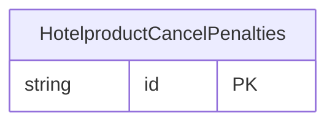

<!-- Code generated by protoc-gen-store. DO NOT EDIT. -->

# `ota/opentravel/hotel/revenue/hotel_product/v1/types/cancel_penalties/` — Prisma schema

Generated from Protobuf by protoc-gen-store. Source of truth is the `.proto` files — regenerate rather than editing.

| Models | Enums |
| ---: | ---: |
| 1 | 0 |

## Entity relationships

Schema file: [`cancel_penalties.postgres.prisma`](./cancel_penalties.postgres.prisma)

### `HotelproductCancelPenalties` → `cancel_penalties`

A collection of CancelPenalty.

| Column | Type | Null |
| --- | --- | --- |
| `id` | `CHAR(26)` | not null |
| `cancel_policy_indicator` | `BOOLEAN` | nullable |
