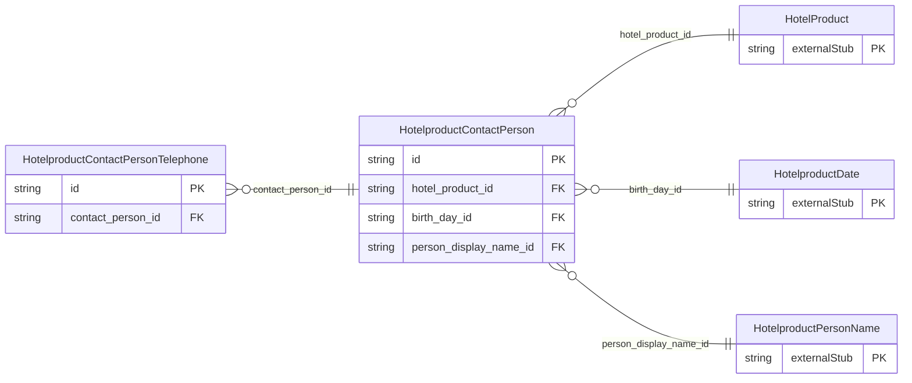

<!-- Code generated by protoc-gen-store. DO NOT EDIT. -->

# `ota/opentravel/hotel/revenue/hotel_product/v1/types/contact_person/` — Prisma schema

Generated from Protobuf by protoc-gen-store. Source of truth is the `.proto` files — regenerate rather than editing.

| Models | Enums |
| ---: | ---: |
| 2 | 0 |

## Entity relationships

Schema file: [`contact_person.postgres.prisma`](./contact_person.postgres.prisma)

### `HotelproductContactPerson` → `contact_persons`

Name of an individual and appropriate contact information. May be contact information for the customer or someone affiliated with the customer.

| Column | Type | Null |
| --- | --- | --- |
| `id` | `CHAR(26)` | not null |
| `share_synch_ind` | `HotelproductAcceptedPaymentShareSynchInd` | nullable |
| `share_market_ind` | `HotelproductAcceptedPaymentShareMarketInd` | nullable |
| `default_value` | `BOOLEAN` | nullable |
| `contact_type` | `VARCHAR(255)` | nullable |
| `relation` | `VARCHAR(255)` | nullable |
| `emergency_flag` | `BOOLEAN` | nullable |
| `rph` | `VARCHAR(255)` | nullable |
| `communication_method_code` | `HotelproductDistributionType` | nullable |
| `document_distrib_method_code` | `HotelproductDistributionType` | nullable |
| `hotel_product_id` | `CHAR(26)` | not null |
| `birth_day_id` | `CHAR(26)` | nullable |
| `person_display_name_id` | `CHAR(26)` | nullable |

### `HotelproductContactPersonTelephone` → `contact_person_telephones`

Information about a telephone number, including the actual number and its usage.

| Column | Type | Null |
| --- | --- | --- |
| `id` | `CHAR(26)` | not null |
| `rph` | `VARCHAR(255)` | nullable |
| `share_synch_ind` | `HotelproductPaymentCardTelephoneShareSynchInd` | nullable |
| `share_market_ind` | `HotelproductPaymentCardTelephoneShareMarketInd` | nullable |
| `phone_location_type` | `HotelproductPhoneLocationType` | nullable |
| `phone_tech_type` | `HotelproductPhoneTechnologyType` | nullable |
| `phone_use_type` | `HotelproductPhoneUseType` | nullable |
| `country_access_code` | `VARCHAR(255)` | nullable |
| `area_city_code` | `VARCHAR(255)` | nullable |
| `phone_number` | `VARCHAR(255)` | not null |
| `extension` | `VARCHAR(255)` | nullable |
| `pin` | `VARCHAR(255)` | nullable |
| `remark` | `VARCHAR(255)` | nullable |
| `formatted` | `BOOLEAN` | nullable |
| `default_value` | `BOOLEAN` | nullable |
| `contact_person_id` | `CHAR(26)` | not null |
