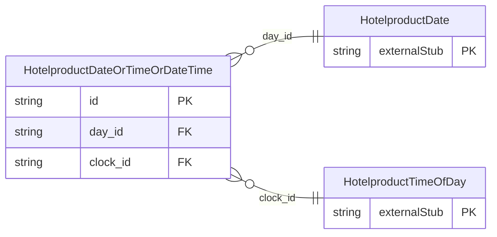

<!-- Code generated by protoc-gen-store. DO NOT EDIT. -->

# `ota/opentravel/hotel/revenue/hotel_product/v1/types/date_or_time_or_date_time/` — Prisma schema

Generated from Protobuf by protoc-gen-store. Source of truth is the `.proto` files — regenerate rather than editing.

| Models | Enums |
| ---: | ---: |
| 1 | 1 |

## Entity relationships

Schema file: [`date_or_time_or_date_time.postgres.prisma`](./date_or_time_or_date_time.postgres.prisma)

### `HotelproductDateOrTimeOrDateTime` → `date_or_time_or_date_times`

A construct to validate either a date or a time or a dateTime value.

| Column | Type | Null |
| --- | --- | --- |
| `id` | `CHAR(26)` | not null |
| `date_time` | `TIMESTAMPTZ` | nullable |
| `value_case` | `HotelproductDateOrTimeOrDateTimeValueCase` | nullable |
| `day_id` | `CHAR(26)` | nullable |
| `clock_id` | `CHAR(26)` | nullable |

### Enums

- `HotelproductDateOrTimeOrDateTimeValueCase`: DAY, DATE_TIME, CLOCK
