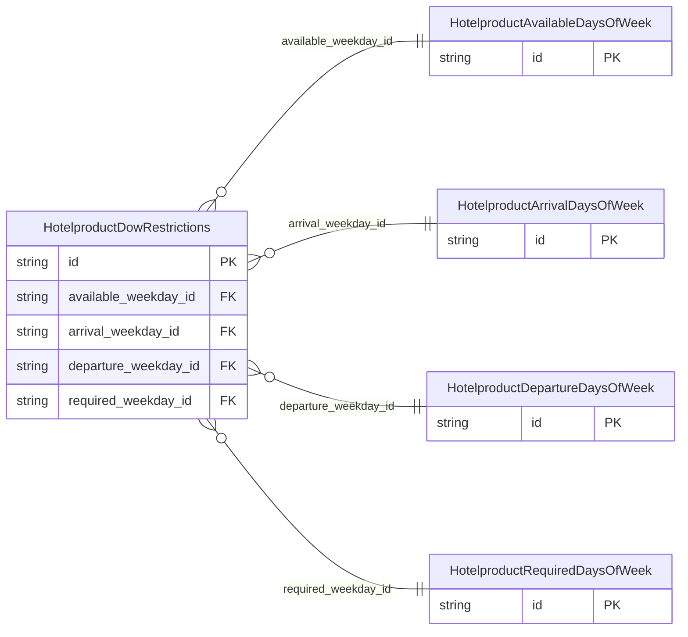

<!-- Code generated by protoc-gen-store. DO NOT EDIT. -->

# `ota/opentravel/hotel/revenue/hotel_product/v1/types/dow_restrictions/` — Prisma schema

Generated from Protobuf by protoc-gen-store. Source of truth is the `.proto` files — regenerate rather than editing.

| Models | Enums |
| ---: | ---: |
| 5 | 0 |

## Entity relationships

Schema file: [`dow_restrictions.postgres.prisma`](./dow_restrictions.postgres.prisma)

### `HotelproductDowRestrictions` → `dow_restrictions`

Dow restrictions.

| Column | Type | Null |
| --- | --- | --- |
| `id` | `CHAR(26)` | not null |
| `available_weekday_id` | `CHAR(26)` | nullable |
| `arrival_weekday_id` | `CHAR(26)` | nullable |
| `departure_weekday_id` | `CHAR(26)` | nullable |
| `required_weekday_id` | `CHAR(26)` | nullable |

### `HotelproductAvailableDaysOfWeek` → `available_days_of_weeks`

Days of week on which this room/rate combination is available.

| Column | Type | Null |
| --- | --- | --- |
| `id` | `CHAR(26)` | not null |
| `weekdays` | `` | nullable |

### `HotelproductArrivalDaysOfWeek` → `arrival_days_of_weeks`

Days of Week on which the guest can arrive.

| Column | Type | Null |
| --- | --- | --- |
| `id` | `CHAR(26)` | not null |
| `weekdays` | `` | nullable |

### `HotelproductDepartureDaysOfWeek` → `departure_days_of_weeks`

Days of Week on which the guest can leave.

| Column | Type | Null |
| --- | --- | --- |
| `id` | `CHAR(26)` | not null |
| `weekdays` | `` | nullable |

### `HotelproductRequiredDaysOfWeek` → `required_days_of_weeks`

Days of Week on which the guest has to stay at the hotel.

| Column | Type | Null |
| --- | --- | --- |
| `id` | `CHAR(26)` | not null |
| `weekdays` | `` | nullable |
