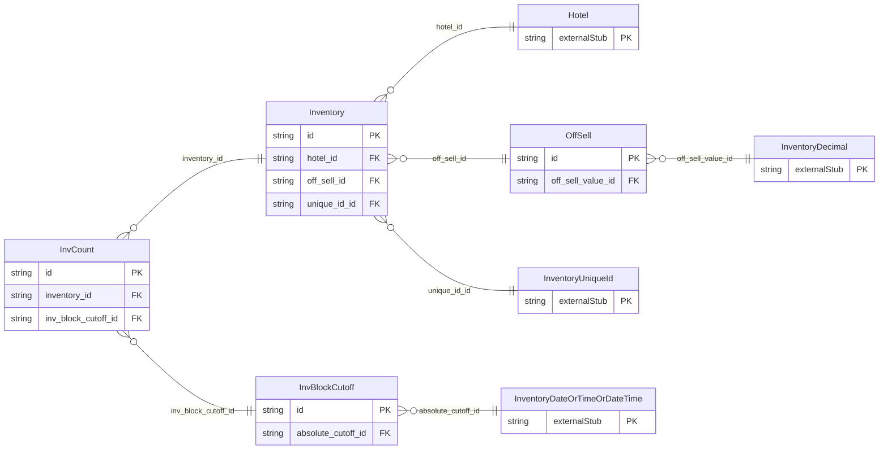

<!-- Code generated by protoc-gen-store. DO NOT EDIT. -->

# `ota/opentravel/hotel/revenue/inventory/inventory/` — Prisma schema

Generated from Protobuf by protoc-gen-store. Source of truth is the `.proto` files — regenerate rather than editing.

| Models | Enums |
| ---: | ---: |
| 4 | 3 |

## Entity relationships

Schema file: [`inventory.postgres.prisma`](./inventory.postgres.prisma)

### `Inventory` → `inventories`

This is the inventory information for a given rate plan, room type, date, etc. A collection resource, named "hotels/{hotel}/roomTypes/{room_type}/inventories/{inventory}". OTA: OTA_HotelInvCountNotifRQ/Inventories/Inventory.

| Column | Type | Null |
| --- | --- | --- |
| `id` | `CHAR(26)` | not null |
| `name` | `VARCHAR(255)` | not null |
| `uid` | `VARCHAR(255)` | nullable |
| `etag` | `VARCHAR(255)` | nullable |
| `delete_time` | `TIMESTAMPTZ` | nullable |
| `expire_time` | `TIMESTAMPTZ` | nullable |
| `create_time` | `TIMESTAMPTZ` | not null |
| `update_time` | `TIMESTAMPTZ` | not null |
| `hotel_id` | `CHAR(26)` | not null |
| `room_type_id` | `CHAR(26)` | not null |
| `off_sell_id` | `CHAR(26)` | nullable |
| `unique_id_id` | `VARCHAR(255)` | nullable |

### `InvCount` → `inv_counts`

Individual inventory count (e.g., Physical, Available, Sold, OOO, NAFS).

| Column | Type | Null |
| --- | --- | --- |
| `id` | `CHAR(26)` | not null |
| `count_type` | `InventoryInventoryCountType` | nullable |
| `count` | `INTEGER` | nullable |
| `adjust_reason` | `VARCHAR(255)` | nullable |
| `action_type` | `InventoryActionType` | nullable |
| `inventory_id` | `CHAR(26)` | not null |
| `inv_block_cutoff_id` | `CHAR(26)` | nullable |

### `OffSell` → `off_sells`

Communicates additional information about inventory that is not available for sale. Communicates information about inventory that is not available for sale.

| Column | Type | Null |
| --- | --- | --- |
| `id` | `CHAR(26)` | not null |
| `off_sell_value_type` | `OffSellValueType` | nullable |
| `off_sell_value_id` | `CHAR(26)` | nullable |

### `InvBlockCutoff` → `inv_block_cutoffs`

Used for information regarding inventory block cutoff dates.

| Column | Type | Null |
| --- | --- | --- |
| `id` | `CHAR(26)` | not null |
| `offset_duration` | `VARCHAR(255)` | nullable |
| `offset_calculation_mode` | `InventoryOffsetCalculationMode` | nullable |
| `absolute_cutoff_id` | `CHAR(26)` | nullable |

### Enums

- `InventoryActionType`: ADJUSTMENT, USED, REMAINING, ALLOCATION
- `OffSellValueType`: TOTAL, ADJUSTMENT
- `InventoryOffsetCalculationMode`: BEFORE_BLOCK_START_DATE, AFTER_BLOCK_CREATION
