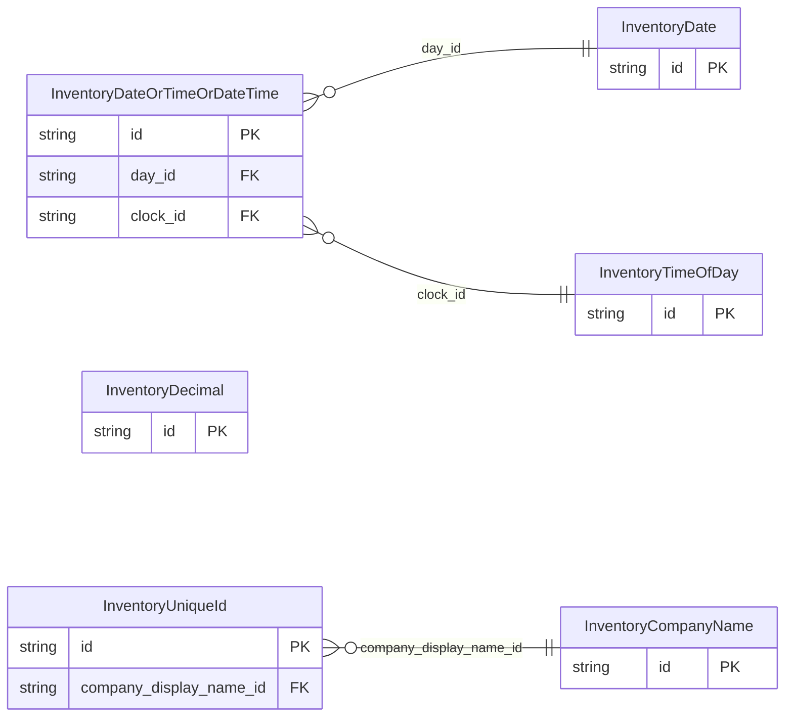

<!-- Code generated by protoc-gen-store. DO NOT EDIT. -->

# `ota/opentravel/hotel/revenue/inventory/v1/types/` — Prisma schema

Generated from Protobuf by protoc-gen-store. Source of truth is the `.proto` files — regenerate rather than editing.

| Models | Enums |
| ---: | ---: |
| 6 | 1 |

## Entity relationships

## Subfolders

- [`company_name/`](./company_name/README.md)
- [`date/`](./date/README.md)
- [`date_or_time_or_date_time/`](./date_or_time_or_date_time/README.md)
- [`decimal/`](./decimal/README.md)
- [`time_of_day/`](./time_of_day/README.md)
- [`unique_id/`](./unique_id/README.md)
