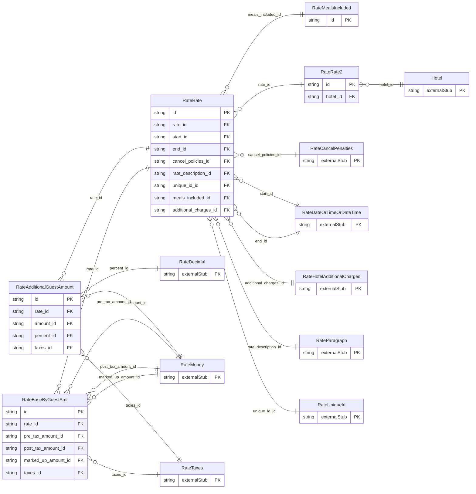

<!-- Code generated by protoc-gen-store. DO NOT EDIT. -->

# `ota/opentravel/hotel/revenue/rate/rate/` — Prisma schema

Generated from Protobuf by protoc-gen-store. Source of truth is the `.proto` files — regenerate rather than editing.

| Models | Enums |
| ---: | ---: |
| 5 | 0 |

## Entity relationships

Schema file: [`rate.postgres.prisma`](./rate.postgres.prisma)

### `RateRate2` → `resource`

RateAmountMessages that define the rate changes to be made. A collection resource, named "hotels/{hotel}/ratePlans/{rate_plan}/rates/{rate}". OTA: OTA_HotelRateAmountNotifRQ/RateAmountMessages/RateAmountMessage.

| Column | Type | Null |
| --- | --- | --- |
| `id` | `CHAR(26)` | not null |
| `name` | `VARCHAR(255)` | not null |
| `uid` | `VARCHAR(255)` | nullable |
| `etag` | `VARCHAR(255)` | nullable |
| `delete_time` | `TIMESTAMPTZ` | nullable |
| `expire_time` | `TIMESTAMPTZ` | nullable |
| `create_time` | `TIMESTAMPTZ` | not null |
| `update_time` | `TIMESTAMPTZ` | not null |
| `locator_id` | `INTEGER` | nullable |
| `hotel_id` | `CHAR(26)` | not null |
| `rate_plan_id` | `CHAR(26)` | not null |

### `RateRate` → `rates_link`

An individual rate, which is a collection of amounts by guest, additional guests, fees, collection of related guarantee, cancel and payment policies, a description and the unique id to identify the rate. Rate restrictions can be sent along with the rate as attributes of this rate.

| Column | Type | Null |
| --- | --- | --- |
| `id` | `CHAR(26)` | not null |
| `unit_count` | `INTEGER` | nullable |
| `rate_time_unit` | `RateTimeUnit` | nullable |
| `unit_multiplier` | `INTEGER` | nullable |
| `min_guest_applicable` | `INTEGER` | nullable |
| `max_guest_applicable` | `INTEGER` | nullable |
| `age_qualifying_code` | `RateAgeQualifyingCode` | nullable |
| `min_age` | `INTEGER` | nullable |
| `max_age` | `INTEGER` | nullable |
| `age_time_unit` | `RateTimeUnit` | nullable |
| `age_bucket` | `VARCHAR(255)` | nullable |
| `min_los` | `VARCHAR(255)` | nullable |
| `max_los` | `VARCHAR(255)` | nullable |
| `stayover_weekday` | `RateDayOfWeek` | nullable |
| `duration` | `VARCHAR(255)` | nullable |
| `weekdays` | `` | nullable |
| `currency_code` | `VARCHAR(255)` | nullable |
| `decimal_places` | `INTEGER` | nullable |
| `rate_tier` | `VARCHAR(255)` | nullable |
| `rate_change_indicator` | `BOOLEAN` | nullable |
| `rate_id` | `CHAR(26)` | not null |
| `start_id` | `CHAR(26)` | nullable |
| `end_id` | `CHAR(26)` | nullable |
| `cancel_policies_id` | `CHAR(26)` | nullable |
| `rate_description_id` | `CHAR(26)` | nullable |
| `unique_id_id` | `VARCHAR(255)` | nullable |
| `meals_included_id` | `CHAR(26)` | nullable |
| `additional_charges_id` | `CHAR(26)` | nullable |

### `RateBaseByGuestAmt` → `base_by_guest_amts`

Base charge for a given number of guests for a given age qualifying code.

| Column | Type | Null |
| --- | --- | --- |
| `id` | `CHAR(26)` | not null |
| `additional_fees_excluded_indicator` | `BOOLEAN` | nullable |
| `type` | `RateChargeType` | nullable |
| `service_override_indicator` | `BOOLEAN` | nullable |
| `rate_override_indicator` | `BOOLEAN` | nullable |
| `code` | `VARCHAR(255)` | nullable |
| `guest_count` | `INTEGER` | nullable |
| `age_qualifying_code` | `RateAgeQualifyingCode` | nullable |
| `min_age` | `INTEGER` | nullable |
| `max_age` | `INTEGER` | nullable |
| `age_time_unit` | `RateTimeUnit` | nullable |
| `age_bucket` | `VARCHAR(255)` | nullable |
| `rate_id` | `CHAR(26)` | not null |
| `pre_tax_amount_id` | `CHAR(26)` | nullable |
| `post_tax_amount_id` | `CHAR(26)` | nullable |
| `marked_up_amount_id` | `CHAR(26)` | nullable |
| `taxes_id` | `CHAR(26)` | nullable |

### `RateAdditionalGuestAmount` → `additional_guest_amounts`

Collection of incremental charges per age qualifying code for additional guests. Amount charged for additional occupant is with respect to age group of the base guests.

| Column | Type | Null |
| --- | --- | --- |
| `id` | `CHAR(26)` | not null |
| `tax_inclusive` | `BOOLEAN` | nullable |
| `max_additional_guests` | `INTEGER` | nullable |
| `age_qualifying_code` | `RateAgeQualifyingCode` | nullable |
| `min_age` | `INTEGER` | nullable |
| `max_age` | `INTEGER` | nullable |
| `age_time_unit` | `RateTimeUnit` | nullable |
| `age_bucket` | `VARCHAR(255)` | nullable |
| `type` | `RateAmountDetermination` | nullable |
| `code` | `RateFeeTaxType` | nullable |
| `rate_id` | `CHAR(26)` | not null |
| `amount_id` | `CHAR(26)` | nullable |
| `percent_id` | `CHAR(26)` | nullable |
| `taxes_id` | `CHAR(26)` | nullable |

### `RateMealsIncluded` → `meals_includeds`

Defines which meals are included with this rate program.

| Column | Type | Null |
| --- | --- | --- |
| `id` | `CHAR(26)` | not null |
| `breakfast` | `BOOLEAN` | nullable |
| `lunch` | `BOOLEAN` | nullable |
| `dinner` | `BOOLEAN` | nullable |
| `meal_plan_indicator` | `BOOLEAN` | nullable |
| `meal_plan_codes` | `` | nullable |
