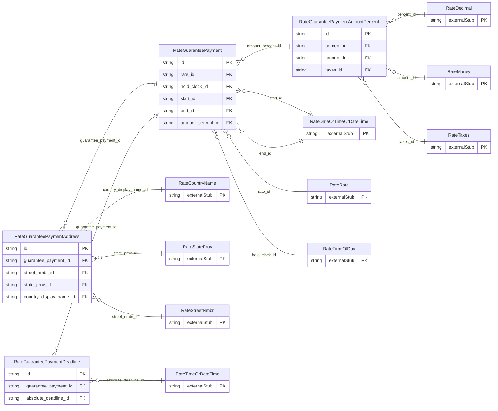

<!-- Code generated by protoc-gen-store. DO NOT EDIT. -->

# `ota/opentravel/hotel/revenue/rate/v1/types/guarantee_payment/` — Prisma schema

Generated from Protobuf by protoc-gen-store. Source of truth is the `.proto` files — regenerate rather than editing.

| Models | Enums |
| ---: | ---: |
| 4 | 3 |

## Entity relationships

Schema file: [`guarantee_payment.postgres.prisma`](./guarantee_payment.postgres.prisma)

### `RateGuaranteePayment` → `guarantee_payments`

Used to define the deposit policy, guarantees policy, and/or accepted forms of payment.

| Column | Type | Null |
| --- | --- | --- |
| `id` | `CHAR(26)` | not null |
| `retribution_type` | `RateGuaranteePaymentRetributionType` | nullable |
| `payment_code` | `VARCHAR(255)` | nullable |
| `type` | `RateType2` | nullable |
| `guarantee_code` | `VARCHAR(255)` | nullable |
| `guarantee_type` | `RateGuaranteePaymentGuaranteeType` | nullable |
| `weekdays` | `` | nullable |
| `duration` | `VARCHAR(255)` | nullable |
| `no_card_holder_info_req` | `BOOLEAN` | nullable |
| `display_name` | `BOOLEAN` | nullable |
| `address` | `BOOLEAN` | nullable |
| `phone` | `BOOLEAN` | nullable |
| `interbank_nbr` | `BOOLEAN` | nullable |
| `room_type_code` | `VARCHAR(255)` | nullable |
| `info_source` | `VARCHAR(255)` | nullable |
| `non_refundable_indicator` | `BOOLEAN` | nullable |
| `policy_code` | `VARCHAR(255)` | nullable |
| `agency_name_addr_req` | `BOOLEAN` | nullable |
| `company_name_addr_req` | `BOOLEAN` | nullable |
| `no_card_holder_info_retain` | `BOOLEAN` | nullable |
| `name_retain` | `BOOLEAN` | nullable |
| `address_retain` | `BOOLEAN` | nullable |
| `phone_retain` | `BOOLEAN` | nullable |
| `rate_id` | `CHAR(26)` | not null |
| `hold_clock_id` | `CHAR(26)` | nullable |
| `start_id` | `CHAR(26)` | nullable |
| `end_id` | `CHAR(26)` | nullable |
| `amount_percent_id` | `CHAR(26)` | nullable |

### `RateGuaranteePaymentAmountPercent` → `guarantee_payment_amount_percents`

Payment expressed as a fixed amount, or a percentage of/or room nights.

| Column | Type | Null |
| --- | --- | --- |
| `id` | `CHAR(26)` | not null |
| `tax_inclusive` | `BOOLEAN` | nullable |
| `fees_inclusive` | `BOOLEAN` | nullable |
| `night_count` | `INTEGER` | nullable |
| `basis_type` | `RateBasisType` | nullable |
| `apply_as` | `RateApplyAs` | nullable |
| `overridden_amount_indicator` | `BOOLEAN` | nullable |
| `percent_id` | `CHAR(26)` | nullable |
| `amount_id` | `CHAR(26)` | nullable |
| `taxes_id` | `CHAR(26)` | nullable |

### `RateGuaranteePaymentDeadline` → `guarantee_payment_deadlines`

Payment deadline, absolute or relative.

| Column | Type | Null |
| --- | --- | --- |
| `id` | `CHAR(26)` | not null |
| `offset_time_unit` | `RateTimeUnit` | nullable |
| `offset_unit_multiplier` | `INTEGER` | nullable |
| `offset_drop_point` | `RateOffsetDropTime` | nullable |
| `override_indicator` | `BOOLEAN` | nullable |
| `guarantee_payment_id` | `CHAR(26)` | not null |
| `absolute_deadline_id` | `CHAR(26)` | nullable |

### `RateGuaranteePaymentAddress` → `guarantee_payment_address`

The address to which a deposit may be sent.

| Column | Type | Null |
| --- | --- | --- |
| `id` | `CHAR(26)` | not null |
| `formatted` | `BOOLEAN` | nullable |
| `share_synch_ind` | `RateGuaranteeGuaranteeAcceptedShareSynchInd` | nullable |
| `share_market_ind` | `RateGuaranteeGuaranteeAcceptedShareMarketInd` | nullable |
| `type` | `RateCommunicationLocationType` | nullable |
| `remark` | `VARCHAR(255)` | nullable |
| `language_code` | `VARCHAR(255)` | nullable |
| `valid` | `BOOLEAN` | nullable |
| `default_value` | `BOOLEAN` | nullable |
| `use_type` | `RateAddressUseType` | nullable |
| `rph` | `VARCHAR(255)` | nullable |
| `addressee_display_name` | `VARCHAR(255)` | nullable |
| `address_lines` | `VARCHAR(255)[]` | nullable |
| `city_display_name` | `VARCHAR(255)` | nullable |
| `postal_code` | `VARCHAR(255)` | nullable |
| `county` | `VARCHAR(255)` | nullable |
| `guarantee_payment_id` | `CHAR(26)` | not null |
| `street_nmbr_id` | `CHAR(26)` | nullable |
| `state_prov_id` | `CHAR(26)` | nullable |
| `country_display_name_id` | `CHAR(26)` | nullable |

### Enums

- `RateGuaranteePaymentRetributionType`: RES_AUTO_CANCELLED, RES_NOT_GUARANTEED
- `RateType2`: REQUIRED_PAYMENT, GUARANTEE_POLICY, ACCEPTED_PAYMENT_FORMS
- `RateGuaranteePaymentGuaranteeType`: GUARANTEE_REQUIRED, NONE, CC_DC_VOUCHER, PROFILE, DEPOSIT, PRE_PAY
