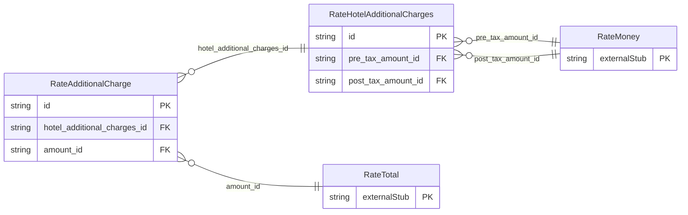

<!-- Code generated by protoc-gen-store. DO NOT EDIT. -->

# `ota/opentravel/hotel/revenue/rate/v1/types/hotel_additional_charges/` — Prisma schema

Generated from Protobuf by protoc-gen-store. Source of truth is the `.proto` files — regenerate rather than editing.

| Models | Enums |
| ---: | ---: |
| 2 | 0 |

## Entity relationships

Schema file: [`hotel_additional_charges.postgres.prisma`](./hotel_additional_charges.postgres.prisma)

### `RateHotelAdditionalCharges` → `hotel_additional_charges`

Hotel additional charges.

| Column | Type | Null |
| --- | --- | --- |
| `id` | `CHAR(26)` | not null |
| `pre_tax_amount_id` | `CHAR(26)` | nullable |
| `post_tax_amount_id` | `CHAR(26)` | nullable |

### `RateAdditionalCharge` → `additional_charges`

Amenities or services to which a charge applies.

| Column | Type | Null |
| --- | --- | --- |
| `id` | `CHAR(26)` | not null |
| `room_amenity_code` | `RateRoomAmenityType` | nullable |
| `quantity` | `INTEGER` | nullable |
| `hotel_additional_charges_id` | `CHAR(26)` | not null |
| `amount_id` | `CHAR(26)` | nullable |
