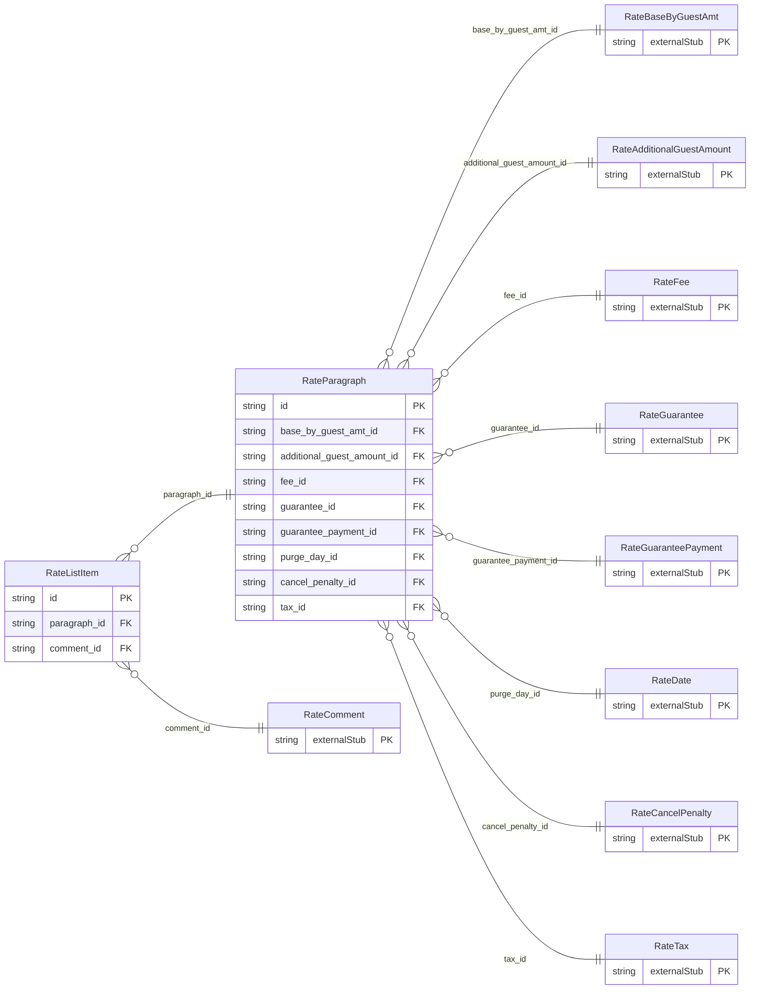

<!-- Code generated by protoc-gen-store. DO NOT EDIT. -->

# `ota/opentravel/hotel/revenue/rate/v1/types/paragraph/` — Prisma schema

Generated from Protobuf by protoc-gen-store. Source of truth is the `.proto` files — regenerate rather than editing.

| Models | Enums |
| ---: | ---: |
| 2 | 0 |

## Entity relationships

Schema file: [`paragraph.postgres.prisma`](./paragraph.postgres.prisma)

### `RateParagraph` → `paragraphs`

An indication of a new paragraph for a sub-section of a formatted text message.

| Column | Type | Null |
| --- | --- | --- |
| `id` | `CHAR(26)` | not null |
| `display_name` | `VARCHAR(255)` | nullable |
| `paragraph_number` | `INTEGER` | nullable |
| `create_date_time` | `TIMESTAMPTZ` | nullable |
| `creator_id` | `VARCHAR(255)` | nullable |
| `last_modify_date_time` | `TIMESTAMPTZ` | nullable |
| `last_modifier_id` | `VARCHAR(255)` | nullable |
| `language_code` | `VARCHAR(255)` | nullable |
| `images` | `VARCHAR(255)[]` | nullable |
| `uris` | `VARCHAR(255)[]` | nullable |
| `base_by_guest_amt_id` | `CHAR(26)` | not null |
| `additional_guest_amount_id` | `CHAR(26)` | not null |
| `fee_id` | `CHAR(26)` | not null |
| `guarantee_id` | `CHAR(26)` | not null |
| `guarantee_payment_id` | `CHAR(26)` | not null |
| `purge_day_id` | `CHAR(26)` | nullable |
| `cancel_penalty_id` | `CHAR(26)` | not null |
| `tax_id` | `CHAR(26)` | not null |

### `RateListItem` → `list_items`

Formatted text content and an associated item or sequence number.

| Column | Type | Null |
| --- | --- | --- |
| `id` | `CHAR(26)` | not null |
| `formatted` | `BOOLEAN` | nullable |
| `language_code` | `VARCHAR(255)` | nullable |
| `text_format` | `RateFormattedTextTextTextFormat` | nullable |
| `list_item` | `INTEGER` | nullable |
| `value` | `VARCHAR(255)` | nullable |
| `paragraph_id` | `CHAR(26)` | not null |
| `comment_id` | `CHAR(26)` | not null |
