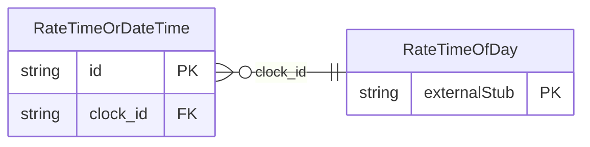

<!-- Code generated by protoc-gen-store. DO NOT EDIT. -->

# `ota/opentravel/hotel/revenue/rate/v1/types/time_or_date_time/` — Prisma schema

Generated from Protobuf by protoc-gen-store. Source of truth is the `.proto` files — regenerate rather than editing.

| Models | Enums |
| ---: | ---: |
| 1 | 1 |

## Entity relationships

Schema file: [`time_or_date_time.postgres.prisma`](./time_or_date_time.postgres.prisma)

### `RateTimeOrDateTime` → `time_or_date_times`

Allows for the specification of a date time or just time.

| Column | Type | Null |
| --- | --- | --- |
| `id` | `CHAR(26)` | not null |
| `date_time` | `TIMESTAMPTZ` | nullable |
| `value_case` | `RateTimeOrDateTimeValueCase` | nullable |
| `clock_id` | `CHAR(26)` | nullable |

### Enums

- `RateTimeOrDateTimeValueCase`: DATE_TIME, CLOCK
