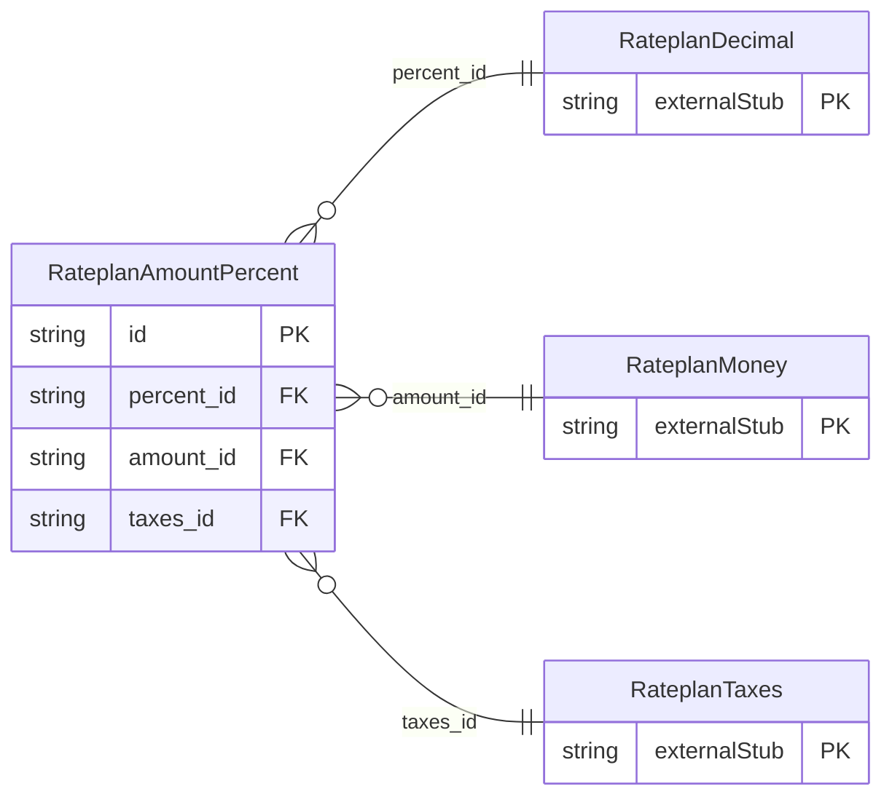

<!-- Code generated by protoc-gen-store. DO NOT EDIT. -->

# `ota/opentravel/hotel/revenue/rate_plan/v1/types/amount_percent/` — Prisma schema

Generated from Protobuf by protoc-gen-store. Source of truth is the `.proto` files — regenerate rather than editing.

| Models | Enums |
| ---: | ---: |
| 1 | 2 |

## Entity relationships

Schema file: [`amount_percent.postgres.prisma`](./amount_percent.postgres.prisma)

### `RateplanAmountPercent` → `amount_percents`

Defines the percentage basis for calculating the fee amount or the amount.

| Column | Type | Null |
| --- | --- | --- |
| `id` | `CHAR(26)` | not null |
| `tax_inclusive` | `BOOLEAN` | nullable |
| `fees_inclusive` | `BOOLEAN` | nullable |
| `night_count` | `INTEGER` | nullable |
| `basis_type` | `RateplanBasisType` | nullable |
| `apply_as` | `RateplanApplyAs` | nullable |
| `percent_id` | `CHAR(26)` | nullable |
| `amount_id` | `CHAR(26)` | nullable |
| `taxes_id` | `CHAR(26)` | nullable |

### Enums

- `RateplanBasisType`: FULL_STAY, NIGHTS, FIRST_LAST
- `RateplanApplyAs`: FIRST_NIGHT_DEPOSIT, LAST_NIGHT_DEPOST, FIRST_AND_LAST_NIGHT_DEPOSIT, FIRST_NIGHT_PAYMENT, LAST_NIGHT_PAYMENT, FIRST_AND_LAST_NIGHT_PAYMENT
