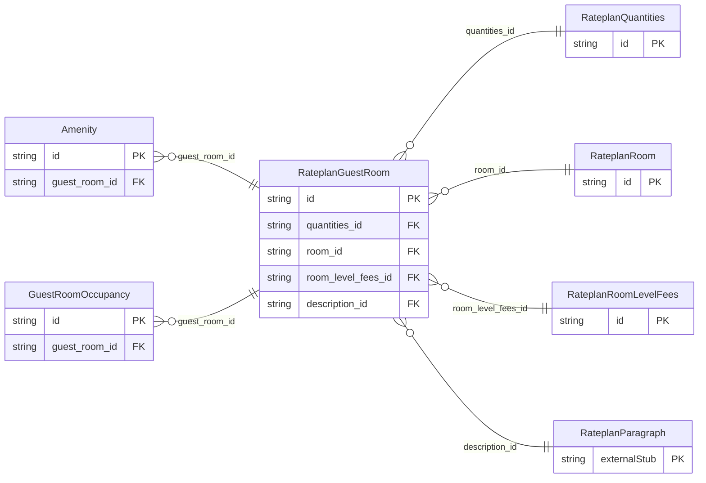

<!-- Code generated by protoc-gen-store. DO NOT EDIT. -->

# `ota/opentravel/hotel/revenue/rate_plan/v1/types/guest_room/` — Prisma schema

Generated from Protobuf by protoc-gen-store. Source of truth is the `.proto` files — regenerate rather than editing.

| Models | Enums |
| ---: | ---: |
| 6 | 1 |

## Entity relationships

Schema file: [`guest_room.postgres.prisma`](./guest_room.postgres.prisma)

### `RateplanGuestRoom` → `guest_rooms`

GuestRoomType is used to contain all the information on a guest room.

| Column | Type | Null |
| --- | --- | --- |
| `id` | `CHAR(26)` | not null |
| `quantities_id` | `CHAR(26)` | nullable |
| `room_id` | `CHAR(26)` | nullable |
| `room_level_fees_id` | `CHAR(26)` | nullable |
| `description_id` | `CHAR(26)` | nullable |

### `RateplanQuantities` → `quantities`

Max rollaways, number of beds.

| Column | Type | Null |
| --- | --- | --- |
| `id` | `CHAR(26)` | not null |
| `max_rollaways` | `INTEGER` | nullable |
| `standard_num_beds` | `INTEGER` | nullable |
| `maximum_additional_guests` | `INTEGER` | nullable |
| `min_billable_guests` | `INTEGER` | nullable |
| `max_cribs` | `INTEGER` | nullable |

### `GuestRoomOccupancy` → `guest_room_occupancies`

Provides parameters of occupancy limits.

| Column | Type | Null |
| --- | --- | --- |
| `id` | `CHAR(26)` | not null |
| `min_occupancy` | `INTEGER` | nullable |
| `max_occupancy` | `INTEGER` | nullable |
| `age_qualifying_code` | `RateplanAgeQualifyingCode` | nullable |
| `min_age` | `INTEGER` | nullable |
| `max_age` | `INTEGER` | nullable |
| `age_time_unit` | `RateplanTimeUnit` | nullable |
| `age_bucket` | `VARCHAR(255)` | nullable |
| `guest_room_id` | `CHAR(26)` | not null |

### `RateplanRoom` → `rooms`

Attributes to describe the room from room category to location to view to bed type.

| Column | Type | Null |
| --- | --- | --- |
| `id` | `CHAR(26)` | not null |
| `room_type` | `VARCHAR(255)` | nullable |
| `room_type_code` | `VARCHAR(255)` | nullable |
| `room_category` | `RateplanSegmentCategoryCode` | nullable |
| `room_id` | `VARCHAR(255)` | nullable |
| `floor` | `INTEGER` | nullable |
| `inv_block_code` | `VARCHAR(255)` | nullable |
| `promotion_code` | `VARCHAR(255)` | nullable |
| `promotion_vendor_codes` | `VARCHAR(255)[]` | nullable |
| `room_location_code` | `RateplanRoomLocationType` | nullable |
| `room_view_code` | `RateplanRoomViewType` | nullable |
| `bed_type_codes` | `` | nullable |
| `non_smoking` | `BOOLEAN` | nullable |
| `config` | `VARCHAR(255)` | nullable |
| `size_measurement` | `VARCHAR(255)` | nullable |
| `quantity` | `INTEGER` | nullable |
| `composite` | `BOOLEAN` | nullable |
| `room_classification_code` | `RateplanGuestRoomInfo` | nullable |
| `room_architecture_code` | `RateplanArchitecturalStyleCode` | nullable |
| `room_gender` | `RateplanRoomGender` | nullable |
| `shared_room` | `BOOLEAN` | nullable |

### `Amenity` → `amenities`

Amenity Code Attribute is used to hold actual amenity code.

| Column | Type | Null |
| --- | --- | --- |
| `id` | `CHAR(26)` | not null |
| `amenity_code` | `RateplanRoomAmenityType` | nullable |
| `guest_room_id` | `CHAR(26)` | not null |

### `RateplanRoomLevelFees` → `room_level_fees`

Collection of fees charged at the room level.

| Column | Type | Null |
| --- | --- | --- |
| `id` | `CHAR(26)` | not null |
| `code` | `VARCHAR(255)` | nullable |
| `code_context` | `VARCHAR(255)` | nullable |
| `quantity` | `INTEGER` | nullable |
| `uri` | `VARCHAR(255)` | nullable |

### Enums

- `RateplanRoomGender`: MALE, FEMALE, MALE_AND_FEMALE, UNKNOWN
