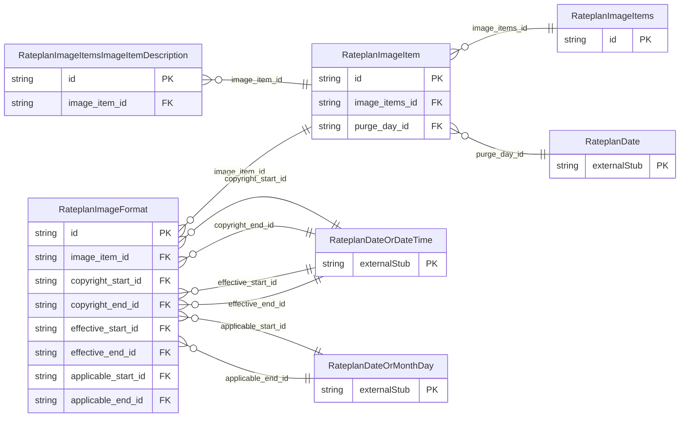

<!-- Code generated by protoc-gen-store. DO NOT EDIT. -->

# `ota/opentravel/hotel/revenue/rate_plan/v1/types/image_items/` — Prisma schema

Generated from Protobuf by protoc-gen-store. Source of truth is the `.proto` files — regenerate rather than editing.

| Models | Enums |
| ---: | ---: |
| 4 | 0 |

## Entity relationships

Schema file: [`image_items.postgres.prisma`](./image_items.postgres.prisma)

### `RateplanImageItems` → `image_items`

Collection of image items.

| Column | Type | Null |
| --- | --- | --- |
| `id` | `CHAR(26)` | not null |

### `RateplanImageItem` → `image_item`

Image of a given category.

| Column | Type | Null |
| --- | --- | --- |
| `category` | `RateplanPictureCategoryCode` | nullable |
| `create_date_time` | `TIMESTAMPTZ` | nullable |
| `creator_id` | `VARCHAR(255)` | nullable |
| `last_modify_date_time` | `TIMESTAMPTZ` | nullable |
| `last_modifier_id` | `VARCHAR(255)` | nullable |
| `version` | `VARCHAR(255)` | nullable |
| `id` | `VARCHAR(255)` | not null |
| `image_items_id` | `CHAR(26)` | not null |
| `purge_day_id` | `CHAR(26)` | nullable |

### `RateplanImageFormat` → `image_formats`

A set of images for a given category which may be provided in multiple formats.

| Column | Type | Null |
| --- | --- | --- |
| `id` | `CHAR(26)` | not null |
| `unit_code` | `RateplanUnitOfMeasureCode` | nullable |
| `width` | `INTEGER` | nullable |
| `height` | `INTEGER` | nullable |
| `content_id` | `VARCHAR(255)` | nullable |
| `title` | `VARCHAR(255)` | nullable |
| `author` | `VARCHAR(255)` | nullable |
| `copyright_notice` | `VARCHAR(255)` | nullable |
| `copyright_owner` | `VARCHAR(255)` | nullable |
| `record_id` | `VARCHAR(255)` | nullable |
| `source_id` | `VARCHAR(255)` | nullable |
| `language_code` | `VARCHAR(255)` | nullable |
| `format` | `RateplanContentFormatCode` | nullable |
| `file_display_name` | `VARCHAR(255)` | nullable |
| `file_size` | `INTEGER` | nullable |
| `dimension_category` | `VARCHAR(255)` | nullable |
| `original_indicator` | `BOOLEAN` | nullable |
| `author_contact` | `VARCHAR(255)` | nullable |
| `sort` | `INTEGER` | nullable |
| `resolution` | `INTEGER` | nullable |
| `color_space` | `VARCHAR(255)` | nullable |
| `latitude` | `VARCHAR(255)` | nullable |
| `longitude` | `VARCHAR(255)` | nullable |
| `original_file_display_name` | `VARCHAR(255)` | nullable |
| `uri` | `VARCHAR(255)` | nullable |
| `image_item_id` | `VARCHAR(255)` | not null |
| `copyright_start_id` | `CHAR(26)` | nullable |
| `copyright_end_id` | `CHAR(26)` | nullable |
| `effective_start_id` | `CHAR(26)` | nullable |
| `effective_end_id` | `CHAR(26)` | nullable |
| `applicable_start_id` | `CHAR(26)` | nullable |
| `applicable_end_id` | `CHAR(26)` | nullable |

### `RateplanImageItemsImageItemDescription` → `image_items_image_item_descriptions`

The description associated with the image in a specific language.

| Column | Type | Null |
| --- | --- | --- |
| `id` | `CHAR(26)` | not null |
| `formatted` | `BOOLEAN` | nullable |
| `language_code` | `VARCHAR(255)` | nullable |
| `text_format` | `RateplanFormattedTextTextTextFormat` | nullable |
| `caption` | `VARCHAR(255)` | nullable |
| `value` | `VARCHAR(255)` | nullable |
| `image_item_id` | `VARCHAR(255)` | not null |
